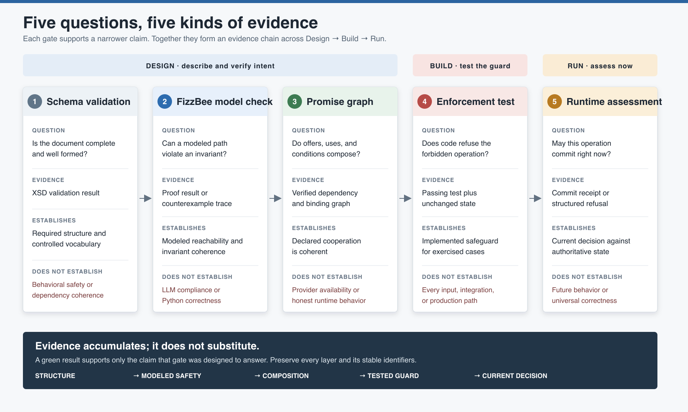

# Five Questions, Five Kinds of Evidence

The kit does not have one master verification step. It has five layers that answer
different questions across **Design → Build → Run**. Confidence comes from preserving
the evidence chain, not from treating one green check as proof of the whole system.

[](assurance-layers.svg)

## The assurance layers

| Stage and gate | Question | Evidence produced | Establishes | Does not establish |
| --- | --- | --- | --- | --- |
| **Design: XSD validation** | Is the contract structurally complete and well formed? | Successful schema-validation result or precise structural errors | Required sections, ordering, attributes, and controlled vocabulary | Behavioral safety or dependency coherence |
| **Design: [FizzBee model check](../counterexample-debugging/README.md)** | Can any reachable modeled path violate an invariant? | Proof result or counterexample action trace | Invariant coherence over the modeled state space | LLM compliance, Python correctness, or model completeness |
| **Design: [Promise-graph verification](../promise-graph/README.md)** | Do offers, uses, and conditions compose? | Verified graph or named unmatched dependency | Declared cooperation is compositionally coherent | Provider availability or honest behavior at runtime |
| **Build: Enforcement-twin tests** | Does the implemented boundary refuse a forbidden operation without changing protected state? | Passing test, structured refusal, and unchanged-state assertion | The tested implementation path enforces the invariant | Every input, integration, concurrency pattern, or production path |
| **Run: Runtime assessment** | May this consequential operation commit against authoritative state now? | Commit receipt or structured refusal naming the unmet condition | The current operation was independently assessed at the boundary | Future behavior or universal system correctness |

## Read the chain from left to right

The layers accumulate evidence but never substitute for one another:

1. A schema-valid contract can still describe unsafe behavior.
2. A model-checked behavior model can still depend on an offer nobody provides.
3. A coherent promise graph can still be implemented with a missing guard.
4. A passing enforcement test can still omit an untested production circumstance.
5. A correct runtime refusal says what happened now, not what will happen next time.

This is why the gate is deliberately plural. Removing any layer changes the claim the
system can honestly make.

## Evidence should preserve identity

Evidence is reviewable when stable names connect the layers:

```text
NoUnsafeCommit
  FizzBee invariant -> enforcement rule -> Python guard duty -> test identity

precondition_met
  model guard -> promise condition -> quenching dependency -> refusal evidence
```

The first chain identifies the safety property. The second identifies the fact that
must hold before the capability is accepted. Together they let an engineer trace why
an operation was allowed or refused without pretending that one artifact proves all
others.

## Review questions

Use these questions when evaluating a contract-driven workflow:

- Which layer supports each safety claim?
- Is any model-check result being presented as proof of runtime behavior?
- Does every invariant have a matching enforcement rule, code guard, and test twin?
- Does each conditional promise name how its condition is quenched or self-assessed?
- Do refusal results identify the unmet condition and preserve protected state?
- Can runtime evidence be correlated back to the contract and implementation version?
- What meaningful failure mode remains outside the modeled or tested boundary?

For the authoring sequence that produces this evidence, continue with
[Authoring an Agent Contract](../authoring-workflow/README.md). For the detailed mapping
from XML identifiers into Python, see
[From Contract to Enforcement](../contract-assessment/README.md).

## Image sources

- [`assurance-layers.svg`](assurance-layers.svg) is the editable source.
- [`assurance-layers.png`](assurance-layers.png) is the rendered copy for Markdown,
  articles, and presentations.
