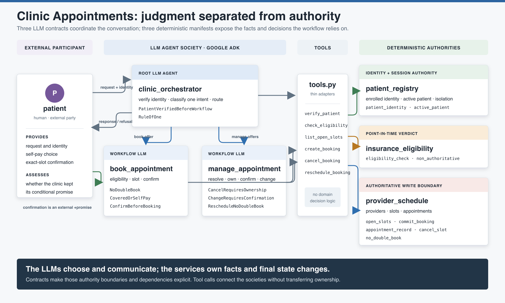
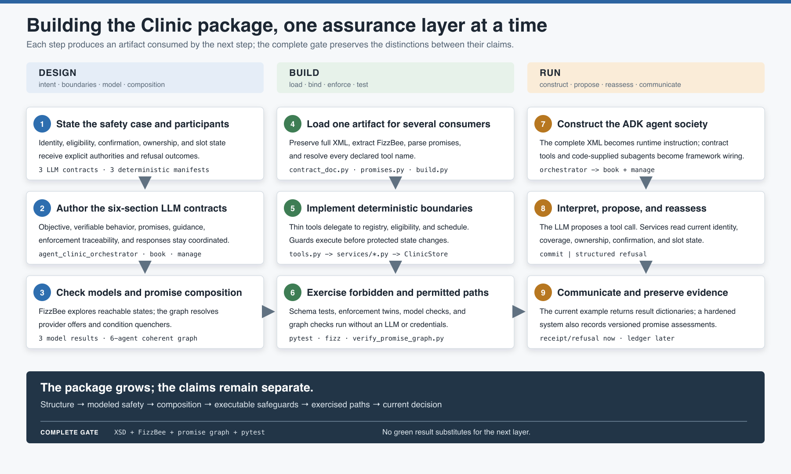
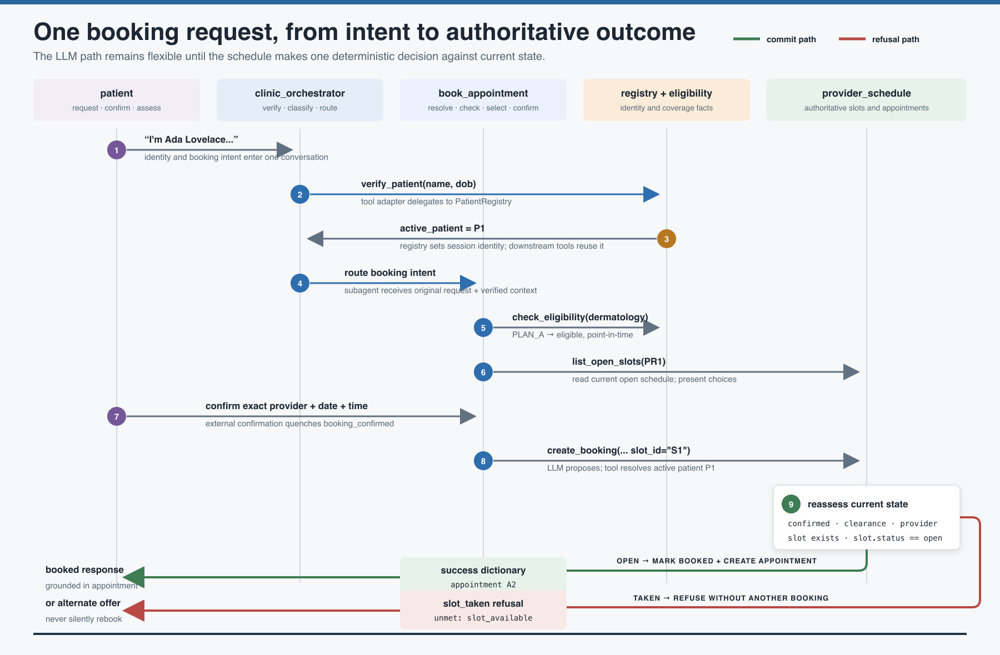

# Clinic Appointments: An End-to-End Case Study

This case study reconstructs the Clinic Appointments example from architectural
decisions through runtime behavior. It follows one booking promise across the actual
XML contracts, FizzBee models, promise graph, Google ADK construction, Python services,
tests, and evidence produced by the current implementation.

The repository contains the finished package rather than a historical build diary.
The sequence below is therefore a **design reconstruction**: the order an engineer can
use to understand or rebuild the solution, grounded in the code that exists now.

The example is intentionally educational. It demonstrates the methodology clearly,
but it is not a production clinic system. The final sections identify exactly where
its assurance ends and what production hardening would add.

[](clinic-architecture.svg)

## The finished package at a glance

The system has six local agents and one external participant:

| Participant | Kind | Owns or promises |
| --- | --- | --- |
| `patient` | External human | Requests, confirmation, and local assessment |
| `clinic_orchestrator` | LLM workflow agent | Identity-before-routing, intent classification, one suspended workflow |
| `book_appointment` | LLM workflow agent | Conditional booking, eligibility, confirmation, alternate-slot behavior |
| `manage_appointment` | LLM workflow agent | Ownership-safe cancellation and rescheduling |
| `patient_registry` | Deterministic state agent | Verified identity, active patient, record isolation |
| `insurance_eligibility` | Deterministic service agent | Point-in-time coverage verdict |
| `provider_schedule` | Deterministic authority | Providers, slots, appointments, and final write decisions |

The three LLM participants have complete `agent_*.xml` contracts. The three
deterministic participants have `manifest_*.xml` promise manifests. At runtime, only
the LLM agents become Google ADK `LlmAgent` objects; the deterministic agents are pure
Python objects behind tool functions.

See the [artifact index](artifact-index.md) for a file-by-file map.

## Step 1: choose the consequential operation

The richest vertical slice is `create_booking`. A booking changes authoritative
schedule state and can create several unacceptable outcomes:

- Acting for an unverified patient
- Booking before eligibility or self-pay is settled
- Booking without confirmation of the exact slot
- Booking a slot that is no longer open
- Claiming success when the schedule refused

The working promise is:

> For the verified patient, create one appointment only after eligibility is checked,
> coverage or self-pay is settled, an open slot is selected, and that exact slot is
> confirmed. If the slot is no longer open, refuse and offer alternatives.

This sentence already implies three kinds of authority:

| Fact or decision | Authority |
| --- | --- |
| Who is acting | `patient_registry` |
| Point-in-time coverage verdict | `insurance_eligibility` |
| Whether a slot is open and whether a booking commits | `provider_schedule` |
| Whether the patient accepts self-pay or confirms a slot | External `patient` |

The LLM coordinates those facts. It does not become their source of truth merely
because it passes values between tools.

## Step 2: choose participant boundaries

The architecture separates judgment from authority.

### Why there is an orchestrator

The orchestrator is the single conversational entry point. Its contract requires it to
verify identity, classify one intent, and route booking or management work to the
matching subagent. The formal model begins at
[`agent_clinic_orchestrator.xml`](../../../examples/clinic-appointments/agent_contracts/agent_clinic_orchestrator.xml)
line 50. `PatientVerifiedBeforeWorkflow` at line 113 prohibits an active workflow while
identity remains unverified.

The orchestrator is not the owner of its subagents. Its `<use>` elements at lines
174-184 accept their published offers. A subagent can still refuse according to its own
contract.

### Why booking and management are separate LLM agents

Booking and management have different state machines, conditions, and failure modes.
Splitting them keeps each model small enough to inspect:

- Booking reasons about provider resolution, eligibility, slots, confirmation, and
  creation.
- Management reasons about appointment resolution, ownership, confirmation, and
  cancellation or rescheduling.

The split also prevents the root conversation agent from carrying every transition in
one large state space.

### Why state and services are agents

The registry, eligibility service, and schedule cross meaningful authority boundaries.
Other participants rely on what they publish, so implicit Python calls are represented
as Promise Theory relationships:

- `patient_registry` publishes `patient_identity` and `active_patient`.
- `insurance_eligibility` publishes `eligibility_check` and explicitly limits that
  promise to a point-in-time verdict.
- `provider_schedule` publishes `open_slots`, `commit_booking`, appointment records,
  and `no_double_book`.

Their manifests make those dependencies visible without pretending that deterministic
services need LLM instructions.

## Step 3: establish the six-section booking contract

The booking contract is
[`agent_book_appointment.xml`](../../../examples/clinic-appointments/agent_contracts/agent_book_appointment.xml).
Its six section types divide responsibilities rather than repeat the same statement.

| Section | Booking responsibility |
| --- | --- |
| `<objective>` | Defines one appointment, eligibility or self-pay, exact confirmation, and alternate-slot behavior. |
| `<verifiable-behavior>` | Models the reachable booking states and four safety invariants. |
| `<promises>` | Publishes the conditional booking and declares identity, eligibility, slot, commit, and confirmation dependencies. |
| `<step-guidance>` | Tells the LLM how to resolve providers, ask questions, call tools, and relay refusals. |
| `<enforcement>` | Names the Python duties corresponding to model invariants. |
| `<responses>` | Supplies honest not-covered, slot-taken, success, and error language. |

The important implementation choice is that the same XML document later becomes:

- FizzBee input after extracting `<verifiable-behavior>`
- Promise-graph input after parsing `<promises>`
- Construction input for tool names and description
- Runtime instruction text for the LLM

That is implemented by
[`contract_doc.py`](../../../examples/clinic-appointments/src/clinic/contracts/contract_doc.py)
lines 23-36 and 72-93.

## Step 4: model booking safety

The booking model initializes uncertainty explicitly:

```python
action Init:
    provider_resolved    = False
    eligibility_checked  = False
    eligible             = oneof [True, False]
    self_pay             = oneof [True, False]
    slot_selected        = False
    slot_available       = oneof [True, False]
    booking_confirmed    = False
    appointment_booked   = False
    alternate_offered    = False
```

The independent alternatives force the checker to explore covered and uncovered
services, available and unavailable slots, and self-pay choices instead of assuming a
happy path.

The commit action at lines 68-76 contains every local gate:

```python
atomic action CreateBooking:
    require not appointment_booked
    require provider_resolved
    require eligibility_checked
    require eligible or self_pay
    require slot_selected
    require slot_available
    require booking_confirmed
    appointment_booked = oneof [True, False]
```

`appointment_booked = oneof [True, False]` represents the schedule accepting or
rejecting the attempted commit. The model does not assume that calling the provider
keeps the booking promise.

Four invariants then state package-level safety properties:

```python
always assertion EligibilityBeforeBooking:
    return (not appointment_booked) or eligibility_checked

always assertion CoveredOrSelfPay:
    return (not appointment_booked) or eligible or self_pay

always assertion NoDoubleBook:
    return (not appointment_booked) or slot_available

always assertion ConfirmBeforeBooking:
    return (not appointment_booked) or booking_confirmed
```

### Why both guards and invariants exist

The `require` statements define when `CreateBooking` is enabled. The invariants define
what must remain true across every reachable modeled state, including future actions
added later.

For example, removing `require slot_available` would produce an illustrative trace:

```text
Init(slot_available=False, appointment_booked=False)
ResolveProvider
CheckEligibility
SelectSlot
ConfirmBooking
CreateBooking -> appointment_booked=True
NoDoubleBook violated
```

The checked repository model already includes the repair. The trace explains what the
guard prevents; it is not presented as a historical defect from the repository.

## Step 5: declare the booking promise graph

The public capability at lines 113-121 is conditional:

```xml
<offer id="book_appointment" type="workflow"
       to="clinic_orchestrator patient">
  <body>Book one appointment for the verified patient ...</body>
  <condition ref="patient_verified"/>
  <condition ref="eligibility_checked"/>
  <condition ref="slot_available"/>
  <condition ref="booking_confirmed"/>
</offer>
```

The conditions are quenched by four accepted dependencies:

| Condition | Consumer use | Provider offer |
| --- | --- | --- |
| `patient_verified` | `active_patient` from `patient_registry` | `patient_registry / active_patient` |
| `eligibility_checked` | `eligibility_check` from `insurance_eligibility` | `insurance_eligibility / eligibility_check` |
| `slot_available` | `open_slots` from `provider_schedule` | `provider_schedule / open_slots` |
| `booking_confirmed` | `confirmation` from external `patient` | External-party exemption |

A fifth use, `commit_booking` from `provider_schedule`, resolves the consequential
capability but does not itself quench a condition. The current slot must be reassessed
when that capability is invoked.

This separation matters:

```text
open_slots       = provider capability
slot_available   = state predicate that capability helps establish
commit_booking   = consequential write capability
NoDoubleBook     = safety identity
```

Collapsing those into one name would make the graph shorter but the architecture less
truthful.

### What the verifier actually checks

[`verify_promise_graph.py`](../../../examples/clinic-appointments/scripts/verify_promise_graph.py)
builds an offer index by agent and ID, then performs two checks:

1. Every non-external use resolves to the named provider's offer.
2. Every non-self-assessed condition token appears in a `quenches` declaration.

The implementation is deliberately small. Its successful result establishes
reference coherence for this example; it does not prove provider availability,
promise-body equivalence, audience compatibility, condition provenance, or semantic
entailment. Its quenching set is global rather than scoped per consumer, which is a
prototype simplification a production verifier should tighten.

## Step 6: connect formal intent to LLM judgment

The model does not decide which dermatologist the patient means, how to resolve an
ambiguous request, or how to phrase a confirmation. Those judgments remain in
`<step-guidance>`:

- `ResolveProvider` says to ask rather than guess.
- `CheckEligibility` says an uncovered service requires an explicit self-pay choice.
- `SelectSlot` limits choices to returned open slots.
- `ConfirmBooking` blocks until the exact provider, date, and time are confirmed.
- `CreateBooking` says `slot_taken` must lead to alternates, not blind retry.

The enforcement section at lines 201-206 uses invariant names to state what code must
do. The response section then gives the LLM language for the outcomes. Guidance and
responses improve judgment and communication; neither can commit an appointment.

[](clinic-build-sequence.svg)

## Step 7: load one artifact for several consumers

The loader reads `agent_<workflow>.xml`, preserves the full text, and extracts the
FizzBee block. `ContractDoc.instruction_text` returns the complete XML unchanged.

The model-check script iterates every LLM contract and passes the extracted block to
`fizz`. The promise parser separately reads offers, uses, and conditions from both
document families.

This arrangement avoids three independently maintained specifications:

```text
agent_book_appointment.xml
  -> FizzBee checker receives <verifiable-behavior>
  -> promise verifier receives <promises>
  -> ADK constructor receives description + tool names
  -> runtime LLM receives the complete XML
```

The same bytes have different consumers because each consumer asks a different
question.

## Step 8: construct the runtime agents

[`build.py`](../../../examples/clinic-appointments/src/clinic/agents/build.py) is the
framework adapter.

At lines 28-46 it parses `<promises>`, reads the description, resolves every declared
`<tool name>` against `clinic.tools`, and fails construction if a callable is missing.
At lines 49-60 it creates one ADK `LlmAgent` with:

- Contract workflow ID as agent name
- Contract description
- Full XML as `instruction`
- Resolved Python functions as tools
- Any declared runtime subagents

`build_clinic_agent` constructs booking and management first, then installs both under
the orchestrator. ADK is therefore an outer runtime shell. The contracts and pure
Python services remain independently testable.

The promise graph records that the orchestrator uses the booking and management
offers, but the current `build_clinic_agent` function manually mirrors that composition.
It does not generate the subagent tree from the verified graph.

## Step 9: keep tool adapters thin

[`tools.py`](../../../examples/clinic-appointments/src/clinic/tools.py) connects names
declared in XML to the deterministic services.

For booking, `create_booking` at lines 68-93:

1. Resolves the active patient from service state.
2. Refuses through the registry when no patient is active.
3. Delegates to `ProviderSchedule.commit_booking`.

The adapter does not duplicate slot logic. This keeps one executable authority for
schedule decisions.

The thin adapter also shows a current limitation: `eligibility_ok`, `confirmed`, and
`self_pay` are supplied as tool arguments. The schedule checks them, but it does not
independently derive them from persisted eligibility and confirmation records. The
slot-status check is authoritative; those other booleans are teaching simplifications.

## Step 10: enforce at the schedule boundary

The decisive code is
[`schedule.py`](../../../examples/clinic-appointments/src/clinic/services/schedule.py)
lines 53-100.

The guard order is intentional:

1. Refuse when `confirmed` is false and emit `booking_confirmed`.
2. Refuse when eligibility/self-pay clearance is false and emit
   `eligibility_checked`.
3. Resolve the slot from the schedule's own store.
4. Refuse a missing, mismatched, or non-open slot and emit `slot_available`.
5. Only then mark the slot booked and create the appointment.

The `NoDoubleBook` protection is stronger than LLM guidance because the service reads
current slot state immediately before mutation. A stale slot list or an invented tool
argument cannot make a booked slot open.

The current store is in-memory and the check/mutation sequence has no lock or database
transaction. It prevents sequential duplicate booking in this example; production
concurrency requires an atomic conditional write or equivalent transaction.

## Step 11: test the enforcement twins

[`test_enforcement.py`](../../../examples/clinic-appointments/tests/test_enforcement.py)
calls pure Python services without ADK, an LLM, credentials, or network access.

The booking tests exercise three forbidden paths:

| Test | Attempt | Required refusal evidence |
| --- | --- | --- |
| `test_no_double_book` | Commit the same slot twice | `slot_taken`, `slot_available` |
| `test_eligibility_before_booking` | Commit without clearance | `eligibility_checked` |
| `test_confirm_before_booking` | Commit without confirmation | `booking_confirmed` |

Management tests cover ownership, confirmation, and unavailable reschedule slots.
Registry and eligibility tests cover patient isolation and honest coverage behavior.

The suite demonstrates the exercised paths, not universal implementation correctness.
It also reflects an earlier teaching style: several refusal tests assert the returned
tokens but do not explicitly snapshot all protected state. A production-strength twin
should add unchanged-state assertions for every forbidden mutation and concurrency
tests around schedule writes.

## Step 12: run the complete offline gate

The example's `make gate` runs three targets:

```text
pytest
FizzBee model checking
promise-graph verification
```

Pytest includes both XSD validation and service enforcement tests. Model checking and
graph verification are also first-class scripts whose nonzero exit status can gate CI.

The current package result is:

```text
3/3 LLM contracts pass model checking
promise graph coherent across 6 local agents
12 pytest cases pass
```

Those results answer different questions. Their conjunction is useful precisely
because no one result is described as proof of the complete runtime system.

[](clinic-runtime-swimlane.svg)

## Step 13: trace a successful booking at runtime

The runtime begins in
[`__main__.py`](../../../examples/clinic-appointments/src/clinic/__main__.py). `_make_runner`
initializes Google configuration, constructs the contract-driven agent tree, creates an
ADK session, and returns a runner.

One successful dermatology path is:

1. **Patient identifies themself.** The orchestrator receives the full contract as its
   instructions and calls `verify_patient`.
2. **Registry verifies identity.** `PatientRegistry.verify_identity` matches the seeded
   patient and sets `active_patient_id`.
3. **Orchestrator detects booking intent.** Its guidance routes the request to
   `book_appointment`.
4. **Booking resolves the provider.** `list_providers` returns Dr. Chen for dermatology.
5. **Eligibility is checked.** The active patient has `PLAN_A`; the eligibility service
   reports dermatology covered and labels the verdict point-in-time.
6. **Open slots are read.** `list_open_slots` returns only schedule entries whose status
   is currently `open`.
7. **Patient confirms the exact slot.** The booking agent asks for confirmation before
   calling the write tool.
8. **Tool resolves active identity.** `create_booking` gets the active patient ID rather
   than allowing the model to choose a different patient.
9. **Schedule reassesses.** `commit_booking` checks confirmation, clearance, provider,
   slot existence, and current slot status.
10. **State changes once.** The service marks the slot booked, creates the appointment,
    and returns a JSON-serializable success dictionary.
11. **LLM communicates the result.** The booking response is grounded in the returned
    appointment rather than the earlier proposal.

The exact conversational wording remains stochastic. The service result and state
transition do not.

## Step 14: trace the slot-taken refusal

The more revealing path is a race between listing and committing:

1. `list_open_slots` reports `S1` open.
2. The patient selects and confirms `S1`.
3. Another booking changes `S1` to `booked` before this commit.
4. The LLM still proposes `create_booking(..., slot_id="S1")`.
5. `commit_booking` reads current state and returns:

```json
{
  "ok": false,
  "refusal": "slot_taken",
  "unmet": "slot_available",
  "message": "That slot was taken since it was offered. Choose another."
}
```

6. The contract tells the booking agent to enter `OfferAlternate` and never silently
   choose a different time.

Operationally, the outcome is `refused`. From the schedule safety viewpoint,
`no_double_book` was kept. The conditional booking capability was not applicable for
that slot once `slot_available` became false.

## Step 15: map runtime evidence

The current example returns success dictionaries and structured refusals. It does not
yet persist the generic assessment records defined elsewhere in the kit.

A future assessment for the slot-taken path would preserve:

| Record field | Clinic value |
| --- | --- |
| Assessor | `provider_schedule` or another named promisee |
| Promiser | `book_appointment` or `provider_schedule`, depending on assessed promise |
| Promise ID | `never_double_book` or `no_double_book` |
| Safety identity | `NoDoubleBook` |
| Operation | `create_booking` / `commit_booking` |
| Outcome | `refused` |
| Refusal code | `slot_taken` |
| Unmet condition | `slot_available` |
| State changed | `false` |
| Contract version | `1.0` |

This is an architectural projection, not evidence currently emitted by the example.
See [Runtime Assessment and Evidence](../../runtime-assessment/README.md) for the record
schema and semantics.

## Step 16: review supported claims and limits

### What the current example establishes

- All six XML documents validate against their document-family schemas.
- All three embedded FizzBee models pass under the installed checker.
- The example verifier finds matching provider offers and condition quenchers across
  six local agents.
- The tested pure-Python paths return expected refusal identities for sequential unsafe
  attempts.
- The schedule reads current slot and appointment ownership from its own store before
  the relevant mutations.
- ADK construction resolves contract tool names to real Python callables and supplies
  the complete XML as LLM instructions.

### What it does not establish

- That the FizzBee models include every production state, action, or concurrency case
- That the LLM always follows routing, confirmation, or relay guidance
- That caller-supplied `eligibility_ok`, `confirmed`, or `self_pay` values are backed by
  durable authoritative evidence
- That schedule check-and-write operations are concurrency-safe
- That idempotency is implemented: the contracts mention a key, the public tool does
  not accept or forward one, and the service's optional argument is currently unused
- That unknown commit outcomes are reconciled
- That every invariant has an exact one-to-one `<rule id>` and explicit unchanged-state
  twin; `CoveredOrSelfPay` is combined under another rule in the current contract
- That orchestrator pivot state and every routing invariant have independent Python
  enforcement
- That assessment records, ledger integrity, privacy policy, or trust aggregation are
  implemented
- That a green promise graph proves semantic provider suitability

These are not reasons to dismiss the example. They are the boundary between a compact
teaching system and a production package. Naming the boundary is part of honest
promising.

## Step 17: evolve one requirement

Suppose the clinic adds `eligibility_fresh`, requiring a verdict no older than fifteen
minutes.

The change propagates across the package:

### Design

- Add modeled freshness state and a guard on `CreateBooking`.
- Add or refine an invariant such as `FreshEligibilityBeforeBooking`.
- Add `<condition ref="eligibility_fresh">` to the booking offer.
- Decide whether `eligibility_check` quenches both checked and fresh, or whether a
  distinct provider offer is more honest.
- Update the eligibility manifest's promise body with timestamp semantics.

### Build

- Return a timestamp or evidence version from `EligibilityService.check`.
- Persist or pass a verifiable evidence reference rather than a free boolean.
- Have `ProviderSchedule` or an authoritative policy boundary calculate freshness.
- Add stale-verdict refusal and permitted-path tests.

### Run

- Emit `eligibility_fresh` as the unmet condition when stale.
- Correlate the refusal with the evidence timestamp and contract version.
- Recheck instead of retrying the same stale commit.

The small requirement touches model, graph, provider contract, service result, commit
boundary, tests, responses, and assessment. The stable condition identity is what makes
that change radius discoverable.

## What to read next

- Use the [artifact index](artifact-index.md) while browsing the implementation.
- Read [From Contract to Enforcement](../../contract-assessment/README.md) for the
  domain-neutral version of the same trace.
- Use [Reviewing a Contract Package](../../reviewing-contract-packages/README.md) to
  turn the limits above into formal findings and an approval decision.
- Follow [Evolving an Agent Contract](../../contract-evolution/README.md) before changing
  the example's identities or behavior.

## Image sources

- [`clinic-architecture.svg`](clinic-architecture.svg) and
  [`clinic-architecture.png`](clinic-architecture.png)
- [`clinic-build-sequence.svg`](clinic-build-sequence.svg) and
  [`clinic-build-sequence.png`](clinic-build-sequence.png)
- [`clinic-runtime-swimlane.svg`](clinic-runtime-swimlane.svg) and
  [`clinic-runtime-swimlane.png`](clinic-runtime-swimlane.png)
