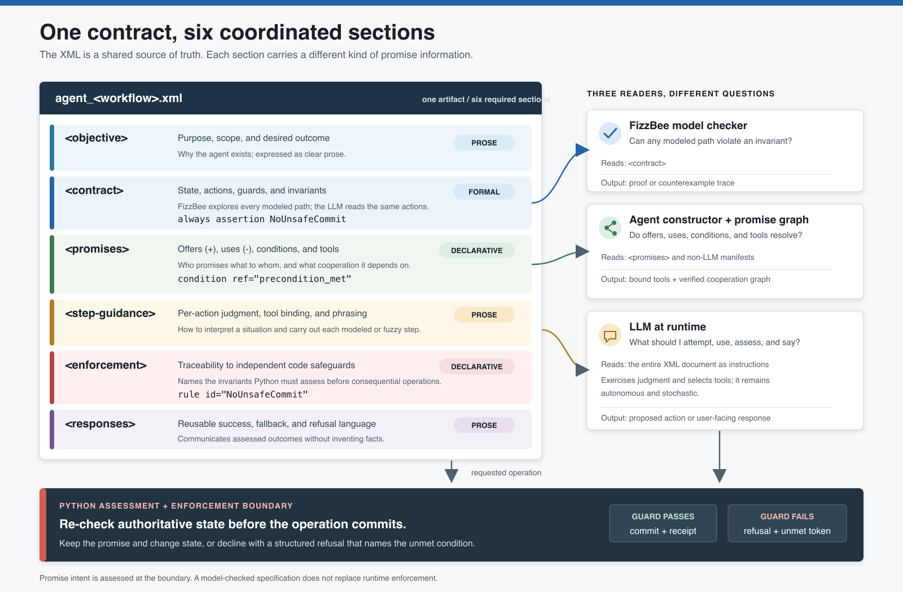
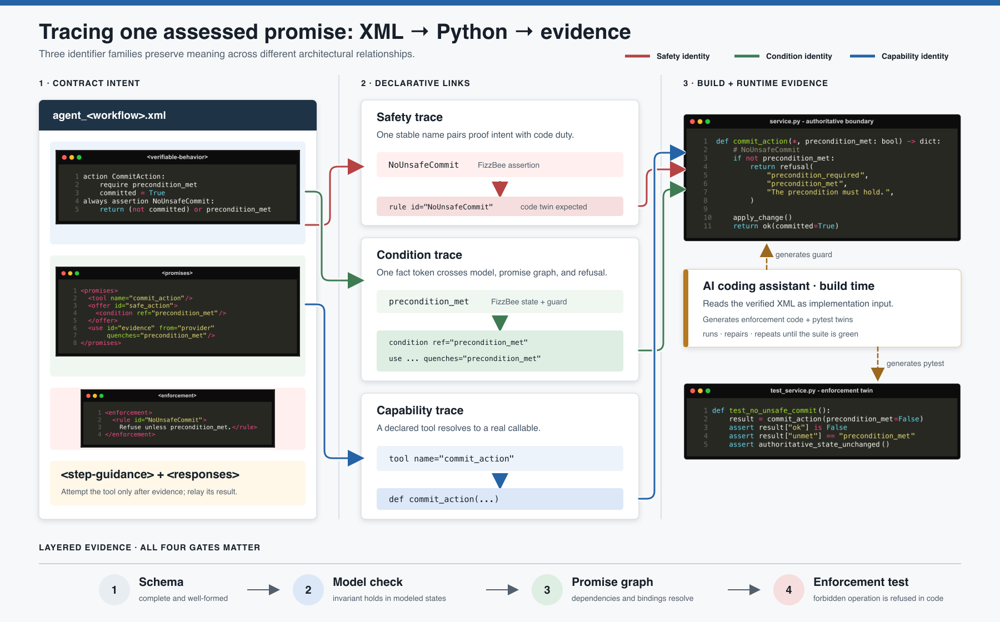
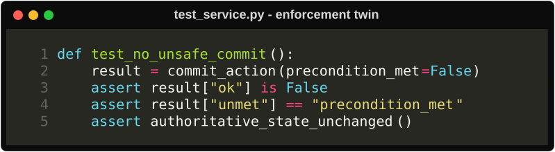
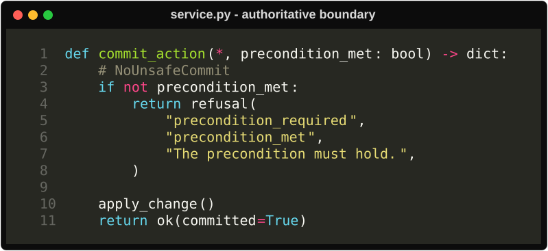

# From Contract to Enforcement

A contract-driven agent is described once, but that description has several jobs. The
XML contract is simultaneously a formal behavioral model, a Promise Theory manifest,
runtime guidance for an LLM, and a traceability record for safeguards implemented in
Python.

That concentration is useful, but it creates a reading problem: the six XML sections
use different descriptive registers, and their connections are expressed through
several kinds of identifiers. The figures in this guide provide two views of the same
architecture:

1. **The overview** explains the responsibility of each section in the agent
   contract, which part of the system consumes it, and where that happens in the
   development lifecycle.
2. **The trace** follows one generic safety promise through Design, Build, and Run:
   from the XML model to generated Python enforcement, executable test evidence, and
   runtime assessment.

The examples are intentionally domain-neutral. Names such as `NoUnsafeCommit`,
`precondition_met`, and `commit_action` stand in for invariants, conditions, and
capabilities in any workflow.

## The lifecycle: Design → Build → Run

The method carries one XML document through three stages of software engineering:
**Design → Build → Run**. The bytes remain the same; what changes is the consumer and
the question it asks of the contract.

| Stage | How the XML is used | Where that usage executes | Result |
| --- | --- | --- | --- |
| **Design** | Author the workflow; validate its structure; prove invariants; verify that offers, uses, and conditions compose. | Engineer + AI coding assistant; XSD validator; FizzBee model checker; promise-graph verifier. These run locally or in CI before implementation is accepted. | A schema-valid, model-checked, compositionally complete contract. |
| **Build** | Treat the verified contract as the implementation specification. Generate agent wiring, Python enforcement twins, and `pytest` cases; run and repair until green. | AI coding assistant and the project test runner, locally or in CI. | Executable code plus tests that trace back to contract identifiers. |
| **Run** | Construct the agent from its promises and tools; give the whole contract to the LLM as instructions; assess consequential operations in Python. | Agent constructor at startup; LLM and service/tool enforcement layer for each request. | A proposed action is executed, or declined with a structured refusal naming the unmet condition. |

Two distinctions keep the stages honest. First, the model checker runs in **Design**;
it proves the specified state machine, not the generated Python. Second, `pytest` runs
in **Build**; it checks the implementation, not whether a stochastic LLM will obey it.
At **Run**, the independent Python boundary closes that remaining gap by reassessing
each consequential operation against authoritative state.

## Figure 1: one contract, six coordinated sections

[](contract-assessment-overview.svg)

The figure isolates the kit's three direct machine readers: the model checker, the
agent constructor, and the runtime LLM. The lifecycle map above adds the AI coding
assistant as a build-time consumer of the entire verified artifact; it is not part of
the deployed agent runtime.

The six sections are not six versions of the same information. Each carries the kind
of statement best suited to its purpose. Every section is authored during Design; the
**Used in** column identifies the later stages where its contents are actively consumed.

Here, **agent contract** names the entire XML artifact. The
`<verifiable-behavior>` section names only the behavior model that can be exhaustively
checked, avoiding a second, nested use of the word *contract*.

| Section | Primary question | Register | Principal consumer | Used in |
| --- | --- | --- | --- | --- |
| `<objective>` | What is this agent for? | Prose | Coding assistant and LLM | Build, Run |
| `<verifiable-behavior>` | Which states are reachable, and what must always hold? | Formal FizzBee | Model checker, coding assistant, and LLM | Design, Build, Run |
| `<promises>` | What does this agent offer, use, and depend on? | Declarative Promise Theory | Promise-graph verifier, coding assistant, constructor, and LLM | Design, Build, Run |
| `<step-guidance>` | How should each action be judged and carried out? | Prose with action bindings | Coding assistant and LLM | Build, Run |
| `<enforcement>` | Which invariants have independent code safeguards? | Declarative traceability | Coding assistant, reviewers, and LLM | Build, Run |
| `<responses>` | How are outcomes and refusals communicated? | Reusable prose | Coding assistant and LLM | Build, Run |

During **Design**, three checks turn the authored document into verified Build input:

- The **schema validator** checks that the document has the correct shape.
- The **model checker** explores the FizzBee state machine and proves its invariants
  over every reachable modeled state.
- The **promise-graph verifier** checks that offers, uses, conditions, and agent
  boundaries compose without missing dependencies.

During **Run**, construction and execution are separate moments. At startup, the agent
constructor resolves the verified promises and tool names into the chosen framework.
For each request, the LLM receives the whole contract as instructions. Python services
remain the authoritative boundary for consequential operations: they assess the
requested operation against real state and either keep the promise or return a specific
refusal.

This distinction matters: a model check proves the specification is internally safe.
It does not prove that a stochastic model will follow the specification. Independent
code enforcement closes that gap.

## Build: From a proven contract to executable evidence

Design ends with a proven contract; Build begins with that contract as its input. The
AI coding assistant participates here, not at runtime. It reads the same verified XML,
its schema, and the surrounding project conventions. It uses the invariant names,
enforcement rules, condition tokens, and tool declarations to generate two
implementation artifacts together:

1. The Python service or tool guard that independently enforces each invariant.
2. A `pytest` enforcement twin that deliberately attempts to violate the invariant.

The test is therefore not an unrelated example added after the implementation. It is
executable evidence derived from the same contract. For a rule such as
`NoUnsafeCommit`, the generated test calls the enforcement boundary with
`precondition_met=False`, checks the structured refusal and its `unmet` token, and
confirms that authoritative state did not change.

The coding assistant then runs the suite, reads failures, repairs the implementation or
test, and repeats until the build is green. This complements rather than duplicates
model checking: the model checker proves the *specified state machine*, while the
generated `pytest` suite checks that the *Python implementation* keeps the same
promise.

## Figure 2: tracing one assessed promise

[](contract-assessment-trace.svg)

The trace figure separates three identifier families that are easy to conflate.

### Safety identity

The FizzBee invariant name and the enforcement rule ID are deliberately identical:

```text
always assertion NoUnsafeCommit  <->  <rule id="NoUnsafeCommit">
```

This creates a reviewable link between the property proved in the model and the
safeguard expected in code. An enforcement test should name or cite the same invariant
so a reviewer can complete the trace.

### Condition identity

The condition token describes a fact that must hold:

```text
FizzBee variable/guard: precondition_met
Promise condition:      <condition ref="precondition_met"/>
Dependency satisfaction:<use ... quenches="precondition_met"/>
Refusal evidence:       {"unmet": "precondition_met"}
```

By convention, the same token is used across these locations. It lets the formal
model, promise graph, and runtime refusal speak about the same unmet dependency. A
condition may instead be marked `assessed="self"` when the promising agent evaluates
it without an external provider.

### Capability identity

Capability names bind declarations to executable behavior:

```text
<tool name="commit_action"/>  <->  Python callable commit_action(...)
```

For inter-agent cooperation, a consumer's `<use id="..." from="...">` must resolve to
an offer with the same ID on the named provider. Tool names and offer/use IDs can be
the same when that is useful, but they are separate relationships and should not be
treated as one global namespace. [Composing Promises](../promise-graph/README.md)
develops this graph relationship in detail.

## Build evidence: The enforcement twin

The matching test deliberately presents the service with a forbidden request. It
checks both the refusal evidence and the more important outcome: authoritative state
did not change. This test is generated and executed during Build; it is not part of the
live agent conversation.

<p align="center">
  <a href="python-enforcement-test.svg"></a>
</p>

## Run: The Python assessment boundary

The guard was generated during Build, but it earns its keep during Run. Whenever the
LLM proposes a consequential operation, the Python function does not merely assume the
model honored the contract. It reassesses the facts that protect the operation:

<p align="center">
  <a href="python-assessment-boundary.svg"></a>
</p>

The shape of the refusal is part of the runtime architecture:

- `refusal` identifies the declined operation in machine-readable form.
- `unmet` identifies the promise condition that failed.
- `message` provides evidence the agent can relay without inventing a reason.

The service owns the final decision because it can inspect authoritative state at the
moment of commitment. The LLM remains responsible for judgment, orchestration, and
communication, but it cannot bypass the guard by choosing different wording or tool
arguments.

## Authoring and review checklist

For each safety invariant:

- Give the FizzBee `always assertion` a stable, descriptive name.
- Use the exact same name for its `<rule id="...">` in `<enforcement>`.
- Use stable condition tokens across FizzBee guards, promise conditions, quenching
  uses, and structured refusals.
- Bind every declared tool name to a real Python callable.
- Enforce the invariant in the service or tool layer independently of the LLM.
- Add a test that attempts the forbidden operation and verifies that state is not
  changed.
- Run schema validation, model checking, promise-graph verification, and tests.

The resulting assurance follows the same lifecycle. **Design** checks completeness,
reachability, and cooperation. **Build** generates the code and checks its enforcement
behavior with tests. **Run** reassesses every consequential operation against
authoritative state.

Continue with [Authoring an Agent Contract](../authoring-workflow/README.md) for the
step-by-step construction process, or [Five Questions, Five Kinds of Evidence](../assurance-model/README.md)
for the precise claim and limitation of each verification layer. For the structure and
semantics of the Run-stage record, continue with
[Runtime Assessment and Evidence](../runtime-assessment/README.md).

## Image sources

The SVG files are the editable sources; the PNG files are rendered copies for Markdown,
articles, and presentation software:

- [`contract-assessment-overview.svg`](contract-assessment-overview.svg)
- [`contract-assessment-overview.png`](contract-assessment-overview.png)
- [`contract-assessment-trace.svg`](contract-assessment-trace.svg)
- [`contract-assessment-trace.png`](contract-assessment-trace.png)
- [`python-assessment-boundary.svg`](python-assessment-boundary.svg)
- [`python-assessment-boundary.png`](python-assessment-boundary.png)
- [`python-enforcement-test.svg`](python-enforcement-test.svg)
- [`python-enforcement-test.png`](python-enforcement-test.png)
- [`contract-intent-fizzbee.svg`](contract-intent-fizzbee.svg)
- [`contract-intent-fizzbee.png`](contract-intent-fizzbee.png)
- [`contract-intent-promises.svg`](contract-intent-promises.svg)
- [`contract-intent-promises.png`](contract-intent-promises.png)
- [`contract-intent-enforcement.svg`](contract-intent-enforcement.svg)
- [`contract-intent-enforcement.png`](contract-intent-enforcement.png)

The syntax-highlighted SVGs are generated with Rich. Run `render_code_snippets.py`
from a Python environment containing `rich` to regenerate them after changing the
examples.
