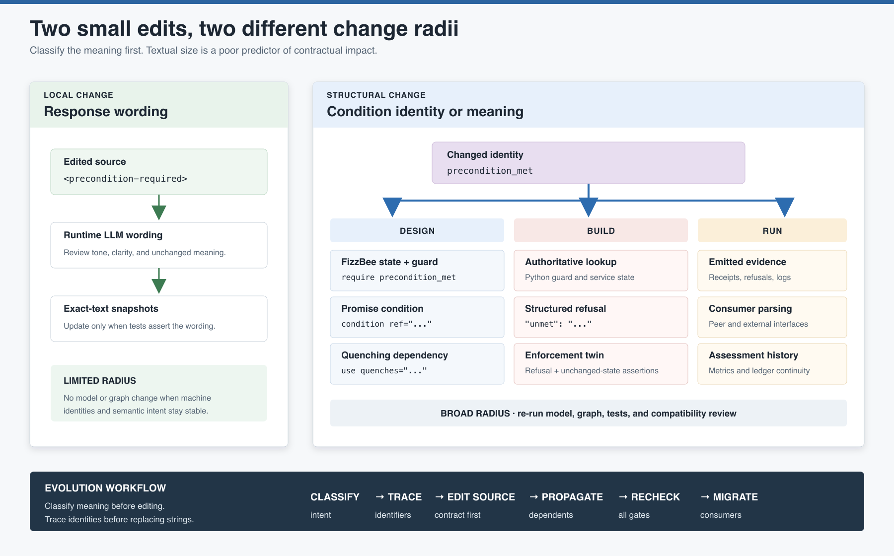

# Evolving an Agent Contract

A contract is one artifact, but its identifiers connect model logic, promise
composition, Python enforcement, tests, runtime evidence, peer agents, and explanatory
diagrams. A small textual edit can therefore have either a tiny or system-wide change
radius.

> The size of the diff does not predict the size of the contractual impact.

[](change-radius.svg)

This guide provides a disciplined way to classify a change, trace its dependencies,
choose a compatibility policy, and rebuild the evidence chain.

## Classify the change before editing

The first question is not “which file changes?” It is “which promise or interface
changes?”

| Change class | Example | Typical radius |
| --- | --- | --- |
| Editorial clarification | Improve an objective sentence without changing intent. | Contract prose, review, and possibly rendered documentation |
| Response wording | Rephrase a user-facing refusal while preserving its structured code and meaning. | `<responses>`, communication review, snapshots if exact text is asserted |
| Identifier rename | Rename a condition, invariant, action, tool, offer, provider, or response field. | Every producer, consumer, verifier, test, and visual that carries the identity |
| Behavioral restriction | Add a guard or condition that makes an action available in fewer states. | Model, promise graph, refusals, enforcement, tests, and consumers |
| Behavioral expansion | Add a transition, fallback, or accepted condition. | Reachable state space, invariants, offers, enforcement, tests, and external claims |
| Composition change | Add, remove, or replace a provider dependency. | Provider manifest, consumer use, quenching, superagent entailment, integration tests |
| Implementation correction | Repair Python enforcement without changing the intended promise. | Guard code, tests, evidence, and a check that the contract already describes the repaired duty |
| Schema evolution | Add or rename an element, attribute, required section, or controlled-vocabulary value. | Canonical and copied schemas, loaders, every document family, authoring guidance, and compatibility policy |

A change can belong to more than one class. Renaming a condition while making it
stricter is both an identity change and a behavioral restriction; treat it as the union
of both radii.

## The identifier families are the dependency map

Stable names make the system traceable, but that traceability also reveals what must
move together.

| Identity family | Canonical meaning | Common locations to search |
| --- | --- | --- |
| Safety identity | Property that must always hold | FizzBee `always assertion`, `<rule id>`, Python guard duty, enforcement-twin test, review evidence |
| Condition identity | Fact that gates a promise or operation | FizzBee state/guard, `<condition ref>`, `<use quenches>`, structured refusal `unmet`, test assertions |
| Capability identity | Executable operation | `<tool name>`, Python callable, construction binding, `<step-guidance>`, tests |
| Promise identity | Offer or accepted dependency | `<offer id>`, matching `<use id>`, superagent `entailed-by`, routing/catalog logic |
| Participant identity | Autonomous promiser or promisee | Root `workflow`/`agent`, filename, `from`, `to`, loader keys, external-party configuration |
| Action identity | Modeled transition and its guidance | FizzBee action, `<step-guidance action>`, traces, diagnostics, documentation |
| Response identity | Machine and human communication contract | Refusal code, response template, result dictionary, caller parsing, snapshots, observability |
| Schema identity | Accepted document language | XSD element/type names, loaders, templates, examples, skills, generated visuals |

Start impact analysis with the stable identifier, not with a folder. A repository-wide
search then reveals both expected dependents and surprising ones:

```bash
rg -n 'NoUnsafeCommit' .
rg -n 'precondition_met' .
rg -n 'commit_action' .
rg -n 'safe_action' .
```

Review each result semantically. A global string replacement can update spelling while
silently preserving an obsolete assumption.

## Two edits with very different radii

### Local: response wording

Changing:

```xml
<precondition-required>
  I cannot commit that action until [required evidence] is available.
</precondition-required>
```

may be local when all of the following remain unchanged:

- The response element name
- Structured refusal code
- `unmet` condition token
- Operation outcome
- Consumer parsing contract
- Intended promise

The change still deserves communication review and any exact-text snapshot updates, but
it does not require a new state-space proof merely because prose changed.

### Structural: condition identity

Renaming or redefining `precondition_met` can touch:

```text
Design: FizzBee state + guard
        <condition ref>
        <use quenches>
        provider/consumer explanation

Build:  Python guard input or authoritative lookup
        structured refusal "unmet"
        enforcement-twin tests

Run:    emitted refusal evidence
        logs, metrics, callers, and assessment records
```

If the new condition has different meaning, this is not a rename. Re-evaluate which
provider can quench it, which actions it guards, and whether the invariant and external
promise remain honest.

## A safe evolution workflow

### 1. Write the change statement

Before editing, write:

- **Current promise:** what the system says now.
- **Proposed promise:** what it should say afterward.
- **Reason:** defect, new capability, provider change, terminology, or schema need.
- **Intended non-changes:** behavior and interfaces that must remain stable.
- **Compatibility audience:** nobody, local developers, deployed code, peer agents, or
  external consumers.

This separates a spelling operation from a behavioral decision.

### 2. Identify every affected identity family

List the invariant, condition, capability, promise, participant, action, response, and
schema tokens involved. Search the whole repository, including:

- Canonical schemas and their synchronized copies
- Agent contracts and deterministic manifests
- Loaders and construction code
- Enforcement services and tests
- Authoring skills and skeleton templates
- Theory documents, practical guides, Medium drafts, SVG sources, and generated PNGs

Do not assume an image is only decoration. A rendered identifier can become stale even
when every executable gate is green.

### 3. Change the contract intent first

For a semantic change, update the agent contract before implementation code. The
contract should describe the intended future behavior that Build must implement.

For a pure implementation correction, confirm that the existing contract already names
the correct promise. If it does not, the defect is larger than Python.

### 4. Re-run Design evidence

Update and verify:

- XML shape against the schema
- FizzBee state, actions, guards, and invariants
- Offer/use binding and condition quenching
- Superagent exterior entailment where used
- Counterexample interpretation if reachability changed

Behavioral restrictions and expansions both require model checking. “Safer” is still a
change to reachable behavior and may introduce dead ends or invalidate other promises.

### 5. Propagate into Build

Update:

- Tool and constructor bindings
- Authoritative Python guards
- Structured refusal fields
- Enforcement-twin tests
- Integration tests between providers and consumers
- Generated code or assistant instructions derived from the contract

Test both refusal and success paths. A newly tightened guard may correctly block one
operation while accidentally blocking all operations.

### 6. Review Run compatibility

Ask which live participants consume the changed meaning:

- Does an LLM receive a changed action or response identity?
- Does a caller parse an exact refusal code or `unmet` token?
- Does an assessment ledger group history by the old identifier?
- Can old and new agents coexist in one promise graph?
- Are in-flight sessions carrying state that the new model interprets differently?

Runtime compatibility is a system property. A schema-valid replacement can still be
incompatible with deployed peers or persisted state.

### 7. Rebuild documentation and visual evidence

Update editable sources first, then regenerate rendered copies. Verify captions, links,
syntax-highlighted snippets, diagram labels, and article references. Keep source and
rendered assets together so the maintenance path remains obvious.

### 8. Run the complete gate

```bash
xmllint --noout --schema schema/agent-contract.xsd \
  agent_contracts/agent_<workflow>.xml

uv run python scripts/verify_fizzbee_contracts.py
uv run python scripts/verify_promise_graph.py
uv run pytest -q
```

Add integration or migration checks when the changed boundary is not covered by the
standard gate.

## Change scenarios

### Invariant logic or name

Review the invariant's meaning before its spelling. Update the FizzBee assertion,
matching `<rule id>`, Python guard responsibility, test identity, failure messages, and
any assurance documentation. Re-run model checking even when only the assertion body
changes.

If only the name changes, preserve an explicit mapping in release notes or migration
evidence when historical test and assessment records use the former identity.

### Provider replacement

Replacing a provider is not only a `from="..."` edit. Confirm that the new provider:

- Publishes the same offer ID or intentionally introduces a new one.
- Makes a semantically equivalent promise body.
- Supplies evidence with equivalent authority and freshness.
- Quenches the same condition honestly.
- Produces compatible refusal and success outcomes.
- Is represented in superagent entailment and integration tests.

The promise graph proves reference coherence, not semantic equivalence between two
providers.

### Tool or callable rename

Update `<tool name>`, Python export/binding, `<step-guidance>`, tests, and any framework
adapter. Decide whether callers need an alias during migration. Promise IDs need not be
renamed merely because an implementation function changes.

### New condition

Adding `<condition ref="x">` restricts an offer. Add the modeled state and guard, name
how `x` is quenched or self-assessed, implement the authoritative check, define refusal
evidence, and test the newly forbidden path. Review external wording because an
unconditional promise has become conditional.

### Controlled-vocabulary or envelope change

Changing an XSD affects a document language, not one contract. Update the canonical
schema, every intentional copy, templates, loaders, authoring references, examples, and
visuals. Validate every document family and decide whether older documents remain
accepted.

## Compatibility strategies

Choose deliberately rather than accumulating accidental aliases.

| Strategy | Use when | Cost |
| --- | --- | --- |
| Hard cut | No external consumers exist, or all producers and consumers can migrate atomically. | Simplest implementation; old artifacts stop working immediately. |
| Temporary alias | A renamed identifier must coexist during a bounded rollout. | Dual parsing, duplicate evidence, removal deadline, and ambiguity risk. |
| Parallel versions | Old and new promises must coexist for independent consumers. | Version routing, two test matrices, and explicit deprecation. |
| Boundary adapter | Internal identities change while an external interface must remain stable. | Translation code becomes part of the assessed boundary. |

Compatibility code is contractual code. Give it tests, an owner, and an expiration
condition.

## Recommended versioning policy for adopters

The schemas require a dotted `version` string but do not interpret its semantics. The
following is a recommended policy for projects adopting the kit, not behavior enforced
by the current XSD or loaders.

| Change | Recommended treatment |
| --- | --- |
| Typo, formatting, or prose clarification with no changed meaning | Keep the document version; record the repository change. |
| Compatible implementation repair that restores the existing promise | Keep or patch-bump according to project release policy; preserve the contract identity. |
| Additive optional capability or response that existing consumers may ignore | Minor document-version bump when the document is shared outside one atomic deployment. |
| Removed/renamed offer, condition, tool, refusal field, or participant | Major document-version bump or an explicit compatibility migration. |
| Stricter condition, changed invariant meaning, state reinterpretation, or altered exterior promise | Treat as behavioral compatibility work even when XML remains schema-valid. |
| Required element/attribute or controlled-vocabulary change | Coordinate a schema release and document migration; do not silently replace the accepted language for existing consumers. |

Before production adoption or external sharing, a hard cut without a version change can
be reasonable because there is no compatibility audience. Once another deployed system
relies on the document, version decisions become part of the promise to that consumer.

## Repository case study: a structural section rename

A recent terminology improvement in this kit renamed one required XML section to better
express *why* it exists. Although the semantic intent remained model-checkable behavior,
the structural rename affected:

- The canonical schema and every synchronized schema copy
- All agent XML examples and the skeleton contract
- Contract loaders and error messages
- Authoring skills, checklists, and anatomy references
- Theory and practical documentation
- Rich-rendered snippet titles and composite diagrams
- Schema, model, graph, and test verification

The repository used a hard cut and retained document version `1.0` because the method
had not been externally shared or deployed. The important lesson is not that every
rename needs a version bump; it is that a one-token structural change can have a
repository-wide radius.

## Change-review record

For consequential changes, capture a short record:

```text
Change:
Current promise:
Proposed promise:
Reason:
Affected identity families:
Affected agents and external consumers:
Compatibility strategy:
Design evidence:
Build evidence:
Runtime/migration evidence:
Documentation and images regenerated:
Known residual risks:
```

This is not bureaucracy for every typo. It is a compact assurance record for changes
whose radius crosses architectural boundaries.

## Evolution checklist

- Classify the change by meaning, not file type.
- State intended behavior and intended non-changes.
- Inventory affected identifier families.
- Search contracts, manifests, code, tests, templates, skills, docs, and image sources.
- Update the contract intent before derived implementation artifacts.
- Re-run model checking for every reachability or invariant change.
- Re-run the promise graph for every offer, use, provider, condition, or entailment change.
- Update authoritative enforcement and both refusal and success tests.
- Review persisted state, peer-agent, and external-consumer compatibility.
- Choose and document hard cut, alias, parallel version, or adapter.
- Regenerate rendered documentation assets.
- Run the complete gate and any boundary-specific migration tests.

For creating the original contract, see
[Authoring an Agent Contract](../authoring-workflow/README.md). For model repairs, see
[Debugging a FizzBee Counterexample](../counterexample-debugging/README.md). For
cross-agent dependencies, see [Composing Promises](../promise-graph/README.md).

## Image sources

- [`change-radius.svg`](change-radius.svg) is the editable source.
- [`change-radius.png`](change-radius.png) is the rendered copy for Markdown, articles,
  and presentations.

