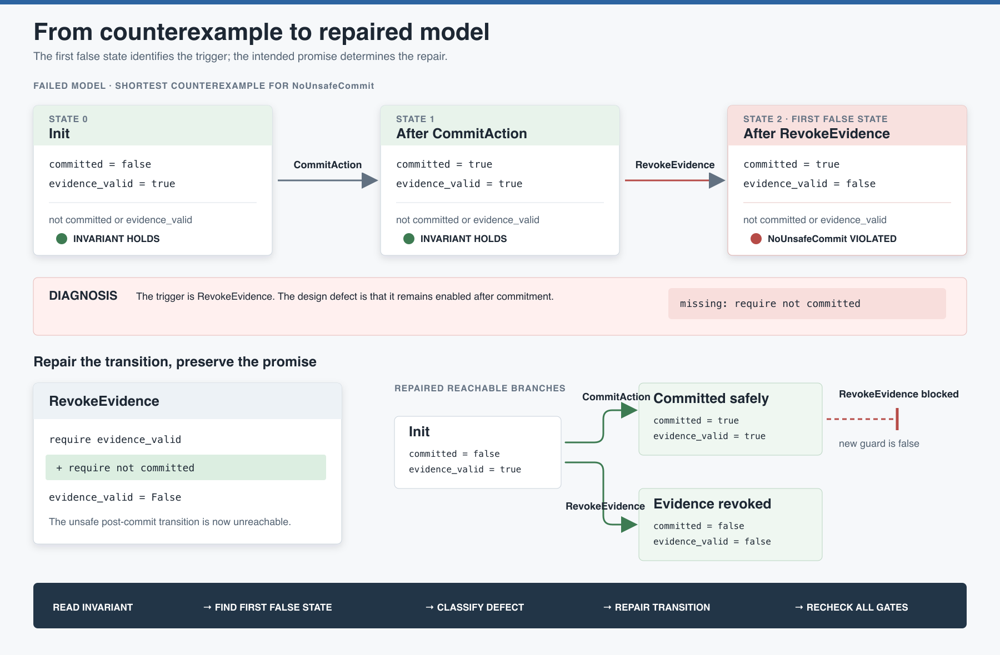

# Debugging a FizzBee Counterexample

A failed model check is not merely a red verdict. It is a reproducible execution trace
from `Init` to the first reachable state that violates an invariant. Read it like a bug
report for the design.

This guide uses a small, runnable model with one safety promise:

> Once an action is committed, its supporting evidence must remain valid.

[](counterexample-repair.svg)

## The failing model

The complete source is [`unsafe-commit.fizz`](unsafe-commit.fizz). Its relevant actions
and invariant are:

```python
atomic action CommitAction:
    require evidence_valid
    require not committed
    committed = True

atomic action RevokeEvidence:
    require evidence_valid
    evidence_valid = False

always assertion NoUnsafeCommit:
    return (not committed) or evidence_valid
```

`CommitAction` is guarded correctly at the moment it runs. The defect appears later:
`RevokeEvidence` may invalidate the evidence after the commit has already occurred.

Run a scratch copy of the model to inspect the checker output without leaving generated
FizzBee artifacts in the documentation tree:

```bash
tmpdir="$(mktemp -d)"
cp docs/counterexample-debugging/unsafe-commit.fizz "$tmpdir/model.fizz"
(cd "$tmpdir" && fizz model.fizz)
```

The kit's `verify_fizzbee_contracts.py` wrapper treats a run as passing only when the
output contains `PASSED`, allowing invariant failures to gate CI consistently.

## Read the counterexample as state transitions

FizzBee reports the violated invariant and the exact path:

```text
FAILED: Model checker failed. Invariant: NoUnsafeCommit

Init
state: {"committed": false, "evidence_valid": true}

CommitAction
state: {"committed": true, "evidence_valid": true}

RevokeEvidence
state: {"committed": true, "evidence_valid": false}
```

Evaluate the invariant after every step:

| Step | `committed` | `evidence_valid` | `not committed or evidence_valid` | Result |
| --- | ---: | ---: | ---: | --- |
| `Init` | false | true | true | Holds |
| `CommitAction` | true | true | true | Holds |
| `RevokeEvidence` | true | false | false | **Violated** |

The first red state is useful, but the transition into it is the real debugging target.
Here, `RevokeEvidence` is the trigger. Its missing post-commit guard is the defect.

## A disciplined debugging sequence

### 1. Read the invariant before the trace

Restate the safety property in plain language. Do not begin by weakening it until the
model passes. Ask whether the invariant expresses the promise the system genuinely
intends to make.

For `NoUnsafeCommit`, the prohibited state is:

```text
committed == true and evidence_valid == false
```

### 2. Find the first state where the invariant is false

Ignore later states initially. The first violation bounds the investigation and avoids
debugging consequences as though they were causes.

### 3. Name the transition that entered the bad state

The final action in the shortest counterexample is often the immediate trigger. Inspect
its guards and assignments, then inspect earlier actions only if they made an impossible
combination reachable.

### 4. Distinguish the trigger from the design decision

The trace says *how* the bad state became reachable; it does not decide what the system
should mean. Several repairs may make the invariant pass:

- Prevent evidence revocation after commitment.
- Retract or invalidate the commitment when evidence is revoked.
- Change the invariant if the original promise was incorrect.
- Introduce a more precise state such as `evidence_snapshot_bound`.

Choose the repair that matches the intended contract, not the smallest edit that makes
the checker green.

### 5. Make the unsafe transition unreachable

For this contract, committed actions are final. The correct repair is a guard on
`RevokeEvidence`:

```diff
 atomic action RevokeEvidence:
     require evidence_valid
+    require not committed
     evidence_valid = False
```

The complete repaired source is [`repaired-commit.fizz`](repaired-commit.fizz).

After the repair, the checker explores both valid branches:

- `CommitAction` may occur while evidence is valid; later revocation is disabled.
- `RevokeEvidence` may occur before commitment; later commitment is disabled by its
  existing `require evidence_valid` guard.

Neither branch reaches `committed == true and evidence_valid == false`.

### 6. Re-run the model and preserve the invariant

```bash
tmpdir="$(mktemp -d)"
cp docs/counterexample-debugging/repaired-commit.fizz "$tmpdir/model.fizz"
(cd "$tmpdir" && fizz model.fizz)
```

Expected result:

```text
PASSED: Model checker completed successfully
```

A passing result means no reachable state in this model violates the invariant. It does
not prove that the state variables, actions, or environmental assumptions completely
describe production reality.

## Counterexample defect patterns

| Pattern | Trace symptom | Typical repair question |
| --- | --- | --- |
| Missing guard | One action enters a state that should have been unavailable. | What prerequisite or exclusion was omitted? |
| Regressing state | A fact becomes false after another action relied on it permanently. | Should the fact be sticky, versioned, or snapshotted? |
| Unsafe retry | Repeating a previously valid action reverses or duplicates an outcome. | Should the action require an unprocessed state or idempotency token? |
| Incorrect ordering | A consequential action appears before its prerequisite action. | Which state token should guard the transition? |
| Unmodeled alternative | The happy path passes, but a nondeterministic failure creates an unsafe state. | Which external outcomes must use `oneof`? |
| Concurrency defect | Two individually valid actions interleave into an invalid state. | Which operation must be atomic or mutually exclusive? |
| Incorrect invariant | Every plausible execution fails for a property the system did not intend. | Is the promise misstated, or is the model missing a legitimate exception? |
| Incomplete state | The repair requires distinctions the current booleans cannot express. | What state must be represented explicitly? |

## Do not repair the wrong artifact

Common counterproductive responses include:

- Deleting the invariant because it is inconvenient.
- Adding an impossible initial value so the failing path disappears.
- Removing `oneof` and assuming an external operation always succeeds.
- Disabling an action the real workflow still needs.
- Adding a broad guard without understanding which promise it represents.
- Treating a longer state-space search as evidence that the failure is unlikely.

The model checker answers reachability, not probability. A path that is reachable once
is a design possibility, even if a stochastic implementation rarely selects it.

## Propagate the repair through the contract

A model repair can change more than `<verifiable-behavior>`. Review its full change
radius. [Evolving an Agent Contract](../contract-evolution/README.md) provides the
complete maintenance and compatibility workflow:

| Repair changes... | Revisit... |
| --- | --- |
| Action guard | Matching condition token, `<step-guidance>`, and refusal behavior |
| Invariant meaning or name | `<enforcement><rule id>`, Python guard duty, and test twin |
| State predicate | Promise `<condition ref>`, `<use quenches>`, and structured refusal `unmet` token |
| Capability availability | Offers, uses, tool binding, and peer-agent expectations |
| External assumption | Provider manifest, external-party configuration, and runtime assessment source |

Then run all Design and Build gates, not only FizzBee:

```bash
xmllint --noout --schema schema/agent-contract.xsd \
  agent_contracts/agent_<workflow>.xml

uv run python scripts/verify_fizzbee_contracts.py
uv run python scripts/verify_promise_graph.py
uv run pytest -q
```

The counterexample may reveal that a condition or dependency was missing from the
promise graph, or that enforcement code and tests embody the same incorrect assumption.

## A real example in the kit

The Trials of the Holy Grail example encountered this exact defect family. Its first
Quest Marshal model allowed a knight to re-attempt a passed trial and make that trial
false after the Grail had been granted, violating `GrailRequiresBothTrials`. The repair
made a passed trial sticky by preventing the unsafe re-attempt.

See the explanation in [The Promise-Driven Agent](../why-promise-driven-agents.md#33-model-checking-as-pre-assessment)
and the repaired model in
[`agent_grail_quest_marshal.xml`](../../examples/holy-grail-trials/agent_contracts/agent_grail_quest_marshal.xml).

## Debugging checklist

- Identify the failed invariant by its exact name.
- Restate the prohibited state in plain language.
- Evaluate the invariant after each reported state.
- Mark the first state where it becomes false.
- Name the action that enters that state.
- Classify the defect before editing the model.
- Choose the repair that preserves the intended promise.
- Re-run the checker and inspect the new reachable branches.
- Propagate changed identifiers or assumptions across the full contract.
- Run schema, model, graph, and implementation tests.
- Keep the counterexample as design evidence when it explains an important repair.

For the full authoring sequence, see
[Authoring an Agent Contract](../authoring-workflow/README.md). For the limits of the
model-check claim, see
[Five Questions, Five Kinds of Evidence](../assurance-model/README.md).

## Image sources

- [`counterexample-repair.svg`](counterexample-repair.svg) is the editable source.
- [`counterexample-repair.png`](counterexample-repair.png) is the rendered copy for
  Markdown, articles, and presentations.
