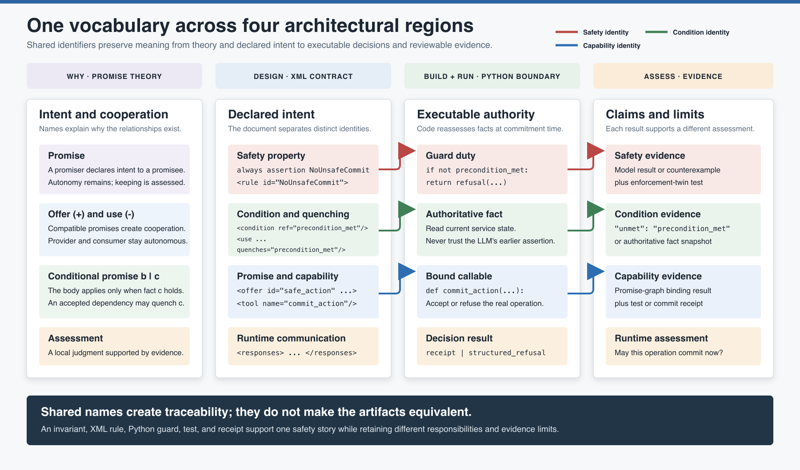

# Glossary and Naming Conventions

This guide gives the promise-driven methodology one shared vocabulary across Promise
Theory, XML documents, behavior models, Python enforcement, and evidence. Use it when
a familiar word appears to mean several things, or when an identifier must remain
traceable across artifacts.

The most important naming rule is:

> Reuse a name when two artifacts represent the same identity. Use different names
> when they represent different relationships, even when those relationships cooperate.

## Promise Theory terms

| Term | Meaning in this methodology |
| --- | --- |
| **Agent** | A boundary chosen for reasoning about autonomous behavior. An agent controls only its own behavior; it may make promises and assess promises made to it. An agent is not necessarily an LLM. |
| **Autonomy** | The principle that one agent cannot directly promise another agent's behavior. Cooperation is voluntary and must be represented through matching promises. |
| **Promise** | A public declaration of intent made by a **promiser** to a **promisee**, with a body and scope. A promise is not a guarantee that the behavior will occur. |
| **Promiser** | The agent that makes a promise. |
| **Promisee** | The agent or party to whom a promise is made and who may assess whether it was kept. In XML, an offer names promisees with `to`. |
| **Promise body** | The behavior or outcome being promised. In XML, this is expressed by `<body>` inside an `<offer>` or `<use>`. |
| **Scope** | The agents that know about a promise. The kit records direct participants but does not yet model Promise Theory scope as a separate XML structure. |
| **Imposition** | An attempt to induce behavior without a prior promise to accept it. A prompt or orchestration command is an imposition, not ownership of the receiving agent. |
| **Obligation** | An imposition coupled to a penalty or consequence. Obligation still does not remove the receiving agent's autonomy. |
| **Offer (`+`)** | A promise to provide behavior, information, or capability. It is represented by `<offer>`. |
| **Use (`-`)** | A promise to accept or use something another agent offers. It is represented by `<use>`. Cooperation requires a compatible offer and use. |
| **Conditional promise** | A promise of body `b` that applies only when condition `c` holds, written `b|c` in Promise Theory. It is represented by an `<offer>` containing `<condition ref="c"/>`. |
| **Condition** | A named fact that must hold before a conditional promise applies. A condition is a state predicate, not a provider capability. |
| **Quenching** | Satisfying a condition through an accepted dependency. In XML, `<use quenches="c">` states that using the provider's offer supplies evidence for condition `c`. |
| **Self-assessed condition** | A condition marked `assessed="self"` because the promisee evaluates it locally; no quenching use is expected in the graph. Use it only when no provider dependency is being hidden. |
| **Assisted promise** | A conditional promise supported by another accepted promise, such as offering a safe commit only when accepted evidence quenches its precondition. |
| **Assessment** | A local decision by a promisee or boundary about whether a promise was kept. Different agents may reach different assessments of the same event. |
| **Trust** | An accumulated valuation derived from previous assessments that influences future reliance. Trust is evidence-based and local; it is not obligation. |
| **Superagent** | An exterior identity drawn around a society of interior agents. Its published promises should be justified by promises made by its members. |
| **Entailment** | The relationship by which interior promises justify an exterior superagent promise. The kit's `entailed-by` check establishes that named references exist; human review establishes whether they semantically justify the exterior claim. |

## Contract and manifest terms

| Term | Meaning in this methodology |
| --- | --- |
| **Agent contract** | The complete `agent_*.xml` document consumed by an LLM as runtime instructions. It contains all six section types: `<objective>`, `<verifiable-behavior>`, `<promises>`, `<step-guidance>`, `<enforcement>`, and `<responses>`. |
| **Deterministic agent manifest** | A `manifest_*.xml` document that publishes promises for a governed non-LLM participant. It contains a description and `<promises>`, but no LLM instructions or embedded behavior model. |
| **External party** | A participant outside the locally governed document set. A narrowly configured verifier exemption permits references to it without a local manifest. External status is a governance decision, not a synonym for deterministic agent. |
| **Promise manifest** | The `<promises>` content that declares tools, offers, uses, conditions, and dependencies. Both document families contribute this information to the promise graph. |
| **Objective** | Prose that defines the LLM agent's role and intended outcome. It can contain judgment and context that do not belong in an exhaustive state model. |
| **Verifiable behavior** | The `<verifiable-behavior>` section containing the model-checkable FizzBee specification. It is one section of an agent contract, not the whole contract. |
| **Step guidance** | Runtime prose that tells the LLM how to apply judgment, sequence actions, and invoke a bound tool. Guidance does not enforce a Python boundary. |
| **Enforcement section** | Declarative traceability from a modeled safety property to a deterministic implementation duty. It describes what code must enforce. |
| **Enforcement rule** | A named `<rule id="...">` inside `<enforcement>`. Its ID should exactly match the corresponding FizzBee invariant identity. The rule itself is not executable code. |
| **Response template** | A structured communication pattern in `<responses>` for success, clarification, or refusal. It helps the LLM report an assessment but does not make the decision. |
| **Tool binding** | The relationship between `<tool name="x">` and the runtime callable named `x`. A declared tool is a capability reference, not proof that the callable is safe. |
| **Enforcement boundary** | The deterministic authority that reads current authoritative state and accepts or refuses a consequential operation. It may be represented by a service manifest in the promise graph. |

## Model, verification, and runtime terms

| Term | Meaning in this methodology |
| --- | --- |
| **Action** | A named FizzBee state transition. It states its guards and state effects. Action names use `PascalCase`. |
| **Guard** | A `require` predicate that controls whether one modeled action is enabled. A guard is local to a transition. |
| **Invariant** | An `always assertion` safety property that must hold over every reachable modeled state. It is broader than any one guard. |
| **Modeled state** | The deliberately bounded variables and values represented in FizzBee. Facts omitted from the model are outside the model check's claim. |
| **Reachable state** | A modeled state that can occur through an explored sequence of actions from initialization. |
| **Counterexample** | A concrete action trace showing how the model reaches a state that violates an invariant. It is diagnostic evidence, not merely a failed test message. |
| **Schema validation** | XSD verification of document structure, ordering, required attributes, and controlled vocabulary. It does not establish behavioral safety. |
| **Model check** | Exhaustive exploration of the bounded FizzBee model. A successful result establishes invariant coherence over reachable modeled states, not correctness of the LLM, Python, or entire system. |
| **Pre-assessment** | Evidence gathered before an offer is relied upon, especially schema, model-check, and promise-graph results. It evaluates declared intent before runtime. |
| **Promise-graph coherence** | The property that non-external uses resolve to the named provider's offer and each conditional promise declares how its condition is quenched or self-assessed. It does not establish runtime availability or honesty. |
| **Authoritative state** | The source of truth used by a deterministic boundary at the moment of a consequential decision. The boundary should derive conditions from this state rather than trust an LLM assertion. |
| **Python guard** | Executable service logic that reassesses authoritative facts and refuses an unsafe operation. It is the runtime safeguard corresponding to a modeled duty. |
| **Enforcement twin** | A test that deliberately attempts the forbidden operation and checks both structured refusal and unchanged protected state. It demonstrates the exercised implementation path, not universal correctness. |
| **Structured refusal** | A normal, machine-readable non-cooperation result, typically including `ok: false`, a refusal code, and the unmet condition. It is not an unexpected exception. |
| **Receipt** | Structured evidence that a consequential operation committed, including enough identity and correlation information for later assessment. |
| **Runtime assessment** | The boundary's current accept-or-refuse decision against authoritative state. It answers whether this operation may proceed now. |
| **Evidence chain** | The connected results of schema validation, model checking, promise-graph verification, enforcement testing, and runtime assessment. Each result supports a different claim. |

## Naming conventions

Choose names during **Design**, preserve them through **Build**, and emit them in
evidence during **Run**.

| Concept | Convention | Generic example |
| --- | --- | --- |
| Agent contract file | `agent_<workflow>.xml` | `agent_safe_workflow.xml` |
| Deterministic manifest file | `manifest_<agent>.xml` | `manifest_authority_service.xml` |
| Agent or workflow identity | `snake_case` | `authority_service` |
| FizzBee action | `PascalCase`, verb or verb phrase | `CommitAction` |
| FizzBee invariant and rule ID | `PascalCase`, stable safety identity | `NoUnsafeCommit` |
| State and condition token | `snake_case`, fact phrased as state | `precondition_met` |
| Tool and Python callable | `snake_case`, verb or verb phrase | `commit_action` |
| Offer and use ID | `snake_case`, capability or evidence noun | `safe_action`, `evidence` |
| Refusal code | `snake_case`, reason or required fact | `precondition_required` |
| Test | `test_<forbidden_or_required_behavior>` | `test_no_unsafe_commit` |

Names should be specific enough to survive beyond one prompt or code path. Avoid vague
IDs such as `result`, `data`, `valid`, `process`, or `rule1` when a domain fact or
capability can be named directly.

## Four identity chains

The methodology uses several related namespaces. Preserve exact spelling within each
chain; do not force one string across all chains.

| Identity | Exact name follows | Purpose |
| --- | --- | --- |
| **Safety identity** | FizzBee invariant -> `<rule id>` -> test name or citation | Traces one forbidden state into its implementation duty and regression evidence. |
| **Condition identity** | Model state/guard -> `<condition ref>` -> `<use quenches>` -> refusal `unmet` | Traces the fact that must hold before a conditional capability applies. |
| **Capability identity** | `<tool name>` -> Python callable | Resolves a declared tool to executable behavior. |
| **Promise identity** | Provider `<offer id>` -> consumer `<use id>` together with `from` | Resolves a dependency to the exact capability promised by a named provider. |

For example, `evidence` and `precondition_met` should not be collapsed into one name.
The first names a provider capability; the second names the fact that using that
capability may establish.

## Do not conflate

| These are different | Why the distinction matters |
| --- | --- |
| Agent contract / `<verifiable-behavior>` | The contract is the whole runtime instruction artifact; verifiable behavior is only its formal model section. |
| Guard / invariant | A guard enables one action; an invariant constrains all reachable modeled states. |
| Condition / use | A condition is a required fact; a use is a promise to accept a provider capability that may quench that fact. |
| Offer/use ID / condition token | The ID names what a provider offers; the condition token names the resulting state predicate. |
| Model check / runtime assessment | The model check evaluates a bounded specification offline; runtime assessment decides one real operation against current state. |
| Enforcement rule / Python guard | The XML rule declares a duty; Python executes the accept-or-refuse decision. |
| Python guard / enforcement twin | The guard protects production behavior; the twin attempts the forbidden path and checks the guard. |
| Deterministic agent / external party | A deterministic agent is locally governed and normally has a manifest; an external party is outside the local document set. |
| Structured refusal / exception | Refusal is an expected autonomous outcome with evidence; an exception signals an unexpected execution failure. |
| Reference completeness / semantic entailment | A verifier can confirm that `entailed-by` names exist; review must still decide whether those promises justify the exterior claim. |
| Schema validity / behavioral safety | Correct XML structure says nothing by itself about unsafe reachable states. |

## Offer type vocabulary

Every `<offer>` uses one controlled `type`: `workflow`, `invariant`, `session-state`,
`auth`, `identity`, `receipts`, `ocr`, `ux`, or `card`. The type classifies the promise;
the `id` gives it a stable identity and the `<body>` states its meaning. See the
[contract anatomy reference](../../skills/authoring-agent-contracts/references/contract-anatomy.md)
and [shared Promise Theory schema](../../schema/promise-common.xsd) for the normative
vocabulary.

## Using terms in documentation

- Define **agent** by autonomy and boundary, not by implementation technology.
- Use **agent contract** for the whole `agent_*.xml` artifact.
- Use **verifiable behavior** or **behavior model** for the embedded FizzBee section.
- Qualify the word **proof** with its boundary: "invariant coherence over reachable
  modeled states" is precise; "the system is proven safe" is not.
- Say **offer** and **use** when discussing graph polarity; say **provider** and
  **consumer** when emphasizing the dependency relationship.
- Name the assessor when an assessment could differ by viewpoint.
- Treat refusal as a valid autonomous outcome, not as failure to obey an orchestrator.

For the practical sequence that applies these terms, continue with
[Authoring an Agent Contract](../authoring-workflow/README.md). For the five evidence
claims, see [Five Questions, Five Kinds of Evidence](../assurance-model/README.md).

## Image sources

- [`vocabulary-map.svg`](vocabulary-map.svg) is the editable source.
- [`vocabulary-map.png`](vocabulary-map.png) is the rendered copy for Markdown,
  articles, and presentations.
