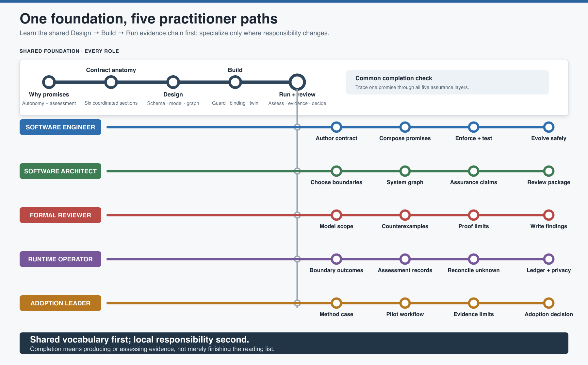

# Practitioner Learning Path

This learning path turns the repository's reference material into a deliberate
onboarding sequence. It is for engineers and architects who need to use, review, or
evaluate the methodology without reading the entire kit first.

The shared foundation is short. Role-specific paths begin only after every learner can
explain the same core distinction:

> The LLM may propose an action. A deterministic boundary decides whether the real
> operation may proceed, and evidence records what that decision means for each
> promise.

## Choose a learning mode

| Available time | Use | Outcome |
| --- | --- | --- |
| **30 minutes** | [Orientation](orientation.md) | Explain the method, its artifacts, and the limits of each assurance claim. |
| **90 minutes** | [Guided workshop](workshop.md) | Design one conditional promise through XML, modeling, graph composition, Python enforcement, tests, and runtime evidence. |
| **Self-check** | [Knowledge check](knowledge-check.md) | Identify misconceptions and decide which topics need another pass. |
| **Role onboarding** | [Role-specific paths](role-paths.md) | Follow the shortest reading and practice sequence for a particular responsibility. |
| **Team review practice** | [Worked package review](../reviewing-contract-packages/worked-review.md) | Classify defects, write findings, and make an approval decision. |

## Shared foundation

Every role should be able to state these six ideas before specializing.

### 1. Agent means autonomous boundary

An agent is chosen by what behavior and authority it controls, not by whether it uses
an LLM. LLM workflows, deterministic services, shared-state owners, and superagent
exteriors can all be agents. Internal helper functions usually are not.

### 2. The agent contract is the whole XML artifact

`<verifiable-behavior>` is one formal section inside an LLM agent contract. The other
sections preserve objective, Promise Theory relationships, runtime judgment,
enforcement traceability, and response language.

### 3. Design, Build, and Run ask different questions

| Stage | Primary question | Main evidence |
| --- | --- | --- |
| **Design** | Is the declared behavior structurally valid, safe over modeled states, and compositionally coherent? | XSD result, model proof or counterexample, promise-graph result |
| **Build** | Does executable code independently enforce the declared safety duty? | Python guard, tool binding, enforcement-twin and integration tests |
| **Run** | May this operation proceed against authoritative state now, and what was assessed? | Receipt or refusal, promise-specific assessment record, reconciliation evidence |

### 4. Stable identifiers carry meaning

Safety, condition, capability, and promise identities connect the artifacts. They are
related namespaces, not one global string. Exact identity is reused only where the
meaning is the same.

### 5. Every assurance claim has a boundary

Schema validation does not prove safety. A model check does not prove Python or LLM
behavior. A coherent graph does not prove provider availability. A passing test does
not prove every runtime path. A runtime decision does not prove future behavior.

### 6. Refusal is a normal outcome

An autonomous participant may decline. A structured refusal names why cooperation did
not bind and preserves protected state. Refusing an unsafe operation may mean the
safety promise was kept while a conditional capability was not applicable.

## Recommended sequence

For an individual learner:

1. Complete the [30-minute orientation](orientation.md).
2. Use the [knowledge check](knowledge-check.md) without consulting the answers.
3. Complete the [90-minute workshop](workshop.md).
4. Read the [role-specific path](role-paths.md) matching current responsibility.
5. Review the [deliberately flawed package](../reviewing-contract-packages/worked-review.md).
6. Use the [review-report template](../reviewing-contract-packages/review-report-template.md)
   to write an independent decision.

For a team, run the orientation together, complete the workshop in pairs, and conduct
the review exercise individually before comparing findings. Different local
assessments are useful discussion evidence; unexplained differences reveal where the
method is still being interpreted inconsistently.

## Learning completion

A practitioner is ready to work with the kit when they can:

- Choose an LLM contract, deterministic manifest, external-party designation, or no
  agent document for a participant.
- State one consequential capability as promise, condition, refusal, and protected
  state effect.
- Distinguish action guard from invariant.
- Connect an offer, use, and quenched condition without collapsing their identities.
- Explain exactly what each Design, Build, and Run gate establishes.
- Trace one invariant into a rule, Python duty, enforcement twin, and assessment.
- Interpret a counterexample as a design trace rather than a generic test failure.
- Distinguish committed, refused, failed, and unknown operational outcomes.
- Review a contract package and issue a defensible approval decision.

## Facilitating the material

Keep the exercises domain-neutral until learners understand the relationships. A
familiar business domain can hide conceptual errors because participants fill missing
assumptions from experience.

During discussion, ask “which artifact owns that responsibility?” before asking how to
implement it. If two people give different answers, locate the relevant boundary in
the contract package rather than resolving the disagreement through terminology alone.

The workshop intentionally uses one small operation. The objective is not broad agent
functionality; it is a complete and reviewable evidence chain.

## Learning materials

- [30-minute orientation](orientation.md)
- [90-minute guided workshop](workshop.md)
- [Role-specific reading paths](role-paths.md)
- [Knowledge check and answer key](knowledge-check.md)
- [Glossary and Naming Conventions](../glossary/README.md)
- [Contract-package review exercise](../reviewing-contract-packages/worked-review.md)

## Image sources

- [`learning-map.svg`](learning-map.svg) is the editable source.
- [`learning-map.png`](learning-map.png) is the rendered copy for Markdown, workshops,
  and presentations.
