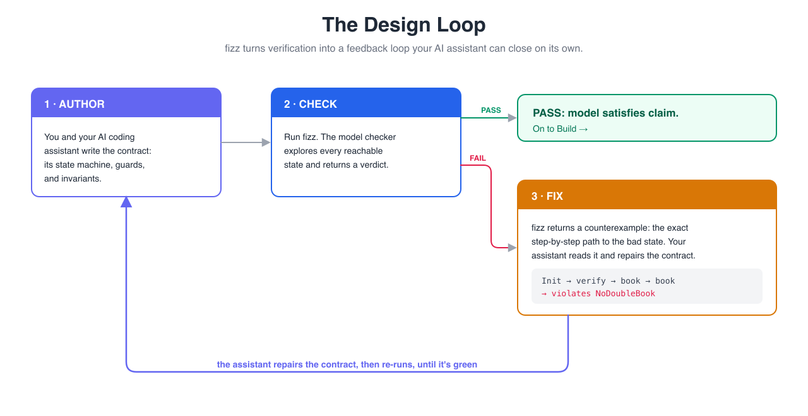
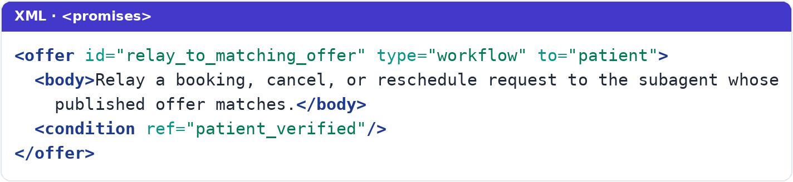
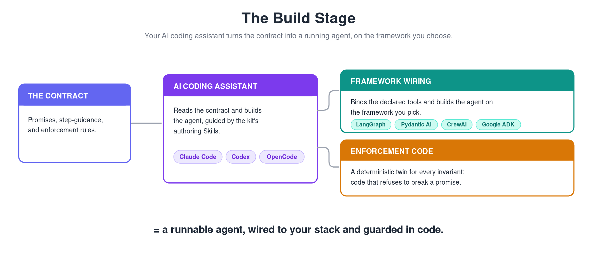
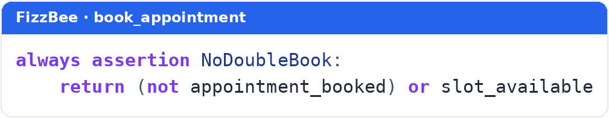
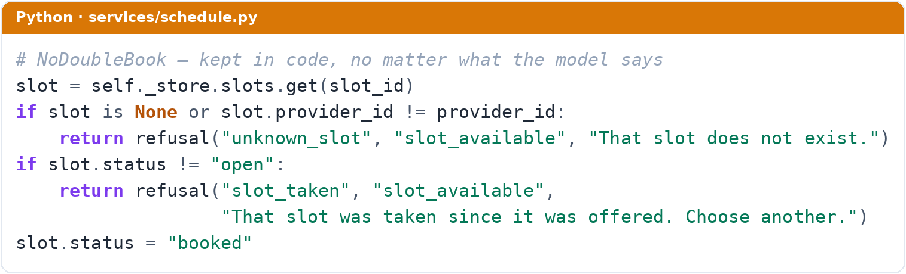
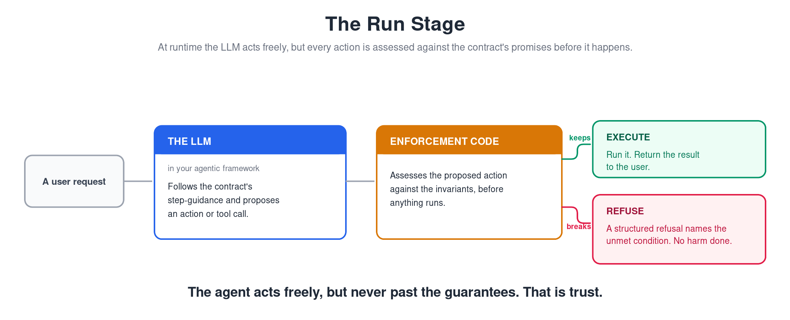

# Everybody Wants to Rule the World

### How to build an agent with model-checked safety claims and independently controlled runtime boundaries.

*By Jeremy Schulman · Part 2 of 3*

---
**TL;DR:** if you just want to look at a GitHub repo: https://github.com/jeremyschulman/promise-driven-agentic-kit.

Does this sound like you?

> *As a software engineer evolving our business-process automation into the era of AI, I need to build systems where many AI agents work together to carry out complex, multi-step workflows, reliably enough to run the business on.*

It's a grand ambition — and it runs straight into the wall this whole series is about: you can't *rule* an autonomous agent any more than you can rule the world. You don't command it. You strike a deal, put it in writing, and hold it to the terms.

This is the second of three pieces. The first, [Promises, Promises — Why Do I Believe?](medium-part-1-why-do-i-believe.md), argued the *why*: you cannot command an LLM, you can only elicit a promise and then *assess* it. *Trust, but verify.* This piece shows you the *how*.

This approach is for engineers building **complex, multi-agent workflows** — systems where many AI agents cooperate to carry a real business process end to end. If you're shipping a single-turn chatbot, it's overkill; for the autonomous BPA I build, where reliability is the whole game, it's essential. We'll learn the method on a *single* agent first, because that's the clearest way to see the machinery work — then wire many of them into one system in the finale, Part 3.

What follows is built around a kit you build *with*, not one you run — and emphatically not *yet another agentic framework* (YAAF). It ships runnable examples you can poke at, and you use it to author agents either the artisanal way or with your favorite coding assistant. The one I'll keep coming back to is **The Clinic**: an appointment agent whose specified model makes booking before verification and double-booking unreachable, and whose authority services independently refuse those operations at runtime. The claim is bounded, inspectable, and stronger than asking a prompt nicely.

## The Road to Hell (Is Paved With Good Intentions)

Here's the move that made everything click. Instead of a prose prompt, an agent's *entire* instruction set becomes a single document. Let's say we call it a **contract** — I'm terrible at naming things, but it fits for now. Not *intent*, tempting as that word is where I come from: you don't impose intent on an autonomous agent, you strike a deal and hold it to the terms. You author it once, then carry that same document through every stage of building the system: Design, Build, and Run.

One document, three stages, same bytes. That last part matters more than it sounds, and I'll come back to it. Three isn't a magic number, either — it's just where I've taken this so far. Anything downstream that drifts from your code today could read the same contract instead: a generated design doc, an integration test plan, an onboarding guide. I haven't built those yet, but the single source is what makes them possible. The rest of this piece walks the three stages I *have* built, one at a time.

## True Colors

You're probably not starting a design from a blank page. Engineers borrowed a word for this from construction: it's a *brownfield* — an existing, load-bearing, slightly contaminated thing — not a *greenfield* you build clean. Sometimes that brownfield is software: a tangle of Zapier zaps, a Workato recipe, some bespoke automation patched for years that everyone's afraid to touch. More often, though, it isn't software at all — it's a process a person runs by hand, following a runbook that lives in a wiki page or a senior employee's head. Either way, there's already a *design* buried in there — you've just never drawn it out. And you almost certainly don't think of that design as a *state machine.* Almost no one does.

You don't have to think in one, though. That design — which manifests as the workflow you run today — already *is* a state machine, whether anyone ever drew it: it has states, transitions between them, and states it must never enter. The machine is latent in the process; someone just has to capture it. That's the real nature of this work: it's brownfield modernization. The AI era doesn't get to start over, it inherits the process that already runs the business — and this method is how you re-express that process, faithfully, as something you can prove.

And that someone doesn't need to be you, at least not by hand. Capturing the design can work like hiring a lawyer: you don't arrive knowing the statutes or how to word the clauses; you describe what you need, you go back and forth, and the lawyer turns the conversation into a contract that holds up. Here, it's the same shape. You express the workflow's intent to an AI coding assistant, refine it through Q&A, and the assistant, which knows the contract's schema, drafts the whole thing, the FizzBee state machine included. Your job is to know the workflow. The assistant's job is to render it as a contract. FizzBee's job is to capture its essence precisely, in a form a machine can check.

So let's look at what the assistant drafts. Take the orchestrator — **The Clinic**'s front desk. On its own it's a ten-action state machine; here it is in full:

We'll zoom in on just one of those ten actions and the single invariant it protects. Here, verbatim, is that slice, written in [FizzBee](https://fizzbee.io), a formal-methods language in the TLA+ family with an approachable, Python-ish syntax. (The Clinic is one of the kit's two runnable examples, a shareable stand-in for the production systems I can't show.)

You don't need to know FizzBee to read that. In plain English:

- An **action** is something the agent can do. The **require** lines are *guards*, the preconditions. `VerifyPatient` can only run when the patient isn't yet verified and no workflow is active.
- `oneof [True, False]` says the outcome is uncertain: verification might succeed or fail.
- An **always assertion** is an *invariant*, something that must be true in **every** reachable state. `PatientVerifiedBeforeWorkflow` says: either no workflow is running, or the patient is verified. There is no legal state where a workflow runs on an unverified patient. Full stop.

Now the payoff. A **model checker** takes that machine and explores *every reachable combination of states* the actions can produce, and confirms no invariant is ever broken. I run it offline, in CI, before anything ships:

This is the question a prose prompt can never answer: *can the specified design reach a
bad state?* The failures that actually hurt an agent are not bad answers, they are bad
*states*: booked before verified, double-booked, access granted without authorization.
And you cannot test your way to *every modeled path*. A model checker walks every
reachable state in the specified model and either proves the forbidden ones unreachable
under its assumptions or hands you the exact steps that reach one. It is the adversarial
read every contract needs. So the answer becomes **"not in this model, and here is the
exhaustive state-space result,"** at design time. Structure alone makes an agent
*neater*; a model check makes selected design claims provable within their declared
boundary.

And this is not a toy that only passes because I wrote it to pass. My second example is the Trials of the Holy Grail (yes, the Monty Python one, knights and the Bridge of Death and the Knights Who Say "Ni!") with a Quest Marshal that should grant the Grail quest only after *both* trials are passed. **Its first draft failed model-checking.** The checker found a sequence I never would have: a knight could re-attempt a trial he'd already passed, fail it *after* the Grail was granted, and blow the invariant. The tool handed me the exact step-by-step trace to the bad state. The fix, making a passed trial "sticky," took two minutes. That's a real bug, caught by exhaustive search, before any human or any model ever touched the agent. Prose could never have caught it.

And here is the part that quietly changes your day. That counterexample is not a stack trace you squint at; it is machine-readable feedback. Point your AI coding assistant at a failing `fizz` run and it reads the trace, repairs the contract, and re-runs, closing the loop on its own until the design is green. Verification stops being a chore and becomes a tight author-check-fix cycle. It is the lawyer again, mid-draft: the model checker flags the exact clause that would fail, and your assistant redlines the contract and refiles, until it holds.

**Where to draw the line.** I am *not* telling you to formalize your whole agent. That way lies madness. The most useful rule I found is about where the formal part stops:

> **Formalize structure and ordering. Leave judgment and phrasing to prose.**

"Verify before you book," "never double-book," "at most one task suspended at a time" are structural. They are about ordering and safety, and they belong in the model-checked state machine, because prose lets them drift.

But "is this message a greeting or a booking request?" is not a formal property and never will be. Neither is "how do I phrase this hand-off warmly?" That is judgment. It stays in prose, in a section of the contract I call step-guidance, right beside the formal parts but clearly quarantined from them.

Don't try to formalize the fuzzy stuff; you'll fail and hate your life. Don't leave the structural stuff to prose; it'll drift and hurt you. Getting that line right is most of the skill.

So how do the FizzBee half and the Promise Theory half actually fit together? One clarification first, because the names are misleading: FizzBee is an actual tool you run, but Promise Theory is not a library you install or a framework you import. It's a way of thinking about who promises what to whom (Mark Burgess's work; the *why* is in Part 1). In this method it manifests concretely in the contract's `<promises>` section. The state model and promise graph are coordinated representations of one safety intent, not the same formal claim. Follow one identifier, `patient_verified`, from Design through Run.

**In Design, the model checker reads it as a proof.** The invariant `PatientVerifiedBeforeWorkflow` says no workflow may run for an unverified patient, and the checker proves that holds in every reachable state.

**In Build, the builder reads it as a proposed promise.** In the contract's
`<promises>` section, the related safety claim appears as a declared offer, carrying a
condition with the *same token*:

That `patient_verified` is not a naming coincidence. It is literally the variable the model checker just reasoned about. This is the hinge of the whole design. Promise Theory does not compete with the state machine; it *names* what the invariant means, a promise made to a promisee, in a vocabulary that other agents can declare they depend on.

**At Run, the LLM reads it as an instruction.** The same safety intent appears once
more in the prose it is asked to follow: never start a workflow before the patient is
verified.

One safety intent, one vocabulary, carried through every stage. That is the answer to
the question I get most often: FizzBee and Promise Theory are not two systems you keep
in sync. They are coordinated readings of one contract, tied by a shared name, with
FizzBee checking the specified state model and Promise Theory supplying the meaning
that lets agents compose. That shared document is the whole point.

Now, "same bytes." In the usual setup (a state machine coded in one place, a prompt written in another) the machine and the instructions are *two different artifacts that drift.* You fix one, forget the other, and find out in production. Here, the state machine the checker proves and the instructions the model reads are **the same document.** They can't drift, because there's nothing to drift from.

That property isn't new, and it isn't really mine. A single declarative source of truth, with everything else derived from it, is the discipline behind intent-based networking, which I came up through years ago (that story is in the first piece). Here the source is a contract rather than a network design, but the rule is identical: change the one source, and everything downstream follows. Nothing drifts.

## You Spin Me Round (Like a Record)

Design handed you a model-checked contract. Build turns it into a running agent.

Point your assistant at that model-checked contract and it gets to work — and not just on the agent. It writes the framework wiring, the enforcement code, *and* the `pytest` suite that exercises them, then runs the tests, reads what failed, fixes the code, and runs them again, round and round until the whole suite is green. It's the deterministic cousin of the Design loop: there, the assistant spun on the model checker's counterexamples; here, it spins on failing tests. Same motion, one layer down — author, run, repair, repeat.

But here's the catch that separates a real contract from theater.

**Model-checking proves the specification, and passing tests prove the code does what you wrote. Neither proves the LLM follows it.**

The proof certifies that the *state machine* can't reach a bad state. It says nothing about whether your stochastic model actually stays on the legal path. The model can still misread eligibility, skip a guard, or fabricate an argument. If you model-check your contract, ship it as a prompt, and stop there, you've bought false confidence, which is worse than none.

This is where a contract needs *teeth.* A legal contract nobody will enforce is just a wish; what gives it force isn't the signatures on the page, it's knowing a court will hold you to them. A model-checked agent contract with nothing behind it is no different. Promise Theory says it in one line: *a promise from an unreliable promiser is worthless to you without independent assessment.* So every safety invariant gets a twin, the code that plays the court. Take the no-double-book rule:

That invariant is represented as the LLM's proposed promise: "I'll never propose a
booking for a taken slot." The scheduling service then assesses the proposed commit
against authoritative state and keeps its own promise never to commit a slot that is
not open:

The model can promise all day; this code decides whether the proposal may change the
service's state and returns a structured refusal when it may not. An unsafe proposal
can mean the LLM promise was not kept while the service's safety promise was kept.
(That `refusal(...)` is the same first-class "no" that surfaces at Run, below.)

This stochastic-promise-plus-authority-boundary pair is, to me, the atomic unit of the
whole method. **Never rely on a stochastic promise without an independently controlled
boundary promise.** The model check proves the specified map is coherent; the service
controls its own territory. You need both, and the code half is not optional.

## The Safety Dance

Now the agent is live, and the runtime posture is the opposite of hope. A request comes
in; the LLM reads the contract's prose and proposes an action, a tool call, or a
hand-off. Before consequential state changes, the authority code assesses that proposal
against current facts. Meet the boundary's conditions, and it runs. Fail them, and the
boundary keeps its own safety promise by refusing.

That refusal is not an error to swallow. It is a first-class outcome: a structured result naming the condition that failed ("slot no longer available," "patient not verified"), which the agent relays to the user or recovers from. Autonomy includes the right to say no, and a clean no beats a confident, wrong yes.

So the LLM stays free to *propose* anything, and being stochastic, sometimes it will. It can never *do* the wrong thing, because the deterministic layer beneath it will not pass a broken promise. This is the lawyer's contract in force: drafted and proven in Design, given teeth in Build, and now, at Run, any move that would breach it simply does not happen.

## One Thing Leads to Another

Everybody wants to rule the world. With an autonomous agent, you don't get to — and
that's the point. You do not rule the model; you prove selected properties of its
specified design and bound consequential effects at the state you control. That is one
agentic boundary made inspectable from Design through Run.

But a single agent is rarely the whole system. Look back at that state machine: the moment the orchestrator reaches `RouteToWorkflow`, it hands off to a *subagent* — a booking agent, or one that cancels and reschedules — and each of those is its own contract, with its own state machine and its own invariants, exactly like the one we just built. The Clinic is really a *society* of agents behind one friendly face. Getting many of them to cooperate without lying to each other is where most designs quietly fall apart, and where the promise graph finally earns its keep. That is the finale: [Games Without Frontiers — How to Check a System's Declared Promise Graph](medium-part-3-games-without-frontiers.md).

---

*With thanks to Mark Burgess, whose Promise Theory underpins the contract's promises, and to the [FizzBee](https://fizzbee.io) project, whose model checker turns a design into a proof.*

---

*Liner notes: this piece takes its name from "Everybody Wants to Rule the World" (Tears for Fears, 1985), and its section titles nod to "The Road to Hell" (Chris Rea, 1989), "True Colors" (Cyndi Lauper, 1986), "You Spin Me Round (Like a Record)" (Dead or Alive, 1985), "The Safety Dance" (Men Without Hats, 1982), and "One Thing Leads to Another" (The Fixx, 1983). Each part of this series is named for an 80s song — a small mixtape playing under the trilogy.*
