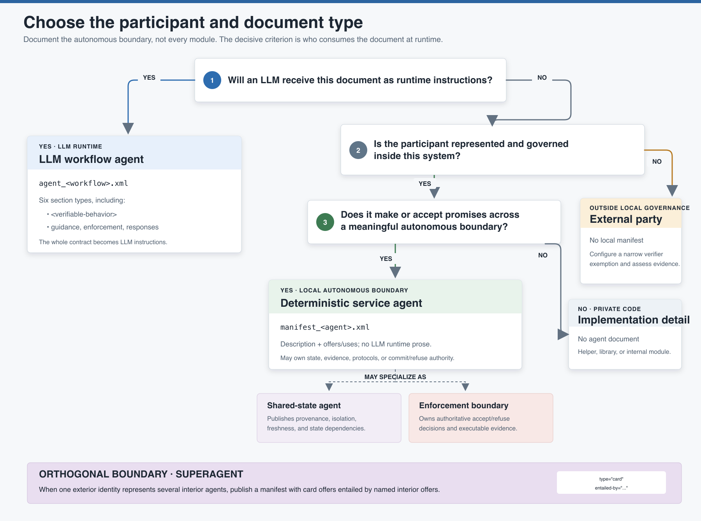

# Choosing a Participant and Document Type

In this methodology, **agent** does not mean “LLM.” An agent is an autonomous boundary
that makes or accepts promises. Some agents interpret natural language; others own
state, enforce a decision, expose a protocol, or represent a society of agents to the
outside world.

The document type follows the participant's runtime role, not its implementation
language or marketing label.

For precise definitions of agent, autonomy, external party, enforcement boundary, and
superagent, see the [Glossary and Naming Conventions](../glossary/README.md).

[](participant-decision-tree.svg)

## The decisive questions

Ask these in order:

1. **Will an LLM receive this document as runtime instructions?**
   - Yes: use an LLM agent contract, `agent_<workflow>.xml`.
   - No: continue.
2. **Is the participant represented and governed inside this system?**
   - No: model it as an explicitly configured external party.
   - Yes: continue.
3. **Does it make or accept promises across a meaningful autonomous boundary?**
   - Yes: use a deterministic agent manifest, `manifest_<agent>.xml`.
   - No: keep it as an implementation detail; it does not need a graph document.
4. **Does one exterior identity represent several interior agents?**
   - Add an orthogonal superagent boundary whose exterior offers are entailed by
     interior offers.

Shared-state and enforcement agents are specializations of deterministic participants,
not additional document families.

## Decision summary

| Role | Representation | Embedded FizzBee | Runtime LLM instructions | Promise graph participant |
| --- | --- | ---: | ---: | ---: |
| LLM workflow agent | `agent_<workflow>.xml` | Yes | Whole document | Yes |
| Deterministic service agent | `manifest_<agent>.xml` | No | No | Yes |
| Shared-state agent | `manifest_<agent>.xml` | No | No | Yes |
| Enforcement boundary | Usually `manifest_<agent>.xml` | No | No | Yes |
| External party | Verifier configuration and references from local documents | No local document | No | Referenced, but exempt from local offer matching where configured |
| Superagent exterior | Usually `manifest_<agent>.xml` with `type="card"` offers | No | No | Yes, with interior entailment references |
| Internal helper or library | No agent document | No | No | No |

## LLM workflow agent

Use `agent_<workflow>.xml` when an LLM receives the document as its operating
instructions and is expected to interpret intent, select among actions, or conduct a
multi-step workflow.

It has all six section types:

```xml
<agent-instructions workflow="workflow_name" version="1.0">
  <objective>...</objective>
  <verifiable-behavior>...</verifiable-behavior>
  <promises>...</promises>
  <step-guidance action="ActionName">...</step-guidance>
  <enforcement>...</enforcement>
  <responses>...</responses>
</agent-instructions>
```

The presence of Python tools does not make the Python service part of the LLM agent.
The LLM proposes and communicates; deterministic boundaries assess consequential
operations independently.

Choose this document because the LLM needs the whole contract at runtime, not merely
because the component calls a model somewhere internally. A deterministic service that
uses a model for OCR or classification may still be represented as a manifest if no LLM
is interpreting the agent contract as instructions.

## Deterministic service agent

Use `manifest_<agent>.xml` when a locally governed service, protocol boundary, or
deterministic process publishes or accepts promises but does not consume an LLM
instruction document.

```xml
<agent-manifest agent="authority_service" version="1.0">
  <description>Owns authoritative state and the commit decision.</description>
  <promises>
    <offer id="commit_operation" type="workflow" to="workflow_agent">
      <body>Commit only when current authoritative conditions hold.</body>
    </offer>
  </promises>
</agent-manifest>
```

A manifest has no `<verifiable-behavior>`, `<step-guidance>`, `<enforcement>`, or
`<responses>` section. That does not mean the service needs no tests, state model, or
formal verification. It means the kit does not feed an embedded behavior model and
runtime prose to an LLM for this participant.

Typical deterministic participants include:

- Domain services
- Databases or repositories exposed through a governed boundary
- Identity and authorization providers
- Protocol adapters
- OCR or extraction services with explicit reliability limits
- Artifact stores
- Schedulers and transaction boundaries

## Shared-state agent

Use a deterministic manifest when state is shared across autonomous consumers and its
provenance or isolation matters. This turns an implicit blackboard into a participant
that publishes state under named promises.

```xml
<offer id="active_subject" type="session-state"
       to="workflow_a workflow_b">
  <body>The verified subject record for this isolated session.</body>
  <condition ref="subject_verified" assessed="self"/>
</offer>
```

Consumers declare matching uses instead of silently reading a global dictionary:

```xml
<use id="active_subject" from="subject_registry"
     quenches="subject_verified">
  <body>Use the registry's verified subject for this workflow.</body>
</use>
```

Promote state to an agent when doing so reveals a dependency, authority, isolation
boundary, freshness promise, or ownership decision that would otherwise remain hidden.
Do not create a manifest for every local variable or private cache.

## Enforcement boundary

An enforcement boundary is the deterministic participant that owns the final accept or
refuse decision for a consequential operation. It often overlaps with a domain service
or shared-state agent.

For example, a scheduling service may simultaneously:

- Publish open slots.
- Own appointment state.
- Offer a commit capability.
- Refuse a slot that is no longer available.
- Produce the authoritative receipt or structured refusal.

The LLM agent may be attributed a promise to follow a `NoDoubleBook` proposal path.
The enforcement boundary separately promises not to commit a taken slot, assesses the
proposal, and rejects an unsafe commit. Keeping the boundary as a named deterministic
participant makes its authority visible in the promise graph and its own duty testable
independently of the model.

Do not add a separate manifest merely because the phrase “enforcement boundary” appears
in the architecture. When an existing service already owns the authoritative decision,
describe that role in the service's manifest.

## External party

Use an external-party designation when a human, outside API, independently deployed
service, or other participant is outside the local manifest set.

Local contracts may still name it in `to` or `from`:

```xml
<use id="confirmation" from="requester"
     quenches="action_confirmed">
  <body>The requester confirms the exact consequential action.</body>
</use>
```

The example verifiers maintain a narrow `EXTERNAL_PARTIES` set. A use from one of those
names is exempt from local offer matching because no local manifest is expected.

External is a governance statement, not a shortcut for a missing manifest. For each
external party, document:

- Why it is outside local governance
- What evidence is accepted from it
- How failures and timeouts are assessed
- Which conditions it may quench
- Whether an adapter or local boundary should represent it instead

If the system wraps an external API with a locally governed adapter that makes its own
promises, the adapter should usually have a deterministic manifest even though the
upstream API remains external.

## Superagent boundary

A superagent is an exterior identity chosen around a society of interior agents. It is
orthogonal to the LLM-versus-deterministic distinction: the members may include both.

Use a superagent manifest when callers should see one published capability surface:

```xml
<agent-manifest agent="system_superagent" version="1.0">
  <description>One exterior identity backed by several interior agents.</description>
  <promises>
    <offer id="system_card" type="card" to="requester"
           entailed-by="safe_action no_unsafe_commit">
      <body>Perform the requested action only when its evidence is valid.</body>
    </offer>
  </promises>
</agent-manifest>
```

`entailed-by` names interior offers that justify the exterior claim. The Trials example
checks that each referenced offer exists. That is reference completeness; human review
still determines whether the interior promises semantically justify the card wording.

A superagent boundary does not make the interior agents subordinate. It chooses the
scope at which an external promise is assessed.

## Implementation detail: no document

Not every class, function, worker, or module deserves an agent identity. Keep something
as an implementation detail when it:

- Has no autonomous lifecycle or governance boundary.
- Makes no promise that another participant relies on directly.
- Owns no authoritative state or decision.
- Is replaceable without changing the promise graph.
- Exists only to organize code inside one participant.

Over-modeling creates graph noise and false boundaries. The purpose of a manifest is to
expose meaningful cooperation, not to reproduce the module tree in XML.

## Roles may overlap

The categories describe responsibilities, not mutually exclusive classes:

- A deterministic scheduling service can also be a shared-state agent and enforcement
  boundary.
- An LLM agent plus its deterministic enforcement service can be viewed as a two-member
  superagent for one safety promise.
- A locally governed adapter can be a deterministic agent while the upstream service it
  wraps remains external.
- A superagent exterior is a boundary over interior participants, not another runtime
  that necessarily executes work.

Choose one document per actual participant boundary, then describe all roles that
participant keeps.

## Repository examples

| Participant | Classification | Why |
| --- | --- | --- |
| `clinic_orchestrator` | LLM workflow agent | Interprets patient intent and receives the six-section contract as instructions. |
| `book_appointment` | LLM workflow agent | Conducts a stochastic multi-step booking conversation. |
| `patient_registry` | Shared-state deterministic agent | Publishes verified identity and isolated session state to several consumers. |
| `provider_schedule` | Deterministic service + state + enforcement boundary | Owns the calendar and refuses unsafe commits such as double booking. |
| `insurance_eligibility` | Deterministic service agent | Publishes a point-in-time verdict with explicit limits. |
| `patient` | External party | Human participant with no local manifest. |
| `grail_superagent` | Superagent exterior | Publishes card offers entailed by interior Trials offers. |

These examples demonstrate why framework wiring is not the classification criterion.
Google ADK and Pydantic AI host the LLM participants, while the same document roles
remain meaningful outside either framework.

## Anti-patterns

| Anti-pattern | Why it fails | Better representation |
| --- | --- | --- |
| Every component is called an LLM agent | Stochastic judgment and deterministic authority become indistinguishable. | Separate LLM contracts from deterministic manifests. |
| Shared dictionary silently read by subagents | Dependency, provenance, and isolation are invisible. | Shared-state agent with explicit offers and uses. |
| Orchestrator “owns” or commands subagents | It promises behavior only another autonomous agent can keep. | Orchestrator uses the subagent's published conditional offer and relays refusal. |
| External API treated as guaranteed | Availability and truth are assumed rather than assessed. | Explicit external party or governed adapter with refusal behavior. |
| Enforcement hidden in framework wiring | The authoritative decision and its tests are hard to locate. | Named deterministic service or boundary with published duties. |
| Manifest for every helper function | The graph mirrors code structure instead of autonomous cooperation. | Leave private implementation inside its owning participant. |
| Superagent card written independently of members | Exterior promises can overstate interior capabilities. | Entail card offers from named interior offers. |

## When classification changes

Reclassifying a participant is an architectural migration:

- **Implementation detail → deterministic agent:** add a manifest, offers/uses, graph
  verification, and integration evidence.
- **External party → governed adapter:** retain the upstream external assumption while
  giving the local adapter its own manifest and assessed promise.
- **Deterministic agent → LLM agent:** add the six-section contract, behavior model,
  guidance, enforcement traceability, responses, tool construction, and model-check
  gate.
- **LLM agent → deterministic service:** remove stochastic instruction concerns, but
  preserve or restate its externally relied-upon offers and enforcement evidence.
- **Interior society → superagent:** derive exterior offers from existing interior
  promises and add entailment review.

Use [Evolving an Agent Contract](../contract-evolution/README.md) to trace identifiers,
compatibility, peer consumers, and version decisions during the migration.

## Decision checklist

- Does an LLM receive this document as runtime instructions?
- Is the participant locally governed or explicitly external?
- Does another participant rely on a promise it makes or accepts?
- Does it own authoritative state, evidence, or a commit/refuse decision?
- Would modeling it expose a hidden dependency or merely duplicate code structure?
- If it is external, is the exemption narrow and documented?
- If it represents shared state, are provenance and isolation named?
- If it enforces an invariant, is that duty published and tested?
- If it is a superagent, are exterior claims entailed by interior offers?
- Are overlapping roles described in one participant rather than fragmented into
  fictional agents?

For authoring the chosen document, continue with
[Authoring an Agent Contract](../authoring-workflow/README.md). For composing its offers
and uses, see [Composing Promises](../promise-graph/README.md).

## Image sources

- [`participant-decision-tree.svg`](participant-decision-tree.svg) is the editable
  source.
- [`participant-decision-tree.png`](participant-decision-tree.png) is the rendered copy
  for Markdown, articles, and presentations.
