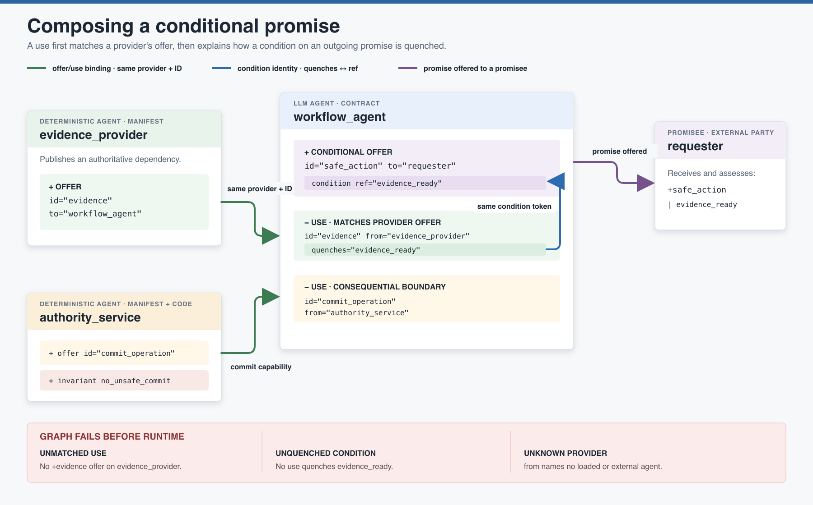
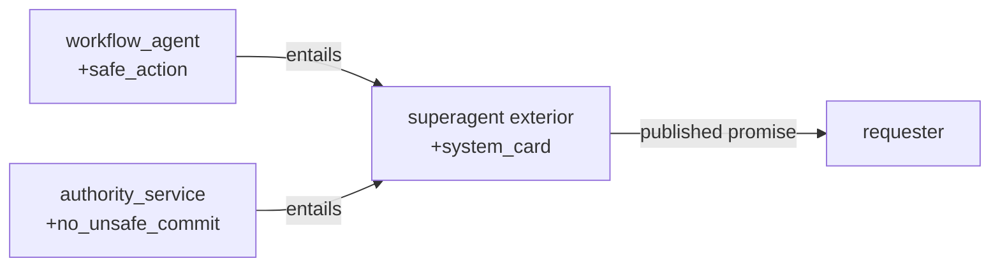

# Composing Promises

An individual agent contract describes what one agent intends to do. A **promise
graph** asks the system-level question:

> Does every declared dependency meet a promise from the agent named as its provider,
> and does every conditional promise say how its condition is satisfied?

The graph spans both document families. LLM agents contribute the `<promises>` section
of `agent_*.xml`; deterministic services and boundaries contribute the `<promises>`
section of `manifest_*.xml`. Their offers and uses form one checked cooperation graph.

The [Glossary and Naming Conventions](../glossary/README.md) distinguishes offer/use
identities from condition tokens and defines the Promise Theory terms used here.

[](promise-graph-anatomy.svg)

## Four roles in the figure

For the decision process behind these roles, see
[Choosing a Participant and Document Type](../participant-types/README.md).

| Participant | Kind | Responsibility |
| --- | --- | --- |
| `workflow_agent` | LLM agent | Offers a conditional capability and declares what it will use from other agents. |
| `evidence_provider` | Deterministic agent | Offers the evidence needed to satisfy the workflow condition. |
| `authority_service` | Deterministic boundary | Offers the consequential commit operation and enforces its guard in code. |
| `requester` | Promisee or external party | Receives and assesses the workflow agent's conditional promise. |

The orchestrator is not an owner in this model. It may select and use another agent's
published offer, but it cannot promise that the other agent will cooperate. Refusal
remains a valid local outcome.

## Relationship 1: an offer meets a use

A provider publishes an offer:

```xml
<agent-manifest agent="evidence_provider" version="1.0">
  <description>Publishes authoritative evidence.</description>
  <promises>
    <offer id="evidence" type="session-state" to="workflow_agent">
      <body>Provide the evidence required before an action may commit.</body>
    </offer>
  </promises>
</agent-manifest>
```

The consumer declares its acceptance of that exact offer:

```xml
<use id="evidence" from="evidence_provider" quenches="evidence_ready">
  <body>Use the provider's evidence to satisfy the action precondition.</body>
</use>
```

Binding completeness is a two-part lookup:

```text
use.from = evidence_provider
use.id   = evidence

must resolve to

evidence_provider / offer.id = evidence
```

Matching an ID on the wrong provider is not sufficient. The `(from, id)` pair names
the edge.

## Relationship 2: a use quenches a condition

The workflow agent's outgoing promise is conditional:

```xml
<offer id="safe_action" type="workflow" to="requester">
  <body>Commit the requested action only after authoritative evidence is ready.</body>
  <condition ref="evidence_ready"/>
</offer>
```

The `quenches="evidence_ready"` token on the use explains how the condition is
satisfied. This is a separate relationship from offer/use binding:

- `evidence` identifies the provider capability being used.
- `evidence_ready` identifies the fact required by the conditional promise.

Keeping those namespaces distinct lets one provider offer quench one or more conditions
without pretending the capability and the resulting state predicate are the same thing.

## Relationship 3: the conditional promise reaches its promisee

The `to="requester"` attribute names who receives the `safe_action` promise. It does
not mean the requester can command the workflow agent. It means the requester may rely
on and assess the offer under its stated condition.

Conceptually, the composition is:

```text
evidence_provider: +evidence -> workflow_agent
workflow_agent:    -evidence, which quenches evidence_ready
workflow_agent:    +safe_action | evidence_ready -> requester
```

The graph preserves who provides the dependency, who promises to use it, what condition
it satisfies, and who assesses the resulting capability.

## Deterministic boundaries belong in the graph

A service that performs the consequential operation is not merely an implementation
detail. It is a deterministic participant that can publish what it offers:

```xml
<agent-manifest agent="authority_service" version="1.0">
  <description>Owns authoritative state and the commit decision.</description>
  <promises>
    <offer id="commit_operation" type="workflow" to="workflow_agent">
      <body>Commit only when the current authoritative precondition holds.</body>
    </offer>
    <offer id="no_unsafe_commit" type="invariant" to="requester compliance">
      <body>Refuse a commit whose required evidence is absent.</body>
    </offer>
  </promises>
</agent-manifest>
```

The workflow agent then declares `<use id="commit_operation"
from="authority_service">`. This makes the runtime boundary visible in the system
architecture while preserving the distinction between graph coherence and code
enforcement: the graph checks that the service promised the capability; tests and
runtime assessment check whether its implementation keeps that promise.

## Self-assessed conditions and external parties

Not every condition needs another agent.

```xml
<condition ref="request_understood" assessed="self"/>
```

`assessed="self"` tells the graph verifier that no quenching use is expected. Reserve
it for a fact the agent genuinely evaluates itself; do not use it to hide a provider
that should be explicit.

Some promisees and providers, such as a human user or an outside service with no local
manifest, may be configured as external parties in `verify_promise_graph.py`. Uses from
those parties are exempt from local offer matching. That exemption is verifier
configuration, not an inference from the XML, and should remain narrow and reviewable.

## Superagent boundaries and entailment

A system may present one exterior agent while containing a society of agents. Exterior
claims should be derived from promises actually offered by interior members.

```xml
<offer id="system_card" type="card" to="requester"
       entailed-by="safe_action no_unsafe_commit">
  <body>Perform the requested action only when its evidence is valid.</body>
</offer>
```



The Trials example extends its verifier so every `entailed-by` token must name an offer
present somewhere in the interior graph. That check establishes reference completeness;
reviewers must still decide whether the named interior promises semantically justify
the exterior wording.

## What the verifier checks

The example verifier builds an offer index keyed by agent and offer ID, then evaluates
the graph in two required passes:

1. **Binding completeness:** every non-external `<use id="x" from="A">` resolves to
   `<offer id="x">` published by agent `A`.
2. **Condition quenching:** every `<condition ref="c">` is either marked
   `assessed="self"` or has a corresponding `c` token in some `<use quenches="...">`.

An implementation may add domain checks such as superagent card entailment. Run the
verifier in Design and CI:

```bash
uv run python scripts/verify_promise_graph.py
```

## Common failures

| Failure | Meaning | Repair |
| --- | --- | --- |
| `uses 'x' from unknown agent 'A'` | `from` names no loaded agent and is not configured as external. | Correct the provider name, add its manifest, or deliberately configure the external boundary. |
| `uses 'x' which 'A' does not offer` | Agent `A` exists, but it publishes no offer with that ID. | Correct the use ID or add the missing provider offer. |
| `condition 'c' is not quenched` | A conditional offer names a fact with no quenching use and no self-assessment. | Add the dependency and `quenches="c"`, or mark a genuinely local assessment as self-assessed. |
| `entailed-by 'x', which no agent offers` | An exterior card cites a missing interior promise. | Correct the reference or add the interior capability before advertising it. |

Do not silence a graph failure by declaring a convenient external party or
`assessed="self"`. Both are architectural claims and deserve the same review as an
offer or use.

## What graph coherence does not prove

A green promise graph establishes **declared compositional coherence**. It does not
prove that:

- A provider is available now.
- A provider will keep its offer honestly or successfully.
- A condition was actually true for a particular request.
- A tool name resolves to a Python callable.
- Enforcement code correctly protects authoritative state.
- The exterior wording of a superagent card is fully justified by its references.

Those questions belong to construction checks, enforcement tests, runtime assessment,
and human review. The promise graph makes dependencies explicit and mechanically
checkable; it does not turn cooperation into command or certainty.

## Authoring and review sequence

1. Inventory every LLM agent, deterministic service, state store, external party, and
   superagent boundary.
2. For each participant, write only the offers it can make on its own behalf.
3. Add a use for every provider capability another participant accepts and relies on.
4. Match each use by both provider name and offer ID.
5. Give every conditional offer a stable condition token.
6. Quench each token with an explicit use or mark a genuinely local self-assessment.
7. Derive exterior promises from interior offer IDs where a superagent boundary exists.
8. Run the promise-graph verifier and review every exemption.

For the single-agent contract that contributes these promises, see
[Authoring an Agent Contract](../authoring-workflow/README.md). For the broader limits
of this gate, see [Five Questions, Five Kinds of Evidence](../assurance-model/README.md).
For provider replacements, offer renames, and other graph migrations, see
[Evolving an Agent Contract](../contract-evolution/README.md).

## Image sources

- [`promise-graph-anatomy.svg`](promise-graph-anatomy.svg) is the editable source.
- [`promise-graph-anatomy.png`](promise-graph-anatomy.png) is the rendered copy for
  Markdown, articles, and presentations.
