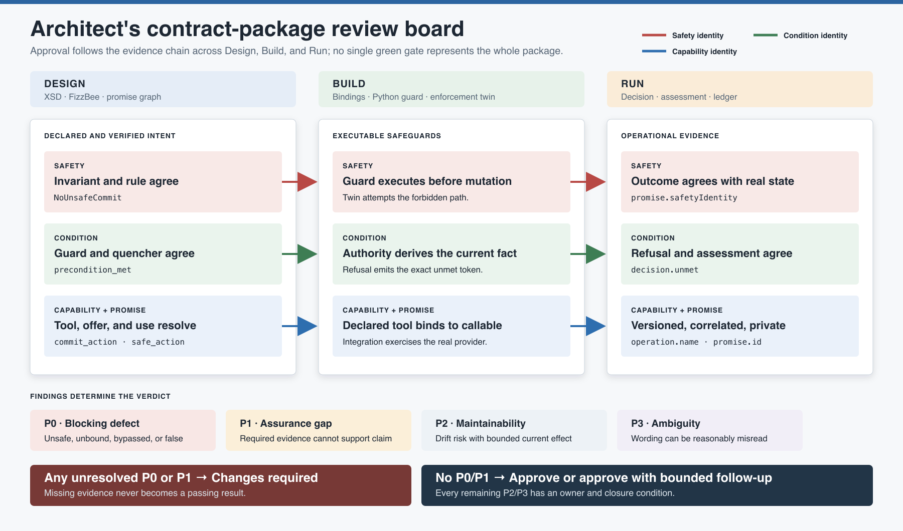

# Reviewing a Contract Package

Authoring asks whether the artifacts can be created. Review asks whether the claims
made by those artifacts are supported by a complete, coherent evidence chain.

A **contract package** is the reviewable unit surrounding one consequential workflow:

- Agent contract and participating manifests
- Embedded FizzBee behavior models
- Promise-graph configuration and verification result
- Tool bindings and deterministic enforcement code
- Enforcement-twin and integration tests
- Runtime receipt, refusal, and assessment-record shapes
- Version, migration, privacy, and operating documentation

Review the package, not an XML file in isolation. A schema-valid contract can still
depend on an absent provider, a safe model can still have unsafe Python, and a passing
test can still assert the wrong outcome.

## The review question

The governing question is:

> For every consequential promise, can a reviewer trace declared intent through
> modeled safety, composition, executable enforcement, adversarial tests, and runtime
> evidence without changing the meaning of its identifiers?

A green tool result is evidence for one layer. Approval is a human judgment that the
layers support the package's actual claims.

## Review outcomes

Use one of four outcomes. Do not average serious defects into a general confidence
score.

| Outcome | Meaning |
| --- | --- |
| **Approved** | No unresolved blocking defects or assurance gaps. Required evidence is present and internally consistent. |
| **Approved with follow-up** | Only bounded maintainability concerns or documentation ambiguities remain, each with an owner and due condition. |
| **Changes required** | At least one blocking defect or assurance gap remains. The package must not be represented as ready. |
| **Unable to assess** | Required artifacts, versions, authoritative evidence, or gate results are missing or inaccessible. Missing evidence is not a passing result. |

## Finding severity

Severity describes the effect on the assurance claim, not the amount of code required
to fix it.

| Severity | Category | Use when | Approval effect |
| --- | --- | --- | --- |
| **P0** | Blocking defect | Unsafe behavior is reachable or executable; a required dependency cannot bind; evidence is materially false; or a consequential boundary can be bypassed. | Changes required |
| **P1** | Assurance gap | A required trace, test, version, runtime outcome, or privacy control is missing or insufficient to support the claim. | Changes required |
| **P2** | Maintainability concern | Current behavior may be correct, but naming, duplication, ownership, or evolution risk makes drift likely. | Follow-up allowed when bounded |
| **P3** | Documentation ambiguity | Wording can reasonably be misread without changing executable behavior or current evidence. | Follow-up allowed when bounded |

When uncertain between two severities, describe the unsupported claim and choose the
lower numeric severity only when the evidence justifies it.

## Prepare the review boundary

Before reading implementation details, record:

- Workflow and consequential operations in scope
- Agent contracts, manifests, and schema versions
- Contract and implementation versions under review
- Promisers, promisees, external parties, and authoritative state owners
- Safety, condition, capability, and promise identities
- Required Design, Build, and Run evidence
- Explicitly excluded behavior and the owner of each exclusion

If the package versions cannot be identified, stop with **Unable to assess**. Reviewing
an unknown mixture of artifacts can produce a precise report about a package that never
exists at runtime.

## The review sequence

Follow the sequence because later evidence depends on earlier meaning. A failing early
gate does not make later inspection useless, but it prevents approval.

### 1. Inventory the package

Confirm that the review includes the expected artifacts and that each generated result
names the source version it evaluated.

| Artifact | Minimum review evidence |
| --- | --- |
| LLM participant | Complete `agent_*.xml` with all six section types |
| Deterministic participant | `manifest_*.xml` when it owns a promise, shared state, or enforcement boundary |
| Structural language | Canonical XSD and successful validation output |
| Behavior model | FizzBee source, checker version, and proof or counterexample result |
| Composition | Promise-graph result and explicit external-party configuration |
| Enforcement | Callable binding and authoritative Python guard |
| Build evidence | Enforcement-twin tests and complete test result |
| Run evidence | Receipt, structured-refusal, failure, and unknown-outcome shapes as applicable |
| Assessment | Promise-specific record tied to contract and implementation version |

### 2. Review Design evidence

#### Structure and document choice

- Is each participant represented by the correct document type?
- Does each LLM contract contain the ordered six-section envelope?
- Are controlled vocabulary, roots, attributes, and versions schema-valid?
- Are implementation details kept inside participant boundaries rather than promoted
  into artificial agents?

#### Modeled behavior

- Does each consequential transition have guards before state mutation?
- Do invariants express forbidden states rather than merely repeat action guards?
- Does initialization explore meaningful success and failure alternatives?
- Are facts omitted from the model acknowledged as assumptions or runtime duties?
- Does the current model-check result correspond to the exact model under review?

#### Promise composition

- Does every non-external use resolve by `(from, id)` to a provider offer?
- Is every condition quenched by the intended use or explicitly self-assessed?
- Are provider authority, freshness, and failure semantics adequate for the condition?
- Do superagent entailment references exist, and do they semantically justify the
  exterior claim?

### 3. Review Build evidence

#### Traceability

Create one row per consequential promise:

| Identity | Model and XML | Python | Test |
| --- | --- | --- | --- |
| Safety | FizzBee invariant and matching `<rule id>` | Guard duty before mutation | Forbidden-path test and unchanged-state assertion |
| Condition | State/guard, `<condition ref>`, `<use quenches>` | Authoritative fact and refusal `unmet` | False-condition case |
| Capability | `<tool name>` and guidance binding | Callable or adapter | Binding and behavior test |
| Promise | Provider `<offer id>` and consumer `<use id>` | Provider operation or evidence source | Integration case where reliance matters |

Do not accept approximate names as traceability. Similar wording is not a stable
identity.

#### Enforcement boundary

- Does the boundary derive relevant facts from authoritative state?
- Are all guards evaluated before irreversible mutation?
- Is the decision atomic enough for the invariant, including concurrency?
- Can the LLM bypass the guard through another callable, direct store access, or
  alternate endpoint?
- Are idempotency and reconciliation defined for uncertain outcomes?

#### Enforcement twin

- Does the test deliberately attempt the forbidden operation?
- Does it assert refusal code, unmet condition, and unchanged protected state?
- Is there also a permitted-path test proving the guard does not block everything?
- Does the test execute the production boundary rather than a duplicate helper?

### 4. Review Run evidence

- Are `committed`, `refused`, `failed`, and `unknown` distinguishable?
- Does a refusal name the unmet condition and prove no forbidden state change?
- Does each assessment record name one assessor, one promiser, and one promise?
- Are operational outcome and promise status represented separately?
- Can evidence resolve to the contract and implementation versions in force?
- Are corrections append-only, and are unknown outcomes reconciled before retry?
- Are raw prompts, secrets, chain-of-thought, and unnecessary personal data excluded?
- Can trust affect reliance without bypassing guards or authorization?

### 5. Test the package's claims

Read outward-facing and explanatory language after the technical trace. Challenge
claims such as “safe,” “verified,” “guaranteed,” or “always”:

- Which exact evidence layer supports the word?
- What boundary and modeled state space limit the claim?
- Does an external card promise more than interior agents offer?
- Is a model-check result being presented as proof of Python or LLM behavior?
- Is a passing test being presented as universal runtime correctness?

Documentation ambiguity becomes a higher-severity finding when it materially
misrepresents assurance to a deployer, reviewer, regulator, or user.

## Automation and human judgment

Automate deterministic questions:

- XML validation
- FizzBee model checking
- Offer/use and condition-quenching verification
- Test execution
- Exact identifier searches
- JSON Schema validation for assessment records
- Broken-link and stale-asset checks

Keep semantic questions in review:

- Is the model complete enough for the claimed risk?
- Does a provider's promise actually justify relying on it?
- Does exterior wording follow from interior promises?
- Is the enforcement boundary authoritative and concurrency-safe?
- Is the evidence proportionate, privacy-preserving, and operationally useful?

Automation can prove reference completeness. It cannot decide whether the references
mean enough.

## Write actionable findings

Every finding should contain:

1. **Severity and title** stating the unsupported assurance claim.
2. **Evidence location** naming the artifact and exact identity.
3. **Observed behavior** describing what the package currently permits or omits.
4. **Consequence** explaining why the promise or evidence chain is unreliable.
5. **Required change** stating the outcome needed without prescribing unnecessary
   implementation detail.
6. **Verification** identifying the gate or exercise that will demonstrate closure.

Lead with findings, ordered P0 through P3. Put package summaries and positive notes
after defects so they do not obscure the decision.

Use the [review-report template](review-report-template.md) for a real package. The
[worked review exercise](worked-review.md) demonstrates the process on a deliberately
flawed generic package.

## Approval checklist

- [ ] Review scope and artifact versions are explicit.
- [ ] Every required artifact is present.
- [ ] Schema, model, graph, and test gates correspond to the reviewed versions.
- [ ] Every consequential promise has a complete identity trace.
- [ ] Python reassesses authoritative state before mutation.
- [ ] Forbidden and permitted paths are tested.
- [ ] Runtime outcomes and promise assessments remain distinct.
- [ ] Unknown outcomes, idempotency, and reconciliation are addressed.
- [ ] Privacy classification and redaction are applied before persistence.
- [ ] External claims are no stronger than the evidence chain.
- [ ] No P0 or P1 finding remains unresolved.
- [ ] P2 and P3 follow-ups have owners and closure conditions.

For the evidence claims behind this review, see
[Five Questions, Five Kinds of Evidence](../assurance-model/README.md). For package
changes, see [Evolving an Agent Contract](../contract-evolution/README.md). For runtime
records, see [Runtime Assessment and Evidence](../runtime-assessment/README.md).

## Image sources

- [`architect-review-board.svg`](architect-review-board.svg) is the editable source.
- [`architect-review-board.png`](architect-review-board.png) is the rendered copy for
  Markdown, articles, and presentations.
