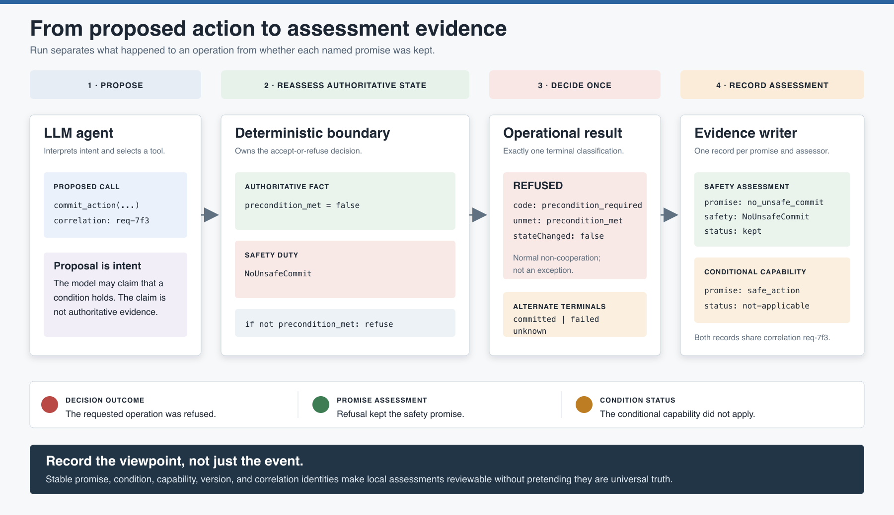

# Runtime Assessment and Evidence

Design establishes what an agent intends to do. Build creates and tests the
deterministic safeguards. Run must still answer the immediate question:

> May this consequential operation proceed against authoritative state now, and what
> evidence will let another party understand that decision later?

This guide defines a general assessment-record pattern for that Run-stage boundary. It
is intentionally independent of observability vendor, database, agent framework, and
application domain.

[](runtime-assessment-flow.svg)

## The assessment boundary

The LLM may interpret intent, choose a tool, and propose arguments. None of those acts
establish that a consequential operation is currently safe. The deterministic boundary
must:

1. Resolve the operation and its stable identities.
2. Read the facts it owns from authoritative state.
3. Reassess every applicable guard at commitment time.
4. Commit once or return a structured refusal without the forbidden state change.
5. Emit evidence that preserves the assessor, promise, condition, decision, and
   version context.

The evidence is part of the boundary's result, not a reconstruction from an LLM's
later narrative.

## Decision outcome is not promise assessment

Two classifications are required because they answer different questions:

- **Decision outcome** says what happened to the requested operation.
- **Promise assessment** says whether one named promise was kept from one assessor's
  viewpoint.

| Decision outcome | Operational meaning | Possible promise assessment |
| --- | --- | --- |
| `committed` | The boundary accepted the operation and changed authoritative state. | `kept` when applicable promises held; `not-kept` if an unsafe commit escaped a safeguard. |
| `refused` | The boundary declined normally and protected state did not change. | Often `kept` for a safety invariant and `not-applicable` for a conditional capability whose condition did not hold. It is `not-kept` only when the refusal violates an applicable promise. |
| `failed` | An unexpected implementation, dependency, or infrastructure failure prevented a normal decision. | `not-kept` or `unknown`, depending on the promise body and available evidence. |
| `unknown` | The boundary cannot determine whether the operation committed. | `unknown`; reconciliation is required before retrying a consequential operation. |

This distinction prevents a common error: treating every refusal as a broken promise.
If `precondition_met` is false and the boundary refuses, `NoUnsafeCommit` was **kept**.
The conditional `safe_action | precondition_met` offer was **not applicable**. The
requested operation was still **refused**.

## One record assesses one promise

An operation may touch several promises. Emit one assessment record per assessed
promise and connect them with the same `correlationId`. This keeps each statement
unambiguous:

```text
correlation req-7f3
  NoUnsafeCommit     assessed by authority_service -> kept
  safe_action        assessed by requester         -> not-applicable
  response_relay     assessed by orchestrator      -> kept
```

Do not compress these into one universal `success` flag. They have different
promisers, promisees, bodies, and assessors.

A boundary may emit a self-assessment because it has direct access to its decision and
state. That record does not replace a requester's independent assessment. Another
agent may append a different judgment under the same correlation without overwriting
the boundary's viewpoint.

## A general assessment record

The companion [JSON Schema](assessment-record.schema.json) is a proposed interchange
profile, not a new section of the agent-contract XML. Adapt storage and transport to
the application while preserving the semantics of the required fields.

```json
{
  "schemaVersion": "1.0",
  "assessmentId": "asm-01J7Y4M2R5",
  "occurredAt": "2026-07-11T18:42:19Z",
  "correlationId": "req-7f3",
  "assessor": {
    "agent": "authority_service"
  },
  "promiser": {
    "agent": "authority_service"
  },
  "promise": {
    "id": "no_unsafe_commit",
    "polarity": "offer",
    "type": "invariant",
    "safetyIdentity": "NoUnsafeCommit",
    "contractDocument": "manifest_authority_service.xml",
    "contractVersion": "1.0"
  },
  "operation": {
    "name": "commit_action",
    "requestId": "op-992",
    "idempotencyKey": "commit-4b8"
  },
  "decision": {
    "outcome": "refused",
    "refusalCode": "precondition_required",
    "unmet": "precondition_met",
    "stateChanged": false
  },
  "assessment": {
    "status": "kept",
    "basis": "The boundary refused while the required condition was false."
  },
  "evidence": [
    {
      "kind": "authoritative-fact",
      "ref": "state://commit/precondition_met/false"
    },
    {
      "kind": "refusal",
      "ref": "result://op-992"
    }
  ],
  "privacy": {
    "classification": "internal",
    "redactedFields": []
  }
}
```

The example evaluates the safety promise. A separate record with the same correlation
could assess `safe_action` as `not-applicable` because its condition did not hold.

## Field responsibilities

| Field | Responsibility |
| --- | --- |
| `assessmentId` | Gives this assessment an immutable identity. It is not the request or receipt ID. |
| `occurredAt` | Records when the boundary made the assessment, in UTC. |
| `correlationId` | Joins assessments, tool calls, refusals, and receipts from one workflow episode. It does not merge their meanings. |
| `assessor` | Names whose local judgment this record contains. Never leave the viewpoint implicit. |
| `promiser` | Names the agent whose promise is being assessed. The assessor and promiser may be the same at a deterministic self-assessing boundary. |
| `promise` | Preserves the promise identity, optional safety identity, and document version that defined them. |
| `operation` | Identifies the consequential attempt and its idempotency context. |
| `decision` | Records the operational outcome, refusal evidence, receipt identity, and whether authoritative state changed. |
| `assessment` | Records `kept`, `not-kept`, `not-applicable`, or `unknown` for exactly one promise. |
| `evidence` | References supporting facts or artifacts. Prefer references and digests over copied sensitive payloads. |
| `privacy` | Makes classification and redaction explicit before persistence or export. |
| `supersedes` | Corrects an earlier assessment without mutating history. |

## Preserve the identity chains

The runtime record should carry forward the names chosen during Design:

```text
Safety:     NoUnsafeCommit -> rule -> Python duty -> promise.safetyIdentity
Condition:  precondition_met -> refusal.unmet -> assessment.decision.unmet
Capability: commit_action -> operation.name
Promise:    offer/use identity -> promise.id
```

Include the contract or manifest version that supplied those identities. A record that
cannot be connected to the specification in force at decision time is much harder to
review after a contract evolves.

## Receipts, refusals, failures, and unknown outcomes

### Commit receipt

A commit receipt is positive operational evidence. It should identify the committed
operation, authoritative resource, result version, time, and idempotency context. It
does not prove every promise in the workflow was kept; assessment records make those
claims separately.

### Structured refusal

A structured refusal is normal non-cooperation. At minimum, record:

```json
{
  "ok": false,
  "refusal": "precondition_required",
  "unmet": "precondition_met",
  "message": "The precondition must hold."
}
```

The code identifies the decision category; `unmet` preserves the condition identity;
the message is safe to relay. The boundary must also establish that the forbidden state
change did not occur.

### Failure

An exception or dependency failure is not a refusal. It means the boundary did not
complete its normal decision path. Record a sanitized error category and evidence
reference, then assess each affected promise as `not-kept` or `unknown` according to
its body. Do not expose stack traces or secrets as agent-facing refusal messages.

### Unknown

Timeout after dispatch, lost acknowledgement, or partial network failure may leave
commit state unknown. Do not translate this into refusal and do not retry blindly. Use
the idempotency key or authoritative resource lookup to reconcile the operation, then
append a correcting assessment linked with `supersedes` if necessary.

## The assessment ledger

An assessment ledger is an append-only collection of assessment records. It enables:

- Reconstruction of why one operation committed or was refused.
- Comparison of assessments made by different agents.
- Detection of repeated `unknown` or `not-kept` outcomes.
- Contract-version impact analysis.
- Derived trust signals for future reliance decisions.

Corrections append a new record; they do not rewrite the original observation. Keep
the ledger separate from application state so audit retention does not become an
accidental operational dependency.

## Trust modulates reliance, never authority

Trust is a local aggregate derived from assessments over a defined promise identity,
assessor, time window, and context. A raw global keep rate is usually misleading.

A trust signal may justify:

- Asking for stronger confirmation.
- Selecting a different provider.
- Requiring fresher evidence.
- Reducing automatic retries.
- Escalating a dependency for review.

It must not bypass an invariant, satisfy a condition, grant authorization, or convert
another agent's behavior into an obligation. Current authoritative facts still decide
the operation.

## Privacy and retention

Assessment evidence is useful precisely because it connects identities and outcomes,
which can also make it sensitive.

- Store stable identifiers and references instead of raw prompts or full state dumps.
- Do not record chain-of-thought, credentials, access tokens, or unnecessary personal
  data.
- Redact before persistence, not only before display.
- Separate user-facing messages from internal diagnostic evidence.
- Define retention by risk, legal need, and replay value rather than keeping all events
  indefinitely.
- Restrict who can read evidence independently from who can invoke the operation.
- Protect ledger integrity and record correction through append-only supersession.

## Design, Build, Run responsibilities

| Stage | Assessment work |
| --- | --- |
| **Design** | Choose promise, safety, condition, capability, assessor, and correlation identities. Define which decisions require evidence and what privacy class applies. |
| **Build** | Implement receipts and structured refusals alongside the guard. Generate one-record-per-promise assessments, enforcement twins, redaction tests, and unknown-outcome reconciliation. |
| **Run** | Reassess authoritative facts, decide once, emit the operational result, append assessment records, and reconcile unknown outcomes before retry. |

## Review checklist

- Is the assessor named explicitly?
- Does each record assess exactly one promise?
- Are decision outcome and promise status represented separately?
- Can the record resolve to the contract or manifest version in force?
- Do safety, condition, capability, and promise identities match their source artifacts?
- Does every refusal name the unmet condition and confirm no forbidden state change?
- Are failures and unknown outcomes distinguishable from normal refusals?
- Are consequential retries idempotent or reconciled against authoritative state?
- Are evidence references sufficient without copying sensitive payloads?
- Are corrections append-only and linked with `supersedes`?
- Are trust aggregates scoped, explainable, and prohibited from bypassing guards?

For the complete assurance chain before Run, see
[Five Questions, Five Kinds of Evidence](../assurance-model/README.md). For identifier
definitions, see the [Glossary and Naming Conventions](../glossary/README.md).
For a package-level readiness decision, use
[Reviewing a Contract Package](../reviewing-contract-packages/README.md).

## Image and schema sources

- [`runtime-assessment-flow.svg`](runtime-assessment-flow.svg) is the editable image.
- [`runtime-assessment-flow.png`](runtime-assessment-flow.png) is the rendered copy for
  Markdown, articles, and presentations.
- [`assessment-record.schema.json`](assessment-record.schema.json) is the proposed
  generic record profile.
