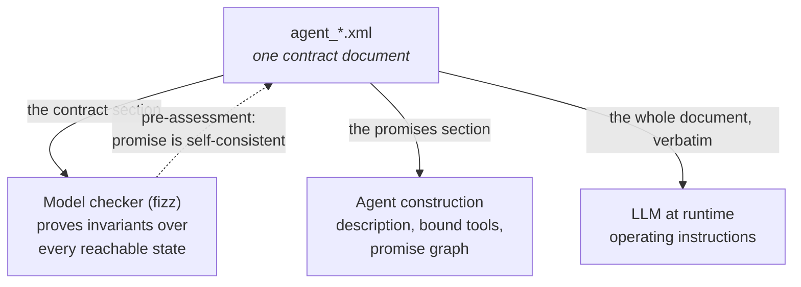
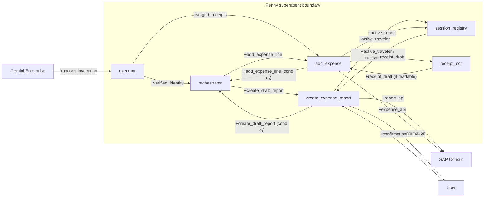
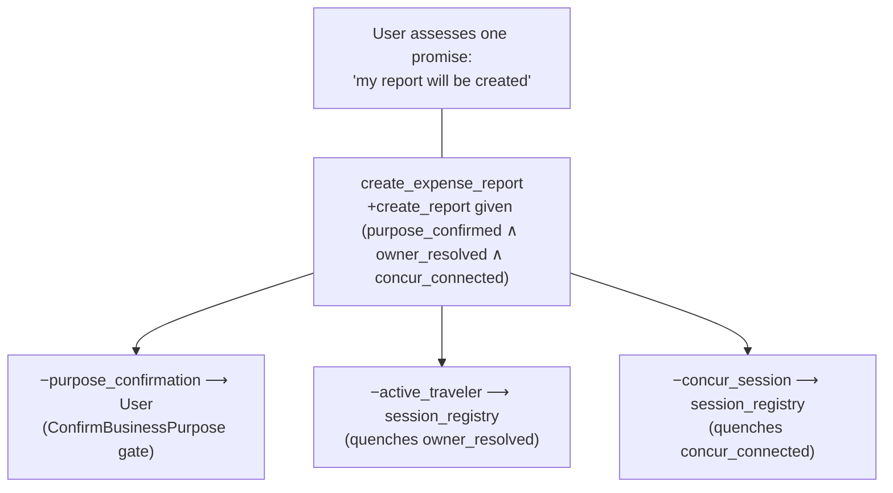
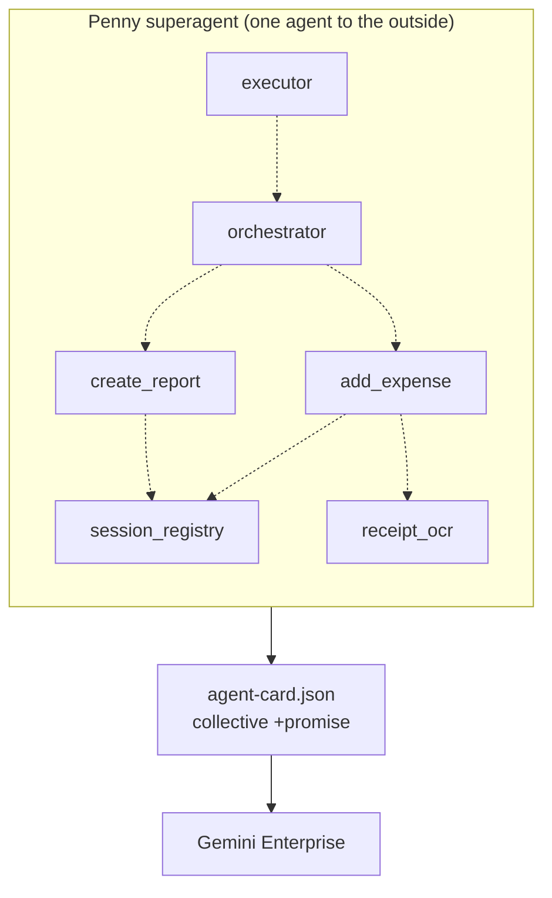

# The Promise-Driven Agent

### Model-Checked Contracts and Promise Theory as a Rubric for Agentic Software Systems

*Concepts and implementation by Jeremy Schulman. This article is AI-generated from the Penny source tree and the two companion documents ([contracts-not-prompts.md](contracts-not-prompts.md), [penny-promise-theory-architecture.md](penny-promise-theory-architecture.md)).*

*Audience: principal engineers and architects designing agentic systems, and readers of Promise Theory. It assumes fluency in distributed-systems thinking but no prior exposure to formal methods or Promise Theory — both are developed from first principles, with citations, as we go.*

---

## How to read this document

This is a long document, written to be read in parts. Each part stands on its own; the dependencies run roughly forward, but a reader who already knows Promise Theory can skip Part II, and a reader who only wants the actionable standard can jump to **Part VIII — The Rubric**.

| Part | Question it answers |
|---|---|
| **I** | Why is agentic software a different engineering problem, and why do prose prompts fail at it? |
| **II** | What is Promise Theory, precisely, and why is it *literally* (not metaphorically) the right model for an LLM? |
| **III** | What is a contract document, and how does one artifact serve three different readers? |
| **IV** | How does a single agent turn its guarantees into model-checked, code-assessed promises? (intra-agent) |
| **V** | How do many agents compose into a system whose promises are mechanically checkable? (inter-agent) |
| **VI** | How do assessment and trust work when the promiser is stochastic? |
| **VII** | How do agents nest into superagents, and what discipline does that impose? |
| **VIII** | The rubric: an eight-point standard for any agentic system, generalized beyond Penny. |
| **IX** | The honest objections and limits — including the ones a Promise Theorist will raise first. |
| **X** | Closing argument. |
| **Appendices** | Glossary (Promise Theory term ↔ Penny artifact), references, repository index. |

Throughout, the running example is **Penny**, MLB's SAP Concur expense agent. Penny is not a toy: it authenticates users against a financial system of record, acts on behalf of other people (executive-assistant delegation), reads receipts with vision models, and writes expense reports and line items through restricted-scope APIs. Every code and contract excerpt below is real and lives in this repository.

---

# Part I — The Problem: Agentic Software Is a Different Category

## 1.1 The category error at the root of most agent bugs

The dominant way teams instruct an LLM agent is a prose system prompt:

> *"You are a helpful expense assistant. Always authenticate the user before creating anything. When acting for an executive, confirm who you're acting for first…"*

This is easy to write, reads well in a design review, and is **impossible to verify**. More importantly, it encodes a category error: it addresses the model as though it were a *deterministic executor* that will *comply* with instructions. It will not, because it cannot. An LLM is a stochastic sampler over token sequences. On any given turn it may classify intent wrongly, skip a step, or invent a tool argument. No wording of a prompt changes the fundamental fact that the prompt is a *solicitation*, not a *command*.

For a one-shot question-answering bot, the category error is harmless — a wrong turn is cheap and self-correcting. For a **stateful, multi-step, safety-sensitive** agent it is the origin of the incidents that keep teams up at night, because it leaves the one question you actually need answered unanswerable:

> *Can this agent ever reach a state it must never be in — for example, filing an expense under the wrong person, or creating a financial record before the user has authenticated?*

With a prose prompt, the honest answer is "probably not, but I can't prove it."

## 1.2 Three specific ways prose breaks down

Penny's real requirements make the failure modes concrete:

- No workflow (create a report, add an expense) may run until the user's Concur account is connected.
- When an executive assistant acts for an executive, the *active traveler* must be resolved **before** any workflow starts, or expenses are filed under the wrong identity.
- If the user pivots mid-task ("actually, first do X"), the agent may suspend the current task — but **at most one** task may be suspended, or the conversation state becomes unrecoverable.

Write those as prose bullets and three problems follow immediately:

1. **No coverage guarantee.** Prose describes the happy path and the handful of edge cases the author imagined. It is silent about the state space the author *didn't* imagine. Can the agent end up with two suspended tasks? Prose can't say.
2. **No single source of truth.** The prompt says one thing, the tool-wrapper code enforces another, the tests assume a third. They drift, silently, and the drift is discovered in production.
3. **No verification loop.** You change the prompt, ship it, and learn in production whether you introduced a contradiction.

The insight that dissolves the category error is this: **a multi-step agent is a state machine whether you write it down or not.** Prose leaves that machine implicit and unchecked. The pattern in this document makes it explicit, checks it exhaustively, and — crucially — reframes the whole exercise in the only theory that takes the LLM's autonomy seriously.

## 1.3 The two moves

Everything here rests on two moves, developed in Parts III–V:

1. **Make the agent's instructions a formal, model-checked state machine** — so "can it ever reach a bad state?" is answered by exhaustive search at design time. (This is the "contracts, not prompts" wager; see the [companion article](contracts-not-prompts.md).)
2. **Model the whole system in Promise Theory** — so that every dependency between agents (and between the LLM and its enforcement code, and between Penny and Concur, and between Penny and its user) is a *voluntary, declared, assessable promise* rather than a hidden assumption or an imposed command.

The first move makes a single agent trustworthy. The second makes a *system* of agents trustworthy. The thesis of this document is that together they constitute a **rubric** — a repeatable engineering standard — for agentic software in general.

---

# Part II — Promise Theory in One Sitting

Promise Theory, developed by Mark Burgess and formalized with Jan Bergstra, is a framework for reasoning about systems built from **autonomous** parts.[^bb][^tip] It was created for configuration management and distributed cooperation, long before LLMs. Its central claims turn out to describe an LLM agent with unsettling precision. This part develops the vocabulary we will use for the rest of the document; the citations point to *Promise Theory: Principles and Applications* (Bergstra & Burgess, 2nd ed.), abbreviated **B&B**.

## 2.1 Autonomy — the axiom everything hangs on

> "Agents are autonomous. They can only make promises about their own behaviour. No other agent can impose a promise upon them." (B&B, ch. 1.3–1.4)

An **agent** is any locus of behavior we choose to reason about — a process, a service, a person, a model. The foundational constraint is that an agent controls *only its own* behavior. You cannot make a promise on another agent's behalf, and you cannot force another agent to do anything. This sounds like a limitation; it is actually the source of the theory's power, because it forces every dependency into the open.

## 2.2 Promises, impositions, and obligations

A **promise** is a publicly declared intention, from a **promiser** to a **promisee**, with a **body** *b* describing what it concerns, made to an audience (its **scope**).

An **imposition** is "an attempt to induce cooperation in another agent … without prior invitation or promise to accept" (B&B, ch. 2) — a hint, a request, a command. An **obligation** is an imposition with a penalty attached for non-compliance.

The distinction is the whole game. A command is an imposition: it *attempts* to induce behavior but guarantees nothing, because the target is autonomous. A promise is a declaration by the agent *about itself*, which the promisee can then rely on — and, critically, **assess**.

## 2.3 Polarity: `+` and `−`

Promises come in two polarities (B&B, §3.11):

- `A ──(+b)──▶ B` — a **giving/offering** promise: "I will provide *b*."
- `A ──(−b)──▶ B` — an **accepting/using** promise: "I will accept/use *b*."

Neither polarity alone compels anything. Cooperation **binds** only when a `+b` from one agent meets a matching `−b` from another. This is the deepest practical lesson of the theory: *an offer that no one has promised to use, and a use of something no one has promised to give, are both design defects* — and, as we will see, both are mechanically detectable.

## 2.4 Conditional promises, assisted promises, and quenching

A **conditional promise** `b|c` reads "I promise *b*, given that *c* holds" (B&B, §3.4). Conditions are how real dependencies enter the theory without violating autonomy: I don't promise you *b* unconditionally; I promise *b* *provided* some condition is met.

When an agent makes a conditional promise `b|c` **and** separately promises to *acquire* the condition `c` from some third party, the pair reduces to an **assisted promise** — from the promisee's view, the agent simply promises *b* (B&B, Def. 31; eq. 6.26; "Law 4 — assisted quenching of a pre-requisite promise"). The act of satisfying a condition is called **quenching** it.

This machinery matters enormously for agentic systems, because it is exactly the shape of "Penny will create your expense report": Penny promises the report *conditional* on authentication, delegation, and duplicate-checking, and separately promises to obtain each of those conditions from the agent responsible for it. We return to this in Part V.

## 2.5 Assessment and trust

> "An assessment is a decision about whether a promise has been kept or not. Every agent makes its own assessment about promises it is aware of." (B&B, §2.13)

Promises are statements of *intent*. Keeping them is never guaranteed — a promise "can increase or decrease our certainty of a promised outcome," nothing more. Therefore every promisee that relies on a promise must **assess** whether it was kept, *locally and subjectively*. Two agents can assess the same event differently (Penny thinks the report was created; the caller's client timed out and thinks it failed).

**Trust** is the accumulated valuation of an agent's promise-keeping — the integral of assessment over time — which modulates *how much* a promisee relies on a promiser. Trust modulates reliance; it never creates obligation.

## 2.6 Superagents and the freedom to choose boundaries

Agents compose. A cluster of agents that makes collective promises to the outside — while coordinating internally — is itself an agent, a **superagent** (B&B, fig. 4.4). The theory grants us a powerful modeling freedom: *"We may choose the boundary of an agent wherever we please."* A server pool, a microservice mesh, or — as we will see — an entire multi-agent LLM system behind a single agent card, can all be treated as one agent from the outside and as a promise graph from the inside.

## 2.7 The punchline: an LLM is *literally* an autonomous stochastic agent

Here is why this decades-old theory is the right foundation for agentic AI, and not a fashionable analogy.

Everything Promise Theory says about autonomous agents is *true of an LLM as a matter of engineering fact*, not metaphor:

- **You cannot impose behavior on it.** No prompt *guarantees* an action. A prompt is an imposition; the model may or may not cooperate. This is not a shortcoming of prompt engineering to be fixed with better wording — it is the nature of a stochastic agent.
- **It can only be induced to promise, and then assessed.** The most a prompt can do is elicit a *promise* to behave a certain way. Because the promiser is stochastic, the promisee **must** verify — which is precisely why an enforcement layer is mandatory rather than optional (Part IV).
- **It is one autonomous agent among several.** The model, its enforcement code, its peer agents, the external APIs, and the human user are all autonomous agents cooperating through promises. There is no privileged commander in the system — not even the orchestrator, as Part V shows.

Teams that treat prompts as *commands* are perpetually surprised when the model "disobeys." Teams that treat prompts as *promises requiring assessment* build the verification layer on day one. Promise Theory is the framework that makes the second stance the default, and — combined with model checking — makes it rigorous.

---

# Part III — The Contract Document: One Artifact, Three Readers

## 3.1 Anatomy

Each Penny LLM agent's *entire* instruction set is a single XML document. Its shape is fixed by a schema in this kit ([agent-contract.xsd](../schema/agent-contract.xsd)); the six sections each have a distinct job:

```
<agent-instructions workflow="…" version="…">
  <objective>       — what this agent is for (natural language)
  <contract>        — the FizzBee state machine: state, actions, guards, invariants
  <promises>        — the Promise Theory manifest: description, tools, +offers, −uses
  <step-guidance>   — per-action prose: LLM judgment, tool bindings, phrasing
  <enforcement>     — invariants the server enforces in code, independent of the LLM
  <responses>       — message templates for key replies
</agent-instructions>
```

The document is authored once and read by three different consumers, each taking a different projection of it:



This "one artifact, three readers" property is the distinctive engineering feature. In the more common alternatives — a LangGraph state machine plus a separate prompt, say — the machine and the instructions are *different artifacts that drift*. Here they are the same bytes.

## 3.2 The `<contract>`: a model-checkable state machine

The center of gravity is `<contract>`, a block of pure [FizzBee](https://fizzbee.io) — a specification language in the TLA+/PlusCal lineage[^lamport] with Python-like syntax. Here is the authentication rule from Penny's orchestrator, verbatim from `agent_orchestrator.xml`:

```python
atomic action EnsureAuth:
    require not concur_authenticated
    require active_workflow == NO_WORKFLOW
    concur_authenticated = oneof [True, False]

always assertion AuthBeforeWorkflow:
    return active_workflow == NO_WORKFLOW or concur_authenticated
```

Read in plain English:

- An **`action`** is something the agent can do. **`require`** clauses are **guards** — preconditions that must hold for the action to be legal. `EnsureAuth` may run only when the user is *not* yet authenticated and *no* workflow is active.
- **`oneof [True, False]`** models a nondeterministic outcome — the login might succeed or fail.
- An **`always assertion`** is an **invariant** — a property that must hold in *every reachable state*. `AuthBeforeWorkflow` says: either no workflow is active, or the user is authenticated. There is *no legal state* in which a workflow runs without authentication.

## 3.3 Model checking as pre-assessment

A **model checker** (`fizz`) explores every reachable combination of state variables the actions can produce and confirms no invariant is ever violated. Penny runs it offline in CI (`scripts/verify_fizzbee_contracts.py`):

```
[PASS] orchestrator
[PASS] create_expense_report
[PASS] add_expense
3/3 contract(s) passed model checking.
```

If someone adds an action that could set `active_workflow` while `concur_authenticated` is false, the checker returns the exact sequence of steps that reaches the bad state and fails the build. "Can it ever…?" is answered by exhaustive search, at design time, before an LLM or a user is anywhere near it.

In Promise Theory terms, this is **pre-assessment** (Part VI): a proof that the agent's promise set is internally *coherent* — that the agent is not promising something it has structurally made impossible — before the promise is ever offered. The `verified="fizz-0.5.1"` attribute stamped in each `<fizzbee>` tag records which toolchain version last certified it.

## 3.4 The crucial reinterpretation: `runtime-instructions` mode

What makes this a set of *instructions* and not merely a spec is a single deliberate reinterpretation. In classic model checking, `oneof [A, B]` means "explore **both** branches." When the same document is handed to the LLM, `oneof` means "**you, the agent, select exactly one** path at runtime, based on the conversation."

Penny declares this explicitly: `<fizzbee mode="runtime-instructions">`. One artifact, two readings:

- **Model checker's reading:** explore all branches → prove no branch violates an invariant.
- **LLM's reading:** choose one branch → the invariants describe the box you must stay inside.

The checker proves the *space of allowed behavior* is safe; the LLM navigates *within* it. This dual reading is the hinge of the whole technique, and the schema enforces `mode="runtime-instructions"` so it cannot be silently dropped.

## 3.5 The division of labor: formalize structure, leave judgment to prose

The contract is deliberately *not* the whole document. The other sections divide the labor:

- **`<step-guidance>`** is where fuzzy judgment lives — how to classify intent, which tool to call, how to phrase a hand-off. This is prose, because "is this message a greeting or a request?" is not a formal property and never will be.
- **`<enforcement>`** restates the invariants as rules the *server code* enforces independently of the model. Every FizzBee invariant has a code twin and a pytest test.
- **`<responses>`** are templates so critical replies (the auth link, the "which report?" prompt) are consistent.

The rule: **formalize structure and ordering (state transitions, invariants); leave judgment and phrasing to prose.** Don't try to formalize intent classification — you'll fail. Don't leave "auth before write" to prose — it'll drift. The `<promises>` section, developed next, is where these two halves are reconciled into a single Promise-Theoretic statement.

---

# Part IV — From Guards to Promises: The Intra-Agent Discipline

This part makes the central conceptual claim of the intra-agent half: **every FizzBee guard is a conditional-promise body, every invariant is a promise, and the enforcement code is the assessment.** Penny's contracts are Promise Theory in disguise; the `<promises>` manifest simply makes the disguise explicit.

## 4.1 An invariant is a promise; its guard is the condition

Return to `AuthBeforeWorkflow`. As a FizzBee invariant it is a safety property. As a *promise* it is Penny's orchestrator declaring, to the user and to its own subagents:

> *"I will not run a workflow unless you are authenticated."*

The corresponding manifest entry in `agent_orchestrator.xml` states it as a conditional offer:

```xml
<offer id="relay_to_matching_offer" type="workflow" to="user">
  <body>Relay workflow requests to the subagent whose published offer
    matches the intent … </body>
  <condition ref="concur_authenticated"/>
  <condition ref="traveler_resolved"/>
</offer>
```

The `<condition ref="concur_authenticated"/>` is the promise's `|c`. Its `ref` is deliberately the *same token* as the FizzBee guard variable, so the prose promise, the model-checked spec, and the enforcement code all speak one vocabulary. That shared name is not a nicety; it is what lets a reviewer trace a single guarantee across all three readers of the document.

## 4.2 Worked example: `create_expense_report`

The create-report subagent (`agent_create_expense_report.xml`) proves five invariants. Two are worth dwelling on:

```python
always assertion CreateRequiresConfirmation:
    return (not report_created) or business_purpose_confirmed

always assertion NoSilentDuplicate:
    return (not report_created) or (not similar_report_exists) or (duplicate_resolution == "create_new")
```

`NoSilentDuplicate` is a genuinely subtle safety property: the agent must never silently create a same-occasion draft twice. As a promise, it is: *"I will not create a report when a same-occasion draft already exists, unless you explicitly chose to."* The manifest publishes it as an `invariant`-typed offer to the compliance scope:

```xml
<offer id="no_silent_duplicate" type="invariant" to="user mlb-compliance">
  <body>Never silently creates a report when a same-occasion DRAFT already
    exists for the owner. An exact same-occasion match … is refused in code
    before the create call … unless the user explicitly chose "create new anyway";
    near-occasion matches are surfaced by the subagent's LLM judgment.</body>
</offer>
```

Notice the body itself names the division of labor from §3.5: the *exact* match is caught in code (a hard assessment), the *near* match is LLM judgment (soft). One promise, kept jointly by two agents of very different reliability — a two-member superagent, which we formalize in Part VII.

## 4.3 Worked example: `add_expense` and the promise-with-fallback

The add-expense subagent (`agent_add_expense.xml`) contains the pattern that best shows Promise Theory earning its keep — a promise *paired with an explicit fallback promise*:

```python
atomic action ItemizeHotel:
    require expense_created
    require is_lodging
    require all_lines_mapped
    require reconciles
    itemized = True

atomic action WarnItemization:
    require expense_created
    require is_lodging
    require (not all_lines_mapped) or (not reconciles)
    itemize_warned = True
```

In the manifest these become two offers:

```xml
<offer id="auto_itemize_hotel" type="workflow" to="user">
  <body>Auto-itemize a lodging expense … when every line maps to a known
    category and the amounts reconcile exactly to the total.</body>
  <condition ref="all_lines_mapped" assessed="self"/>
  <condition ref="reconciles" assessed="self"/>
</offer>
<offer id="itemization_warning" type="workflow" to="user">
  <body>The promised fallback for auto_itemize_hotel: when the lodging
    breakdown does not map or reconcile, warn the user … — never guess.</body>
</offer>
```

This is honest promising in the strict sense: the agent assesses *its own* ability to keep `auto_itemize` (via `all_lines_mapped ∧ reconciles`, computed in code, not by the model) and, when it cannot, keeps a *different* promise — a warning — rather than guessing. The `assessed="self"` attribute is a Promise-Theoretic annotation: it marks a condition the promiser evaluates itself, as opposed to one quenched by another agent's offer (Part V).

## 4.4 Why the enforcement layer is non-negotiable

`add_expense` also proves the whitelist and readable-receipt invariants:

```python
always assertion CreateRequiresSupportedType:
    return (not expense_created) or expense_type_resolved

always assertion CreateRequiresReadableReceipt:
    return (not expense_created) or (not has_receipt) or receipt_readable
```

The model check proves these hold *for every legal action sequence*. It does **not** — and cannot — prove that the *LLM follows the legal action sequence*. The model can still mis-classify an expense type or attempt a create it shouldn't. This is the single most important caveat in the entire technique, and Promise Theory explains exactly why the fix is mandatory:

> The LLM is a stochastic promiser. A promise from an unreliable promiser is worthless to the promisee **without independent assessment.**

So the twelve-type whitelist is enforced in code (`expense_core/services/expense_types.py`), the readable-receipt gate is enforced in code (`receipt_extraction.py`), and the boilerplate comment is *not even exposed* as a parameter the model could set (`services/contract.py`). The `<enforcement>` section names each rule; a pytest twin re-checks it. The code is the **assessment apparatus** the promisee (here, the compliance scope, on the user's behalf) uses to decide whether the stochastic promiser kept its promise.

**If you ship the contract as a prompt and skip the code layer, you have bought false confidence.** The proof certifies the map; the code polices the territory.

---

# Part V — The Inter-Agent Graph: Composing Promises

Part IV made a single agent trustworthy. But Penny is not one agent — it is a system of agents behind a single face. The inter-agent half of the theory is where most agentic-system designs are weakest, because their dependencies are *hidden*: shared state that one agent writes and another silently reads, construction-time coupling, orchestrators that claim to "own" their subordinates. Promise Theory's contribution here is to make every such dependency an explicit, checkable edge.

## 5.1 The agents, restated as autonomous promisers

Penny's runtime agents (full inventory in the [architecture doc](penny-promise-theory-architecture.md)):

| Agent | Kind | Contract / manifest |
|---|---|---|
| `penny_orchestrator` | LLM (root) | `agent_orchestrator.xml` |
| `penny_create_expense_report` | LLM (subagent) | `agent_create_expense_report.xml` |
| `penny_add_expense` | LLM (subagent) | `agent_add_expense.xml` |
| `executor` | non-LLM gateway | `manifest_executor.xml` |
| `session_registry` | non-LLM shared state | `manifest_session_registry.xml` |
| `receipt_ocr` | non-LLM (vision) | `manifest_receipt_ocr.xml` |
| `penny_superagent` | the collective face | `manifest_penny_superagent.xml` |

Each publishes a **promise manifest**: what it offers (`+`), what it agrees to use (`−`), and under which conditions. The non-LLM agents have *no* FizzBee block — they are not stochastic, so there is no state machine to model-check — but they are full participants in the promise graph. This is why the kit ships *two* schemas: [agent-contract.xsd](../schema/agent-contract.xsd) for stochastic LLM agents and [agent-manifest.xsd](../schema/agent-manifest.xsd) for the deterministic ones.

## 5.2 The orchestrator that owns nothing

The most consequential reframing is the orchestrator. Under the autonomy axiom (§2.1), the orchestrator **cannot** promise that a subagent will create a report — it can only promise its *own* behavior. So its manifest contains no "ownership": it promises to *classify* intent, to *relay* to the subagent whose published offer matches, to *resolve the traveler via the approved roster*, to *remember at most one suspension*, and to *relay results verbatim*. Routing stops being a command and becomes **selection among published offers**:

```xml
<use id="create_draft_report" from="penny_create_expense_report">
  <body>The create-report workflow offer; its confirmation and owner
    conditions are the subagent's own to keep.</body>
</use>
```

The orchestrator holds a `−use` promise against the subagent's `+offer`. Whether the subagent acts is the *subagent's* decision, governed by its own contract — it may refuse, and the orchestrator relays the refusal rather than overriding it. "Suspend" is not something done *to* a subagent; it is the orchestrator promising to *stop relaying* to it and to remember the context. Nothing reaches inside the subagent.

## 5.3 The promise graph

Pairing every `−` with a `+` yields a bidirectional, typed graph. Contrast this with a conventional call/write diagram, whose arrows are anonymous and whose dependencies are discovered at runtime.



Three properties of this graph are worth stating as design laws:

1. **An unmatched `−` is a detectable defect.** An agent consuming something no agent promised is a bug the promise-graph verifier can find offline. Penny's pre-migration codebase had exactly one such defect: subagents read `active_traveler_login` from shared state that *no agent had promised*. Which brings us to §5.4.
2. **There are no ownership edges.** The command edges (orchestrator → subagent "route/suspend/resume") are gone. What remains is the orchestrator's `−use` of the subagent's *conditional offer*. The subagent's guards were always the real gate; the graph now says so.
3. **Failure semantics are local.** If the create-report subagent fails to keep its offer, the orchestrator (which promised only to *relay* outcomes) assesses that independently, and so does the user. No one's promise *obliges* anyone else to compensate — compensation, if wanted, must itself be a promise.

## 5.4 Promoting shared state to an agent

The single most important structural move in Penny's migration was to stop treating shared session state as a *blackboard* and start treating it as an *agent*. Before: `EaMcpRuntime`/Firestore was written by the orchestrator and silently read by subagents — a hidden imposition. After: `session_registry` is an autonomous agent that *publishes* `+active_traveler` with provenance, and the subagents declare matching `−use` promises quenched by it:

```xml
<!-- in add_expense's manifest -->
<use id="active_report" from="session_registry" quenches="report_resolved">
  <body>Consumes the active report the registry publishes; when absent,
    resolves one with the user before creating.</body>
</use>
```

The `quenches="report_resolved"` attribute is the edge the verifier follows from a consumer's *need* to a provider's *offer*. Once state is an agent, the dependency that was invisible becomes a binding — assessable, testable, and impossible to forget when you add workflow #3.

## 5.5 The assisted promise: "Penny will create your report"

Now the machinery of §2.4 pays off. The user experiences a single promise — *"Penny will create my report."* Internally that decomposes into a conditional promise plus a chain of quenched conditions:



Because the subagent promises both `create | owner_resolved` **and** `−owner_resolved` (it will acquire the owner from the registry), the pair reduces — by Law 4 — to the assisted promise `create(owner)` that the user actually experiences, while the graph preserves *who quenches each prerequisite*. This is what the theory adds over the FizzBee guards alone: the guards say *when* the agent may act; the conditional promises say *who it relies on for each condition, and that the reliance is agreed.*

## 5.6 Offline verification of the graph

Exactly as the FizzBee contracts are model-checked, the promise manifests are verified offline (`scripts/verify_promise_graph.py`) for:

- **Binding completeness** — every `−` has a matching `+`.
- **Condition quenching** — every `|c` is either quenched by some agent's offer or explicitly `assessed="self"`.
- **Card entailment** — every capability advertised on the external agent card is *entailed* by interior offers (Part VII).

This extends the "contracts, not prompts" wager from the single-agent question — *"can this agent reach a bad state?"* — to the system-level question: ***"can this system of agents make a promise it has no way to keep?"***

---

# Part VI — Assessment, Trust, and Honest Promising

Promises are about intent; keeping them is never guaranteed (§2.5). A mature agentic system is therefore defined less by its promises than by its *assessments*. Penny already assesses constantly — the discipline is to *recognize* these as assessments and to eventually *record* them.

## 6.1 Assessment mechanisms Penny already has

- **`ConcurResponse.raise_for_status()/.parse()`** — Penny's per-call assessment of Concur's API promise. A parse failure ("promise not kept: malformed body") is a distinct assessment from a 4xx ("promise not kept: refused").
- **OAuth scope comparison** (`_log_granted_scopes`) — comparing requested vs. granted scopes is a documented assessment of Concur's authorization promise: Concur "silently drops" scopes the app isn't approved for. That log line is the canonical example of promise-vs-outcome divergence in the codebase.
- **`validate_receipt_draft` / the `readable` flag** — the add-expense agent's assessment of the OCR agent's draft *before* relying on it.
- **`verify_fizzbee_contracts.py` + `verified="…"`** — *pre-assessment*: proof that a promise set is coherent before it is ever offered (§3.3). The pytest `<enforcement>` twins are repeated offline assessments.
- **The `reconciles` check** — the add-expense agent assessing its *own* ability to keep `auto_itemize` before promising it, downgrading to `warn` when it can't (§4.3).

## 6.2 Honest promisers

The OCR agent is a textbook honest promiser. Its manifest (`manifest_receipt_ocr.xml`) declares the limits of its own reliability *in the promise body*:

```xml
<offer id="non_authoritative" type="invariant" to="penny_add_expense user">
  <body>Nothing extracted is authoritative; every draft requires user
    confirmation before anything is written to Concur.</body>
</offer>
```

A promiser that publishes its own unreliability lets promisees calibrate their assessment. The consumer (`add_expense`) accordingly conditions its `−use` of the draft on downstream user confirmation. Compare `PENNY_REPORT_COMMENT` — the boilerplate stamped on every created report ("Penny is still in training, and the User is required to verify all values before submitting"). That is Penny publicly calibrating the *user's* expected assessment: an honest, low-trust self-declaration.

## 6.3 Trust as recorded assessment

What Penny lacks — and what the [architecture doc](penny-promise-theory-architecture.md) proposes as refactoring R4 — is an **assessment ledger**: a record, per `(agent, promise-type)`, of promised / kept / not-kept / unknown outcomes. With it, **trust modulates reliance, never obligation**: low OCR keep-rate for a vendor class → the add-expense agent tightens its confirmation prompt; repeated Concur 401s on a scope → the orchestrator proactively offers reconnection instead of retrying; high subagent keep-rate → the orchestrator relays with less hedging. This is the theory's trust-as-integral-of-assessment made operational — and it is the natural next build once the promise graph exists.

## 6.4 Structured refusal as the non-cooperation path

Autonomy includes the right to decline. Penny's tools already return `{"ok": false, …}` structured refusals rather than raising across boundaries — voluntary non-cooperation, not an error. Standardizing these into one shape that names *which promise could not bind and which condition failed* (architecture doc, R5) lets the orchestrator relay unmet-condition information mechanically, and lets the ledger record `not_kept(condition)` rather than a generic error. A refusal is a first-class promise outcome, not an exception.

---

# Part VII — Superagents and Boundaries

## 7.1 Penny is the worked example of a superagent

From Gemini Enterprise's vantage point there is exactly one agent: the card at `/.well-known/agent-card.json` promising "manage Concur expenses; does not submit." Inside the boundary, that collective promise is *emergent from* the sub-promises — the executor's identity/staging offers, the orchestrator's classify/relay offers, the subagents' conditional workflow offers, the registry's state offers, the OCR agent's draft offer. This is B&B's server-pool pattern (fig. 4.4): members promise `+S` outward through a common face plus interior coordination promises invisible to the client.



## 7.2 The card-entailment discipline

The superagent manifest (`manifest_penny_superagent.xml`) makes each external offer name the interior offers that justify it:

```xml
<offer id="agent_description" type="card" to="gemini_enterprise user"
       entailed-by="classify_intent relay_to_matching_offer create_draft_report add_expense_line staged_receipts attach_receipt never_submit">
  <body>Autonomous expense assistant for SAP Concur … Does not submit
    reports; users review and submit manually in Concur.</body>
</offer>
```

The discipline: **no capability appears on the agent card unless the interior promise graph can derive it.** The card's "attaches receipts only when the photo is readable" is derivable from the add-expense agent's `+attach|readable` and the OCR agent's `+readable` assessment. The verifier fails the build if any `entailed-by` id does not exist. This is the same single-source-of-truth move that `contract_doc.py` made for instructions-vs-model-checking, applied one level up — the outward promise can never drift from what the members actually offer.

## 7.3 The interior two-member superagent

The `(create_report LLM + services/contract.py)` pair is itself a superagent: the LLM half promises to *follow* the contract; the code half promises to *enforce* it. Their conjunction is what makes `CommentIsBoilerplate` a promise Penny can keep *against a stochastic executor*. The companion article calls this "defense in depth"; in promise terms it is a coordinated promise made jointly by two agents with very different keeping-probabilities — the reliable agent (code) backstopping the unreliable one (LLM). **This is the atomic unit of the whole methodology**: never a stochastic promise alone, always a stochastic promise paired with a deterministic assessment.

---

# Part VIII — The Rubric

This is the generalization. Everything above is specific to Penny; the following is not. It is a standard applicable to *any* agentic software system — any system in which one or more stochastic models are given tools and asked to act over multiple steps. The claim is strong and deliberate: **Promise Theory plus model-checked contracts is the correct engineering foundation for agentic AI, and the eight points below are its rubric.**

The reasoning is a syllogism: an LLM is an autonomous stochastic agent (§2.7); autonomous agents cannot be commanded, only induced to promise and then assessed (§2.2, §2.5); therefore any system that relies on an LLM's behavior *must* be architected as promises with assessments, whether or not its designers use the vocabulary. The rubric simply makes explicit — and checkable — what the theory says is unavoidable.

### The eight points

1. **Model every model as an autonomous agent.** Treat the LLM as a stochastic promiser you cannot command. Design for elicited promises and mandatory assessment, not for compliance. *Failure mode avoided: the "why won't it obey?" spiral.*

2. **Make each agent's self-promises a model-checked contract.** Formalize the structural guarantees (ordering, mutual exclusion, safety invariants) as a state machine and prove them exhaustively offline. Keep judgment (classification, tone) in prose, quarantined so it cannot corrupt the structural guarantees. *One artifact, three readers: model checker, constructor, model.*

3. **Every promise's condition names its quencher.** No hidden dependencies. If an agent's promise is conditional, the condition is either explicitly self-assessed or quenched by a named agent's published offer. *Failure mode avoided: the invisible shared-state dependency.*

4. **Pair every stochastic promise with a deterministic assessment.** The enforcement code is not belt-and-suspenders; it is the assessment apparatus without which a stochastic promise is worthless. Model-checking proves the spec; code polices behavior. *Never ship the contract without the assessment.*

5. **Declare acceptances; forbid unmatched edges.** Every `−use` must meet a `+offer` and vice-versa. Verify binding completeness offline. An agent consuming something no one promised is a build failure, not a runtime surprise.

6. **Derive the external promise from the interior graph.** A composite system presents one promise (an agent card, an API contract). Generate it from the union of interior offers so it can never overstate what the members deliver. *Card entailment as a CI gate.*

7. **Record assessments; let trust modulate reliance, never obligation.** Keep a ledger of promised/kept/not-kept/unknown. Use accumulated trust to tune how much each agent relies on another — tighter confirmations, proactive reconnection, less hedging — never to *compel* another agent.

8. **Make refusal first-class.** Autonomy includes declining. A structured refusal naming the unmet condition is a normal promise outcome, relayed verbatim and recorded, not an exception to be swallowed.

### The rubric as a maturity model

The eight points also read as a maturity ladder. Points 1–2 make a *single agent* trustworthy (most teams stop here, if they get this far). Points 3–6 make a *system* trustworthy. Points 7–8 make it *adaptive and honest* over time. Penny today fully implements 1–6, with 7–8 designed and partially built (the [architecture doc](penny-promise-theory-architecture.md) tracks them as refactorings R4–R5, R8).

## 8.2 When *not* to use it

Honesty is the point of a rubric. The costs are real:

- **Authoring and maintenance overhead** — a formal contract is more work than a paragraph; it pays off only when the flow is genuinely stateful and a wrong state is expensive.
- **Token cost** — the contract rides in the context window every turn.
- **The model check proves the spec, not the behavior** (§4.4) — the enforcement layer is mandatory, which is more engineering, not less.
- **Skill and tooling** — your team must read a state machine, run a model checker in CI, and maintain spec/code/test parity.

**Reach for it** when there are multi-step workflows, ordering or safety constraints that must hold, money/identity/irreversible actions, multiple interacting sub-flows, and a need to evolve without regressions. **Skip it** for one-shot Q&A, a single-tool lookup assistant, a prototype, or anywhere a wrong turn is cheap to undo. There, a good prose prompt is the right tool and a formal contract is ceremony.

## 8.3 How the rubric reframes the alternatives

| Approach | Through the promise lens |
|---|---|
| **Plain prose prompt** | An imposition with no assessment. The direct upgrade path: same delivery mechanism, add structure + verification. |
| **ReAct / free tool loop** | Pure elicitation, no declared promises, no invariants. Fine for exploratory low-stakes use. |
| **Guardrails / structured output** | Assessment of *output shape* only — a partial, output-side assessment. Complementary: Penny uses it for OCR extraction. |
| **Code state-machine graph (LangGraph, etc.)** | Encodes the machine in code but *not model-checked* and *not the model's instructions* — two artifacts that drift. The promise/assessment split is implicit at best. |
| **Deterministic workflow engine (LLM as leaf)** | Removes the stochastic agent from control flow — the safest option *when feasible*. When conversational routing needs the model, it isn't. |
| **This pattern** | Promises (contracts) + assessment (code) + composition (promise graph), all model-checked and verified offline, one artifact per agent. |

---

# Part IX — Objections and Limits

A rigorous reader — and certainly a Promise Theorist — will raise these before endorsing anything. Meeting them head-on is part of the argument.

**"You claim autonomy, but your enforcement code *forces* the outcome — isn't that an imposition on the LLM, smuggled back in?"** No, and the distinction matters. The enforcement code does not reach into the model and change its behavior; the model remains free to emit whatever it samples. The code is the *promisee's assessment* — it decides whether to accept the model's output as keeping the promise, and declines (a structured refusal) when it doesn't. Equivalently, it is the *deterministic half* of a two-member superagent (§7.3) making its *own* promise to the compliance scope. Autonomy is preserved on both sides: the model may promise or break; the code assesses and may accept or refuse. What is eliminated is the *illusion of command*, not the model's freedom.

**"Model checking proves the specification, not the system."** Correct, and stated as the central caveat throughout (§3.3, §4.4). The proof certifies that the *promise set is coherent* — a pre-assessment. Keeping the promise at runtime is never guaranteed for a stochastic agent, which is exactly why points 4 and 7 of the rubric (assessment, ledger) are not optional. The technique does not claim to make the LLM correct; it claims to make its *failures bounded and detected*.

**"Assessments are subjective and local — so what does a proof buy you across a boundary?"** Precisely the ability to *name whose assessment is whose*. When Gemini Enterprise assesses a turn as failed (timeout) while Penny assesses it as kept (the report exists in Concur), the promise graph does not eliminate the divergence — it makes the conversation tractable: *"your orchestrator broke its promise; ours kept ours."* Locality of assessment is a feature of reality, not a bug in the method.

**"Isn't this just a state machine plus tests with fancier words?"** The words are load-bearing. A state machine plus tests gives you a machine and some checks. Promise Theory tells you *which* checks are mandatory (assessment of every stochastic promise), *which* dependencies are defects (unmatched `−`), *why* the orchestrator must not "own" its subagents (autonomy), and *how* the external contract relates to the internal one (entailment). It is the theory that turns a pile of good practices into a *rubric* with a reason for each rule.

**The residual limits are real:** the fuzzy parts stay fuzzy (intent classification is as reliable as any prompt); the contract costs tokens every turn; and the whole approach demands formal-methods literacy on the team. These are the price of the guarantee, not flaws in it.

---

# Part X — Closing Argument

The deepest finding, stated plainly: **an agentic system's intra-agent discipline is already Promise Theory in disguise, and its inter-agent discipline is where the theory has the most to give.** Penny's contract documents were self-promises — model-checked declarations about an agent's own behavior, enforced in code, with structured refusal as the non-cooperation path — before anyone used the word "promise." What the theory added was the other half: declared acceptances, conditions that name their quenchers, an assessment record, and an external promise *derived from* rather than *asserted alongside* its members.

The wager compounds. "Contracts, not prompts" answered, for one agent, *can it reach a bad state?* Promise Theory answers, for the system, *can it make a promise it has no way to keep?* Both questions are answered **before deployment, by exhaustive offline checking**, on the same artifacts the model reads at runtime.

Penny takes a receipt photo and turns it into a fully populated, receipt-attached Concur expense line — through authentication, delegation, intent routing, OCR, and three restricted-scope APIs — without ever being able to reach a state where it files an expense for the wrong person or before you have logged in. Not because a prompt asked nicely, but because the contract made it *provably impossible*, the code made it *assessed*, and the promise graph made every dependency *declared*.

That is not a Penny-specific result. It is what any serious agentic system will need, because the premise is universal: the model is an autonomous stochastic agent, and autonomous agents can only be promised, and then assessed. The eight-point rubric of Part VIII is one concrete way to build on that premise. It is offered here not as the last word but as a starting standard — a rubric for the agentic systems still to be built.

---

# Appendix A — Glossary: Promise Theory term ↔ Penny artifact

| Promise Theory | In Penny |
|---|---|
| Agent (autonomous) | Each `LlmAgent`, the executor, the session registry, the OCR service, Concur, GE, the user |
| Promise body *b* | The `<body>` of an `<offer>`/`<use>`; a FizzBee invariant |
| `+b` (offer) | `<offer>` in a manifest |
| `−b` (use/accept) | `<use>` in a manifest |
| Conditional promise `b|c` | `<offer>` with a `<condition ref="c"/>`; a FizzBee `require` guard |
| Quenching a condition | `<use … quenches="c">` matched to another agent's `+c` |
| Self-assessed condition | `<condition … assessed="self"/>` |
| Assisted promise (Law 4) | "Penny will create your report" = create-report's `create|owner` + `−owner` from the registry (§5.5) |
| Assessment | `ConcurResponse.parse()`, the `readable` gate, code `<enforcement>`, pytest twins |
| Pre-assessment | `fizz` model checking; `verified="fizz-0.5.1"` |
| Trust (integral of assessment) | Proposed assessment ledger (architecture doc R4); `PENNY_REPORT_COMMENT` self-calibration |
| Imposition | GE invoking Penny; a prose command to the LLM |
| Structured refusal (non-cooperation) | `{"ok": false, …}` tool results; `<responses>` refusal templates |
| Superagent | The Penny agent card; the LLM+code enforcement pair |
| Card entailment | `entailed-by` on superagent offers; `verify_promise_graph.py` |

# Appendix B — References

**Promise Theory**

- J. A. Bergstra & M. Burgess, *Promise Theory: Principles and Applications*, 2nd ed. — the primary source; sections cited inline (autonomy ch. 1.3–1.4; impositions ch. 2; polarity §3.11; conditional/assisted promises §3.4, Def. 31, eq. 6.26, Law 4; assessment §2.13; superagents fig. 4.4).[^bb]
- M. Burgess, *Thinking in Promises*, O'Reilly, 2015 — the accessible introduction to autonomy, impositions vs. promises, and assessment.[^tip]
- M. Burgess, [Promise Theory essays](http://markburgess.org/promises.html) and ["Promises 101"](http://markburgess.org/treatise.html) — short readable on-ramps.

**Formal methods / model checking**

- L. Lamport, [*Specifying Systems*](https://lamport.azurewebsites.net/tla/book.html) — the TLA+ book; the lineage behind FizzBee.[^lamport]
- H. Wayne, [*Learn TLA+*](https://learntla.com) and ["The business case for formal methods"](https://www.hillelwayne.com/post/business-case-formal-methods/).
- [FizzBee](https://fizzbee.io) — the specification language and model checker used by Penny's contracts.

**Agent patterns (for the comparison in Part VIII)**

- Yao et al., [*ReAct: Synergizing Reasoning and Acting in Language Models*](https://arxiv.org/abs/2210.03629).
- [LangGraph](https://langchain-ai.github.io/langgraph/) — the code state-machine-graph approach.
- [Guardrails AI](https://www.guardrailsai.com/docs) — output-validation guardrails.
- Anthropic, ["Building effective agents"](https://www.anthropic.com/engineering/building-effective-agents) — orchestrator-workers and routing patterns, which map onto Penny's split.

**Companion documents in this repository**

- [contracts-not-prompts.md](contracts-not-prompts.md) — the shorter, no-formal-methods-assumed article this whitepaper deepens.
- [penny-promise-theory-architecture.md](penny-promise-theory-architecture.md) — the full agent-by-agent Promise Theory analysis and the eight prioritized refactorings (R1–R8).

# Appendix C — Repository index

| Artifact | Path |
|---|---|
| Orchestrator contract | `agent_contracts/agent_orchestrator.xml` |
| Create-report contract | `agent_contracts/agent_create_expense_report.xml` |
| Add-expense contract | `agent_contracts/agent_add_expense.xml` |
| Executor / registry / OCR / superagent manifests | `agent_contracts/manifest_*.xml` |
| Contract schemas (this kit) | [schema/](../schema/) |
| FizzBee model-check gate | `scripts/verify_fizzbee_contracts.py` |
| Promise-graph verifier | `scripts/verify_promise_graph.py` |
| Contract loader | `src/penny/a2a/workflows/contract_doc.py` |
| Code-enforced invariants | `src/penny/expense_core/services/contract.py` |

---

[^bb]: J. A. Bergstra & M. Burgess, *Promise Theory: Principles and Applications*, 2nd ed. Section references inline are to this edition.

[^tip]: M. Burgess, *Thinking in Promises: Designing Systems for Cooperation*, O'Reilly Media, 2015.

[^lamport]: L. Lamport, *Specifying Systems: The TLA+ Language and Tools for Hardware and Software Engineers*, Addison-Wesley, 2002.

---

*This whitepaper is part of the [promise-driven-agentic-kit](../README.md). It is a living document; corrections and extensions are welcome.*
