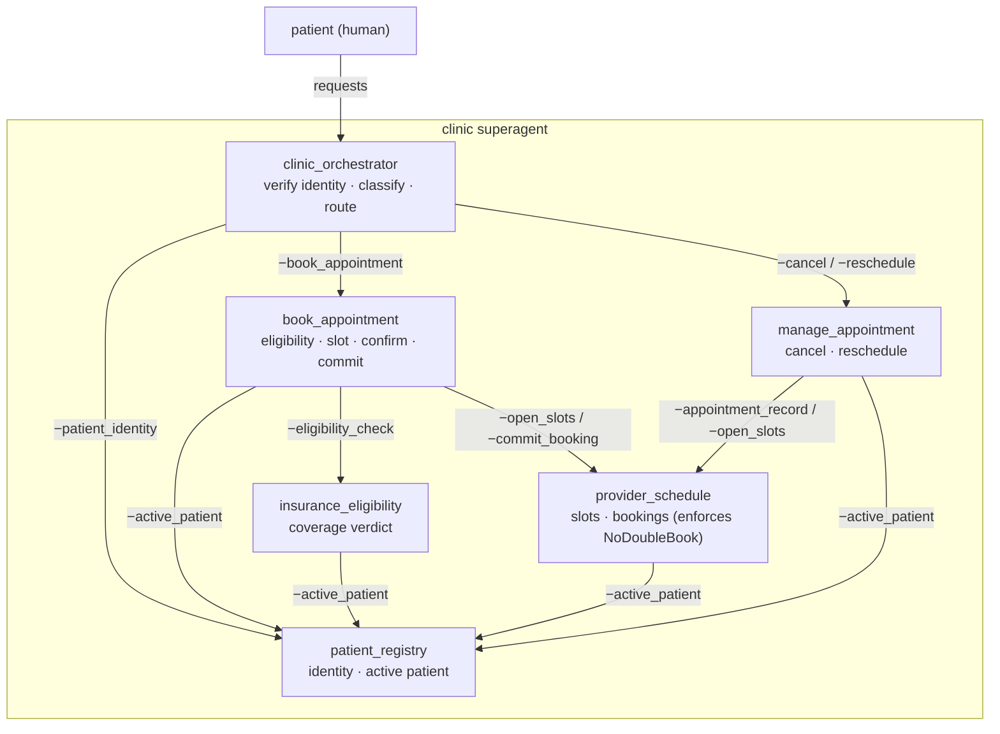

# Clinic Appointments — a live, contract-driven agent

The worked example for the [promise-driven-agentic-kit](../../README.md): a
**runnable** multi-agent clinic assistant built on Google's ADK, where modeled
safety properties are checked offline and consequential service paths have
deterministic Python safeguards.

It books, reschedules, cancels, and lists clinic appointments, and answers
insurance-eligibility questions. Its bounded FizzBee models make specified unsafe
states unreachable, while pure-Python services refuse the exercised sequential
double-book, missing-confirmation, missing-clearance, and ownership violations.

For a step-by-step reconstruction, including the exact supported claims and current
teaching limitations, read the
[Clinic Appointments end-to-end case study](../../docs/case-studies/clinic-appointments/README.md).

> This example is deliberately richer than the kit's `skeleton/` toy (one agent):
> it has six agents, so it shows the part of Promise Theory that matters most —
> **composition**. It is still small enough to read in a sitting.

## Watch it


A real recorded session (live on Vertex, Rich-rendered). The agent verifies the
patient, lists their appointments, **declines an uncovered service and offers
self-pay** (the eligibility gate), then books a covered visit **only after the
patient confirms** (the confirm gate). The flow combines modeled conditions with
service-level checks; the case study distinguishes which facts are authoritative.

```bash
asciinema play media/demo.cast     # replay the source recording in your terminal
uv run python -m clinic demo       # run the scripted scenario live yourself
# re-record + regenerate the GIF:
asciinema rec -c "uv run python -m clinic demo" media/demo.cast
agg media/demo.cast media/demo.gif
```

## The promise graph



Every edge is a declared `−use` bound to a matching `+offer`; the whole graph is
verified offline (`scripts/verify_promise_graph.py`).

## The agents and their guarantees

| Agent | Kind | Flagship modeled property or deterministic safeguard |
| --- | --- | --- |
| `clinic_orchestrator` | LLM (root) | **PatientVerifiedBeforeWorkflow**, RuleOfOne |
| `book_appointment` | LLM subagent | **EligibilityBeforeBooking**, **NoDoubleBook**, ConfirmBeforeBooking |
| `manage_appointment` | LLM subagent | **CancelRequiresOwnership**, RescheduleNoDoubleBook |
| `provider_schedule` | service | keeps **NoDoubleBook** in code — refuses a taken slot |
| `insurance_eligibility` | service | honest promiser: verdict is point-in-time, not a guarantee |
| `patient_registry` | state | per-patient record isolation |

**The showcase:** `NoDoubleBook` is *promised* by the LLM `book_appointment`
agent and supported by `provider_schedule`'s code, which refuses a sequential
attempt to commit a slot that is currently not open regardless of the model's
proposal. That LLM-promise + code-assessment pair is the whole methodology in
one place (see the kit's
[whitepaper](../../docs/why-promise-driven-agents.md)).

## Run it

Two layers — the **offline gate needs no credentials**, the **live agent needs
Vertex** (see [GETTING-STARTED.md](GETTING-STARTED.md)).

```bash
uv sync

# offline — no Google credentials required:
make gate            # schema + fizz model-check + promise-graph + enforcement tests

# live — needs a Google service-account JSON (see GETTING-STARTED.md):
export GOOGLE_APPLICATION_CREDENTIALS=/path/to/service-account.json
uv run python -m clinic smoke     # scripted verify -> list -> book demo
uv run python -m clinic chat      # interactive (Rich: Markdown replies + a "thinking" spinner)
```

`adk web` also works — point it at `src/clinic`.

## Layout

| Path | What it is |
| --- | --- |
| `agent_contracts/` | 3 `agent_*.xml` (LLM) + 3 `manifest_*.xml` (services/state) |
| `schema/` | the kit's XSDs (vendored) |
| `src/clinic/contracts/` | contract loader, `fizz` runner, promise-manifest reader |
| `src/clinic/services/` | **pure-Python domain + enforcement twins — no ADK, no LLM** |
| `src/clinic/tools.py` | thin ADK tool wrappers over the services |
| `src/clinic/agents/` | `build_*_agent()` — constructs ADK `LlmAgent`s from the contracts |
| `src/clinic/env.py` | Vertex bootstrap (derives project from the SA file) |
| `src/clinic/__main__.py` | the `chat` / `smoke` / `once` CLI |
| `tests/` | schema-validation, model-check, and service **enforcement-twin** tests |

The clean separation is the point: `services/` contains the deterministic identity,
eligibility, ownership, and scheduling paths with no ADK dependency, so the entire
offline gate runs green with no model, keys, or network. The LLM runtime is a thin,
replaceable shell on top.
