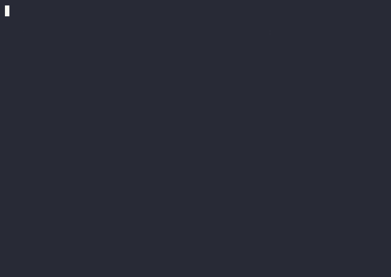
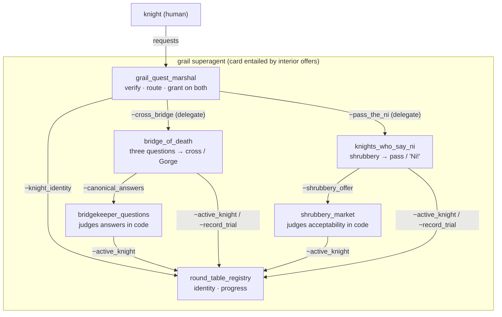

# The Trials of the Holy Grail — a contract-driven agent (on Pydantic AI)

The kit's **second** worked example, and its point is singular: **the same
methodology, a different framework.** Where [`clinic-appointments/`](../clinic-appointments/)
runs on Google ADK, this runs on **Pydantic AI** (Gemini via Vertex) — yet the
contracts, the pure-Python enforcement, and the offline gate are structurally
identical. Only the thin runtime shell changed. That is the whitepaper's
framework-independence claim, demonstrated rather than asserted.

A Quest Marshal verifies you're a Knight of the Round Table and sends you through
two trials — the **Bridge of Death** and the **Knights Who Say Ni**. The Grail
quest is granted only once both are passed. Those forbidden paths are unreachable in
the specified models, and the deterministic service boundaries independently refuse a
wrong Bridge answer, an unacceptable shrubbery, or an unverified trial request.

## Watch it



A real recorded session (live on Vertex via Pydantic AI). Sir Lancelot answers
the Bridgekeeper wrong ("green") and is cast into the Gorge, answers again
("blue") and crosses, offers a too-expensive shrubbery and hears "Ni!", offers an
acceptable one and passes — then is granted the Grail quest. Every gate is
model-checked *and* code-enforced.

```bash
asciinema play media/demo.cast     # replay in your terminal
uv run python -m grail demo        # run the scripted arc live yourself
```

## The promise graph



## The agents and their guarantees

| Agent | Kind | Flagship invariant(s) — proven *and* code-enforced |
| --- | --- | --- |
| `grail_quest_marshal` | LLM (root) | **KnightVerifiedBeforeTrial**, **GrailRequiresBothTrials** (assisted promise), RuleOfOne |
| `bridge_of_death` | LLM subagent | **NoCrossingWithWrongAnswer**, ThreeQuestionsBeforeCrossing (fallback: the Gorge) |
| `knights_who_say_ni` | LLM subagent | **ShrubberyMustBeAcceptable**, NoPassageWithoutShrubbery (fallback: "Ni!" again) |
| `round_table_registry` | state | per-knight progress isolation |
| `bridgekeeper_questions` | service | judges the three answers in code |
| `shrubbery_market` | service | judges niceness + budget in code |
| `grail_superagent` | card | external offers **entailed-by** interior offers |

**What it showcases (beyond the clinic):**
- **Framework independence** — Pydantic AI *agent delegation* (the Marshal calls each trial agent as a tool) instead of ADK's `sub_agents`; identical promise graph.
- **A superagent card + an entailment check** — `manifest_grail_superagent.xml`'s external offers name the interior offers that justify them, and `scripts/verify_promise_graph.py` fails if any `entailed-by` id doesn't exist. (The clinic example doesn't have this.)
- **An assisted promise across two subagents** — the Grail is granted only when both trials are recorded passed.
- **The model checker earning its keep** — the first draft of the Marshal *failed* `fizz` (a knight could re-attempt a passed trial and un-pass it after the Grail was granted); the fix made passing sticky. That trace is real.

## Run it

The **offline gate needs no credentials**; the **live agent needs Vertex** (see
[GETTING-STARTED.md](GETTING-STARTED.md)).

```bash
uv sync
make gate            # schema + fizz model-check + promise-graph (+ entailment) + enforcement tests

export GOOGLE_APPLICATION_CREDENTIALS=/path/to/service-account.json
uv run python -m grail smoke      # scripted arc
uv run python -m grail chat       # interactive (Rich)
```

## Layout

| Path | What it is |
| --- | --- |
| `agent_contracts/` | 3 `agent_*.xml` (LLM) + 4 `manifest_*.xml` (services/state + the superagent card) |
| `schema/` | the kit's XSDs (vendored) |
| `src/grail/services/` | **pure-Python domain + enforcement twins — no framework, no LLM** |
| `src/grail/tools.py` | thin tool wrappers over the services |
| `src/grail/agents/build.py` | builds Pydantic AI agents from the contracts (marshal + delegated trials) |
| `src/grail/env.py` | Vertex bootstrap (derives project from the SA file) |
| `src/grail/__main__.py` | the `chat` / `smoke` / `demo` / `once` CLI |
| `scripts/verify_promise_graph.py` | binding + quench **+ card-entailment** checks |
| `tests/` | schema-validate + model-check + **enforcement-twin** tests |

Compare `src/grail/agents/build.py` here with `src/clinic/agents/build.py` in the
clinic example: that thin runtime-wiring file is the primary framework difference.
The domain contracts and services differ, while their contract structure,
verification gates, and authority-boundary pattern have the same shape. That's the
whole point.
