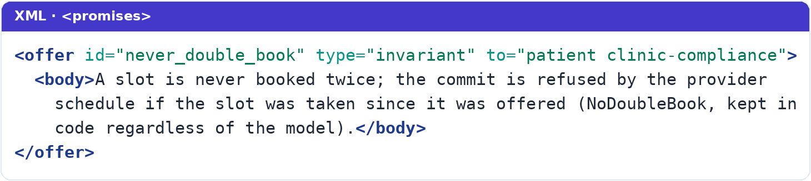
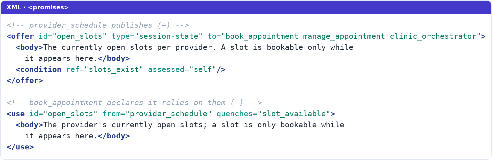

# A Society of Agents: How to Compose a System You Can Prove

### The runnable method at system scale: many agents composed through a promise graph, verified offline, so a whole *system* of agents can't make a promise it has no way to keep.

*By Jeremy Schulman · Part 3 of 3*

---

This is the third and final piece. Part 1, [Promises, Promises — Why Should You Believe?](#), argued the *why*: you cannot command an LLM, only elicit a promise and then *assess* it. Part 2, [Contracts, Not Prompts](#), showed the *how* for a single agent: capture the workflow as a contract and Design, Build, and Run it, so it provably cannot reach a state it must never be in.

But one agent is rarely the whole story. The workflows worth automating are carried by *many* agents cooperating, and that is exactly where most multi-agent designs quietly fall apart. This piece is about composing them without lying to yourself, so that a whole *system* of agents, not just one, can't make a promise it has no way to keep.

## From One Agent to a System of Agents

Take The Clinic. It presents as one agent, but inside it's a small society: an orchestrator that verifies you and routes your request, a booking subagent, a subagent that cancels and reschedules, plus non-LLM service agents for the schedule, the insurance check, and the patient registry.

Draw a boundary around that whole society and treat it as one agent making a single promise to the patient (*"I'll book your appointment"*), and you have what Promise Theory calls a **superagent**: one face to the outside, a promise graph within. Mark Burgess's rule is that *"we may choose the boundary of an agent wherever we please,"* and that freedom is the point. The patient talks to one agent; inside, it's a society. Think of a firm: one name on the door, many parties bound by their own agreements inside.

This is where I think Promise Theory earns its keep most, because multi-agent systems rot in the same place every time: **hidden dependencies.** One agent writes some shared state, another silently reads it, and nobody put the handshake in writing. It works until it doesn't. (Networking people: this is the "pinprick of death" all over again, a thousand tiny uncoordinated changes.)

Promise Theory drags every one of those dependencies into the open using two polarities. An agent makes an **offer** (`+`), "I will provide this," or a **use** (`−`), "I will accept and use that." Both are promises; the `−` is not mere dependence, it's an agent promising to accept what another offers. And the rule that does the work: cooperation only *binds* when a `+` offer meets a matching `−` use. An offer nobody uses, or a use nothing offers, is a **design defect you can detect mechanically.**

Draw the whole clinic that way and its promise graph appears:

Trace one request through it. A patient says *"book me an appointment."* The orchestrator verifies identity against the `patient_registry`, classifies the intent, and then, instead of *commanding* anyone, hands the request to the subagent whose published offer matches it — here, `book_appointment`. That booking agent in turn *uses* three offers to do its job: the registry's verified patient, the insurer's `eligibility_check`, and the schedule's `open_slots`; then it commits through the schedule's `commit_booking`, where `NoDoubleBook` is kept in code regardless of what the model decided. Every arrow on that path is a promise one agent published and another declared it depends on. None of it is implicit.

Each agent publishes a small manifest of its offers and uses. Here's the booking agent promising not to double-book, written as an offer:

Notice the body names its own division of labor: the LLM promises it, the schedule service *keeps* it. Promise-and-assess, made explicit for anyone reading the manifest.

Three consequences fall out of this, and they're why I now design this way:

**The orchestrator owns nothing.** This one took me a while to fit my brain. Under the autonomy axiom, the orchestrator *cannot* promise that a subagent will book anything. It can only promise *its own* behavior: verify the patient, classify intent, relay to the subagent whose offer matches, remember at most one suspended task, relay the result. Routing stops being a *command* and becomes **selection among published offers.** The orchestrator is a general contractor who cannot pour the concrete or force a subcontractor's hand; it can only rely on the offer each subagent signed, and that subagent's own guards are the real gate. If the subagent refuses, the orchestrator relays the refusal; it doesn't override it. In Promise Theory terms, every agent signs only for itself. (That's RBAC thinking, "who can do what," grown into a full graph.)

**Shared state becomes an agent.** Instead of a blackboard the orchestrator scribbles on and the subagents peek at, the patient registry is its *own* agent that publishes the verified patient; consumers declare that they rely on it. The invisible dependency becomes a declared, checkable binding, impossible to forget when you add a third workflow six months later.

**The whole graph is verified offline.** Just as the state machines get model-checked, the promise manifests get checked for completeness: every `−` use meets a `+` offer, and every condition is either met by some agent's offer or explicitly self-assessed. An agent relying on something nobody promised is a **build failure, not a 2 a.m. surprise.**

Concretely, that check is just matching names across contracts. The schedule *publishes* its open slots, and the booking agent *declares* it depends on them — same `id`, a `+` meeting a `−`:

Miss that match — a `−` with no `+` to meet it — and the build goes red before a single request arrives.

So the wager scales. For one agent it was *"can this reach a bad state?"* For the superagent it becomes *"can this society of agents make a promise it has no way to keep?"* And I answer that before I deploy, too.

I believe engineers building serious systems must have **choice and control**: choice of tools, frameworks, and languages, and control over how they build, deploy, and evolve. Any method worth adopting has to honor that instead of locking you in. So the property I care about most here isn't a feature at all; it's that the method asks nothing of your stack. The two examples prove it: The Clinic and the Trials of the Holy Grail run on **entirely different frameworks** (The Clinic on Google's ADK, the Trials on Pydantic AI) yet they share the *same* contracts and the *same* enforcement code. The only meaningful difference between them is a single file wiring each to its runtime. Everything that makes them *safe* is identical and framework-independent. The method lives in the contracts and the assessment code, not in anybody's framework-of-the-month. Choose your tools; keep your guarantees.

## What You Actually Walk Away With

I don't want to leave you with a vibe. Here's the distilled standard I hold my own systems to, mapped to the lifecycle across the series. If you build nothing else from these pieces, run your design past these:

1. **Treat every model as an autonomous agent.** Design for elicited promises and mandatory assessment, not compliance. This ends the "why won't it obey?" spiral, because you stop expecting obedience.
2. **Make each agent's self-promises a model-checked contract.** *(Design.)* Formalize ordering and safety as a state machine; prove it exhaustively offline. Keep judgment in prose, quarantined so it can't corrupt the guarantees.
3. **Every condition names who satisfies it.** *(Design.)* No hidden dependencies. A condition is either self-assessed or met by a named agent's offer.
4. **Pair every stochastic promise with a deterministic guarantee.** *(Build.)* The enforcement code isn't belt-and-suspenders. It's the whole point. Never ship the contract without it.
5. **Make refusal first-class.** *(Run.)* A structured "no" that names the unmet condition is a normal outcome, relayed and recorded, not an exception to swallow.
6. **Declare what you rely on; forbid unmatched edges.** *(Compose.)* Every use meets an offer. Relying on something nobody promised is a build failure.
7. **Derive the outside promise from the inside.** *(Compose.)* A superagent, a society of agents behind one face, must generate what it advertises to the world from what its members actually offer, so it can never overstate what it delivers.

Points 1 through 5 make a single agent trustworthy, from Design through Run; points 6 and 7 make a *system* trustworthy as you compose. And I genuinely believe this is where agentic engineering is heading, whether or not anyone uses the word "promise," because the premise underneath it is simply *true:* the model is an autonomous stochastic agent, and autonomous agents can only be promised, then assessed.

## When *Not* to Do This

I'd be doing you a disservice if I pretended this is free. It isn't, and knowing where it *doesn't* pay off is part of using it well.

A formal contract is more work than a paragraph. It costs tokens every turn, because it rides in the context window. It asks your team to read a state machine and run a model checker in CI. And I'll say it again, because it's the trap: the model check proves the spec, not the behavior, so the enforcement code is mandatory, which is *more* engineering, not less.

So **skip it** for one-shot Q&A, a single-tool lookup, or a throwaway prototype where a wrong turn costs nothing. There, a good prose prompt is exactly the right tool and a contract is just ceremony.

**Reach for it** when you've got multi-step workflows, ordering or safety constraints that truly must hold, actions involving money or identity or anything irreversible, and a system you need to evolve without quietly regressing. That's precisely the situation where "probably not, but I can't prove it" isn't good enough, and it's the situation I keep finding myself in.

## Promise Made, Promise Kept

We've walked the whole method now: the contract that every stage reads, the model check that proves the bad states unreachable, the enforcement code that keeps a promise against a stochastic promiser, and the promise graph that scales it all up to a superagent.

Strip away the machinery and one shape remains, and it's the same shape I first met in 2013. An autonomous actor, handed scoped authority, made safe not by trust but by a guarantee underneath. Then the actor was a config-management agent and the guarantee lived in the OS. Now the actor is an LLM and the guarantee lives in a model-checked contract and its enforcement code. Same idea. New actor. That's the whole reason I'm confident this is a real shift and not a fashion: I've watched this exact pattern cross a boundary from a neighboring discipline once already, and I've spent thirteen years living inside the field it remade.

The prize I promised at the start of this series, The Clinic that *provably cannot* book before you're verified, isn't a trick of a clever prompt. It's the payoff of that shape, made concrete: the contract makes the bad states unreachable, the code makes every promise assessed, and the promise graph makes every dependency something we declared out loud.

I packaged all of this as the **promise-driven-agentic-kit**. It isn't an app you run; it's a set of files you build *with*, in Python. It ships two complete worked examples you *can* run and talk to (The Clinic and the Trials of the Holy Grail), the contract schemas, a template that scaffolds a fresh contract-driven agent that's green out of the box, and agentic-coding **Skills** you fold into your own workflow to author and model-check contracts as you go.

So here's my ask: go try it. Take a small, stateful agent you already have, one where a wrong turn actually costs something, and write its rules as a contract instead of a prompt. Run the model checker. Watch it find the state you didn't think of. Then come tell me what it caught.

So, why should you believe? You shouldn't. Not a promise from a stochastic machine, and honestly, not one from me either. This is where *trust, but verify* earns its keep, with one word removed: you come to trust an agent *by* verifying it, in code, over and over. Trust *by* verify. You can't command an LLM. You can only get a promise out of it, and then prove it's kept. That was the "Ah, Ha!" This is the "Cha, Ching!"

I opened this series by promising to blow your mind — and in the same breath, told you not to believe me. That wasn't modesty; it was the whole thesis. I've bet on this shape once before, when it crossed over from a neighboring field before mine was ready for it, and I watched it remake an industry. I'm betting on it again — but don't take the bet on faith; you've just read three pieces on exactly why you shouldn't. Take the proof for yourself.

---

*The [promise-driven-agentic-kit](#) is open source under Apache-2.0. Start with the whitepaper, then open The Clinic example. Corrections and extensions welcome; this is a living kit, and I mean that.*

*With deep gratitude to Mark Burgess, whose Promise Theory is the foundation everything here is built on: his* [Book of Promises](http://markburgess.org/BookOfPromises.pdf) *(the full* Promise Theory: Principles and Applications*, with Jan Bergstra, free to read online) and the more approachable* Thinking in Promises *(O'Reilly). Thanks, too, to the FizzBee project for the model checker that makes the proofs run.*
